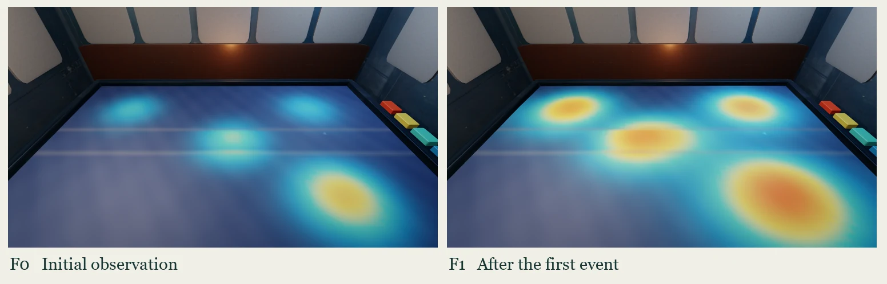

<div align="center">


<h1 align="center">CaveBench: Benchmarking Abductive Physical Reasoning from Internal Observations</h1>

<p align="center">Guanxin Lin<sup>∗</sup>, Chen Yang<sup>∗</sup>, Shenxiang Zeng, Honghui Zhu, Xin Li, Wenbo Deng, Jiansheng Fan, Chen Wang<sup>†</sup></p>

<p align="center"><sup>∗</sup> Equal contribution &nbsp;·&nbsp; <sup>†</sup> Corresponding author</p>

<p align="center">Tsinghua University</p>

<p align="center">
  <a href="https://pier-lab.github.io/CaveBench/"></a>
  <a href="https://pier-lab.github.io/CaveBench/papers/CaveBench.pdf"></a>
  <a href="https://pier-lab.github.io/CaveBench/papers/Supplement.pdf"></a>
  <a href="https://huggingface.co/datasets/linguanxin/CaveBench"></a>
  <a href="https://github.com/PIER-Lab/CaveBench/releases/tag/cavebench-qwen35-adapters-v1"></a>
  <a href="https://pier-lab.github.io/CaveBench/#film"></a>
</p>

</div>

## News

- 🔥 [2026-11-23] The [research film](https://pier-lab.github.io/CaveBench/#film) pairs the inside view of a gold-leaf electroscope with the motion of a mica slab outside the cabinet. [Try the electroscope experiment](https://pier-lab.github.io/CaveBench/#try-S11).

## Introduction

A camera inside a physical apparatus records the response to a sequence of external controls. Can a model reconstruct what happened outside? CaveBench gives the model the internal images in time order, the apparatus description and a list of possible controls. Its answer specifies which controls acted between each pair of images, including any that acted together. [Explore the 20 case studies](#case-studies).

[](docs/assets/teaser.png)

## Leaderboard

| Model | Six-event exact match (%) | Type |
| --- | ---: | --- |
| GPT-6.1 Sol | 68.0 | Proprietary |
| GPT-6.1 Terra | 65.0 | Proprietary |
| GPT-6 Luna | 28.5 | Proprietary |
| Gemini 3.8 Flash | 21.5 | Proprietary |
| GPT-5.6 Luna | 19.5 | Proprietary |
| Gemini 3.6 Flash | 17.0 | Proprietary |
| Claude Sonnet 5.5 | 16.5 | Proprietary |
| Qwen3.8 Flash | 14.0 | Proprietary |
| Claude Haiku 5.5 | 13.5 | Proprietary |
| MiniMax M3.1 Flash | 12.5 | Open-weight |
| Qwen3.7 Plus | 11.5 | Proprietary |
| Qwen3.8 27B | 10.5 | Open-weight |
| GLM 5.3 Flash | 9.0 | Open-weight |
| DeepSeek V4.1 Flash | 6.5 | Open-weight |
| Seed-2.0-Lite | 5.5 | Proprietary |
| MiniMax M3 | 5.0 | Open-weight |
| Gemma 4 31B | 4.5 | Open-weight |
| Seed 2.1 Turbo | 4.0 | Proprietary |
| Kimi K2.6 | 3.5 | Open-weight |
| Claude Sonnet 5 | 3.0 | Proprietary |
| Seed-2.0-Mini | 3.0 | Proprietary |
| GLM 5V Turbo | 2.5 | Proprietary |
| Kimi K2.5 | 2.0 | Open-weight |
| Gemini 3.5 Flash Lite | 1.0 | Proprietary |
| DeepSeek V4 Flash | 0.5 | Open-weight |
| Llama 4 Maverick | 0.5 | Open-weight |
| Qwen3.5-9B | 0.5 | Open-weight |
| Uniform choice among legal control sets | 0.0193 expected | Analytic reference |

GPT-6.1 Sol recovered 136 of 200 six-event sequences (68.0%), followed by GPT-6.1 Terra with 130 (65.0%). MiniMax M3.1 Flash led the open-weight models with 25 (12.5%). Each sequence scores one point when all six events match the experiment log. Scoring each event separately, Sol identified the complete set of controls at 1,035 of 1,200 events (86.25%). [Event counts by model and question length](results/domain_tables.md#event-by-length) · [Detailed results](#detailed-results)

## Installation

Install the dataset tools with Python 3.9 or newer.

```bash
git clone https://github.com/PIER-Lab/CaveBench.git
cd CaveBench
python -m pip install -r requirements.txt
```

### Project Page

Run the project page locally, then open [localhost:8000](http://localhost:8000/).

```bash
python -m http.server 8000 --directory docs
```

<a name="load-the-dataset"></a>
<a name="dataset"></a>

## Load Dataset

Each of the 20 apparatuses contributes ten test episodes. A question starts with the initial frame and ends after one to six events. In the dielectric-response apparatus (S11), the first three events show full insertion, half insertion and withdrawal in varying order. Its questions start at three events so the reader can compare all three leaf openings. Together, the 200 test episodes yield 1,180 questions. The development split contains 9,000 training episodes and 1,000 validation episodes.

Download the test questions, reference labels and internal frames. Add `--all` to include the development episodes and dual-view videos.

```bash
python prepare_media.py --repo linguanxin/CaveBench --data ./dataset
```

Load the one-event question for the moving heater in S05. The question supplies the prompt and the paths to F0 and F1. The label file records the control applied between them.

```python
import json
from pathlib import Path

data = Path("dataset")
case_id = "scene_03/sample_0025/k1"

def load_record(filename):
    with (data / filename).open(encoding="utf-8") as stream:
        return next(row for row in map(json.loads, stream) if row["id"] == case_id)

question = load_record("questions.jsonl")
print(question["prompt"])
print(question["images"])
print(load_record("labels.jsonl")["operations"])  # [['MoveLeft']]
```

### Case Studies

**Which way did the heater move?** One heater moves beneath a conducting plate while three others stay fixed. The camera sees the temperature field on the surface. Compare the hot spot near the middle of the plate in the two observations below.

[](https://pier-lab.github.io/CaveBench/#try-S05)

<details>
<summary>Reveal the recorded control and Claude Sonnet 5.5’s answer</summary>

The experiment log records `MoveLeft`. Claude Sonnet 5.5 tracked the same hot spot across the two frames.

> the spot is at about x=500, y=290 in F0 and about x=440, y=295 in F1. It shifted left by about 60 px, with little vertical change. Event 1 is MoveLeft.

[Read the complete six-event case](docs/assets/cases/thermal-physics.md#s05) · [Watch the original episode](docs/examples/S05/dual_view.mp4)

</details>

| Dynamics | Thermal physics | Electromagnetism | Acoustics | Optics |
| --- | --- | --- | --- | --- |
| [S01–S04](docs/assets/cases/dynamics.md) | [S05–S08](docs/assets/cases/thermal-physics.md) | [S09–S12](docs/assets/cases/electromagnetism.md) | [S13–S16](docs/assets/cases/acoustics.md) | [S17–S20](docs/assets/cases/optics.md) |

[Illustrated case index](docs/assets/cases/README.md) · [Editable PowerPoint](docs/assets/cases/CaveBench_Case_Studies.pptx) · [Supplementary PDF](docs/papers/Supplement.pdf)

<a name="run-an-evaluation"></a>

## Evaluation

<a name="chat-completions-endpoint"></a>

### API Models

Use the model ID and URL of your image-capable chat-completions endpoint. Set `CAVEBENCH_API_KEY` if the endpoint requires authentication.

```bash
python run.py --data ./dataset --model MODEL_ID --endpoint https://HOST/v1/chat/completions --output predictions.jsonl
python score.py --data ./dataset --predictions predictions.jsonl
```

To score an existing set of predictions, write one JSON object per question to `predictions.jsonl` and run the same scoring command. For the moving-heater example, a correct prediction is

```json
{"id":"scene_03/sample_0025/k1","response":"{\"operations\":[[\"MoveLeft\"]]}"}
```

List events chronologically. Within each event, the scorer compares the set of controls and accepts them in any order. Missing or invalid answers score zero. The output reports exact-match accuracy over all 1,180 questions in `exact_match_percent.overall` and at each length in `k1` through `k6`.

<a name="local-qwen-checkpoints"></a>

### Hugging Face Models

Download the SFT adapter for all trained models. For preference-trained models, also download the adapter for the method and seed you want to evaluate.

| Adapter | Training seed | Six-event exact match | Weights |
|---|---:|---:|---|
| SFT | 20261102 | 40/200 (20.0%) | [Download ZIP](https://github.com/PIER-Lab/CaveBench/releases/download/cavebench-qwen35-adapters-v1/CaveBench-Qwen3.5-9B-SFT-20261102.zip) |
| DPO | 20261106 | 61/200 (30.5%) | [Download ZIP](https://github.com/PIER-Lab/CaveBench/releases/download/cavebench-qwen35-adapters-v1/CaveBench-Qwen3.5-9B-DPO-20261106.zip) |
| SimPO | 20261108 | 63/200 (31.5%) | [Download ZIP](https://github.com/PIER-Lab/CaveBench/releases/download/cavebench-qwen35-adapters-v1/CaveBench-Qwen3.5-9B-SimPO-20261108.zip) |
| SimPO | 20261109 | 64/200 (32.0%) | [Download ZIP](https://github.com/PIER-Lab/CaveBench/releases/download/cavebench-qwen35-adapters-v1/CaveBench-Qwen3.5-9B-SimPO-20261109.zip) |
| KTO | 20261107 | 29/200 (14.5%) | [Download ZIP](https://github.com/PIER-Lab/CaveBench/releases/download/cavebench-qwen35-adapters-v1/CaveBench-Qwen3.5-9B-KTO-20261107.zip) |
| KTO | 20261108 | 29/200 (14.5%) | [Download ZIP](https://github.com/PIER-Lab/CaveBench/releases/download/cavebench-qwen35-adapters-v1/CaveBench-Qwen3.5-9B-KTO-20261108.zip) |

The two SimPO runs each recovered 27 six-event sequences that SFT missed. They agreed on 26 of those sequences. [Compare the two seeds by question](results/adaptation_tables.md#simpo-seeds)

To evaluate the SimPO adapter trained with seed 20261108, run the following commands.

```bash
python -m pip install -r requirements-local.txt
python -m zipfile -e CaveBench-Qwen3.5-9B-SFT-20261102.zip weights/sft
python -m zipfile -e CaveBench-Qwen3.5-9B-SimPO-20261108.zip weights/simpo-20261108
python run_local.py --data ./dataset --sft weights/sft --preference weights/simpo-20261108 --output simpo.jsonl
python score.py --data ./dataset --predictions simpo.jsonl
```

The runner loads `Qwen/Qwen3.5-9B`, merges the SFT adapter, then loads the selected preference adapter. For SFT alone, omit `--preference`. To evaluate the base model, omit both adapter arguments. Training used PyTorch 2.10.0, torchvision 0.25.0, Transformers 5.22.1, PEFT 0.20.0 and Accelerate 1.15.0.

<a name="other-models-with-vlmevalkit"></a>

### VLMEvalKit Models

Install [VLMEvalKit and the dependencies for your chosen model](https://github.com/open-compass/VLMEvalKit) in the environment used to run the commands below. Pass its registered model name to the CaveBench runner, which sends the prompt followed by the internal frames in chronological order.

```bash
python run_vlmevalkit.py --data ./dataset --model Qwen2.5-VL-7B-Instruct --output predictions-vlmevalkit.jsonl
python score.py --data ./dataset --predictions predictions-vlmevalkit.jsonl
```

<a name="reproduce-result-tables"></a>

### Reproduce the Tables

- `python verify_results.py` recomputes the leaderboard, adaptation and reasoning-effort scores from the question-level results.
- `python compare_training_runs.py --check` pairs each preference-training seed with SFT by question ID.
- `python render_result_tables.py --check` compares the Markdown tables with their source CSV files.

### Detailed Results

Each apparatus contributes ten questions at each available length. At one and two events, the tables cover 190 questions each. At three through six, they cover 200 each. Choose a length to compare models across domains or across all 20 apparatuses.

| Comparison | 1 event | 2 events | 3 events | 4 events | 5 events | 6 events | Project page |
| --- | ---: | ---: | ---: | ---: | ---: | ---: | --- |
| 27 models by domain | [1](results/domain_tables.md#domain-k1) | [2](results/domain_tables.md#domain-k2) | [3](results/domain_tables.md#domain-k3) | [4](results/domain_tables.md#domain-k4) | [5](results/domain_tables.md#domain-k5) | [6](results/domain_tables.md#domain-k6) | [Explore](https://pier-lab.github.io/CaveBench/#domain-k1) |
| 27 models by apparatus | [1](results/tasks_by_length.md#tasks-k1) | [2](results/tasks_by_length.md#tasks-k2) | [3](results/tasks_by_length.md#tasks-k3) | [4](results/tasks_by_length.md#tasks-k4) | [5](results/tasks_by_length.md#tasks-k5) | [6](results/tasks_by_length.md#tasks-k6) | [Explore](https://pier-lab.github.io/CaveBench/#tasks-k1) |
| Adaptation methods by domain | [1](results/adaptation_domains.md#adaptation-k1) | [2](results/adaptation_domains.md#adaptation-k2) | [3](results/adaptation_domains.md#adaptation-k3) | [4](results/adaptation_domains.md#adaptation-k4) | [5](results/adaptation_domains.md#adaptation-k5) | [6](results/adaptation_domains.md#adaptation-k6) | [Explore](https://pier-lab.github.io/CaveBench/#table-adaptation_by_domain-k1) |

To follow one apparatus across its available question lengths, open its [GitHub table](results/apparatus_tables.md) or [interactive table](https://pier-lab.github.io/CaveBench/#apparatus-S01).

<details>
<summary>Figure data, scores by question, and training comparisons</summary>

| Results and underlying counts | Data |
|---|---|
| Main leaderboard by domain, apparatus and question length | [Domain × length](docs/assets/results/domain_by_length.csv) · [Apparatus × length](docs/assets/results/scene_by_length.csv) · [Overall by length](docs/assets/length.csv) |
| Correct control sets at each question length, across 4,170 event predictions per model | [Event accuracy for all 27 models](results/domain_tables.md#event-by-length) · [Correct and scored event counts](docs/assets/results/main_event_by_length.csv) |
| SFT, DPO, SimPO and KTO on Qwen3.5-9B, plus ReAct, Visual Sketchpad and ViperGPT on Gemini 3.8 Flash | [Domains](results/adaptation_domains.md) · [Individual apparatuses](results/adaptation_tables.md) · [Domain counts (CSV)](docs/assets/results/adaptation_by_domain.csv) · [Run and length (CSV)](docs/assets/results/adaptation_by_length.csv) · [Apparatus (CSV)](docs/assets/results/adaptation_by_scene.csv) · [Method summary](docs/assets/methods.csv) |
| Preference training vs. SFT on matched question IDs | [Paired outcomes for each seed and question length](docs/assets/results/paired_training.csv) · [Interactive comparison](https://pier-lab.github.io/CaveBench/#table-paired_training) |
| Accuracy at events 1–6 for the 11 adaptation runs and baselines | [Per-run table](results/adaptation_tables.md#event-positions) · [Interactive comparison](https://pier-lab.github.io/CaveBench/#table-adaptation_by_position) · [Correct events and denominators (CSV)](docs/assets/results/adaptation_by_position.csv) |
| Evaluation settings for the 27 leaderboard configurations | [Browse model protocols](https://pier-lab.github.io/CaveBench/#table-model_protocols) · [Download CSV](docs/assets/results/model_protocols.csv) |
| Data for the figures | [Figure 1 · model scores](results/figure_tables.md#figure-1) · [Figure 3 · dataset construction](results/figure_tables.md#figure-3) · [Figure 5 · dielectric-response predictions](results/figure_tables.md#figure-5) · [Figure 6 · reasoning effort](results/figure_tables.md#figure-6) · [Error categories](results/figure_tables.md#error-categories) |
| Event-position accuracy on six-event questions, single- and two-label questions, and error classifications | [Event positions](docs/assets/results/event_positions.csv) · [Control composition](docs/assets/results/compound_by_length.csv) · [Error counts](docs/assets/results/error_categories.csv) |
| Candidate-control vocabulary, uniform-choice probability and related benchmark tasks | [Apparatus statistics](docs/assets/results/scene_controls.csv) · [Uniform-choice reference](docs/assets/results/uniform_reference.csv) · [Benchmark comparison with sources](docs/assets/results/benchmark_comparison.csv) |

[Interactive result tables](https://pier-lab.github.io/CaveBench/#detailed-results) · Question-level scores for [27 models on 1,180 questions](results/question_scores.csv), [11 adaptation runs and baselines](results/adaptation_question_scores.csv) and [three reasoning-effort settings](results/effort_question_scores.csv).

</details>

## Citation

```bibtex
@misc{lin2026cavebench,
  title  = {{CaveBench}: Benchmarking Abductive Physical Reasoning from Internal Observations},
  author = {Lin, Guanxin and Yang, Chen and Zeng, Shenxiang and Zhu, Honghui and Li, Xin and Deng, Wenbo and Fan, Jiansheng and Wang, Chen},
  year   = {2026},
  url    = {https://pier-lab.github.io/CaveBench/}
}
```

<a name="acknowledgments"></a>

## Acknowledgment

The case studies follow the presentation of questions and model answers in [SSI-Bench](https://github.com/PIER-Lab/SSI-Bench). The research film uses a script by GPT-6.2-Astra and narration synthesized with [Sci2Video](https://github.com/BioTender-max/sci2video).

## License

The [MIT license](LICENSE) covers the original CaveBench code.

## Contact

For questions about the data, evaluation or training results, [open a repository issue](https://github.com/PIER-Lab/CaveBench/issues).
