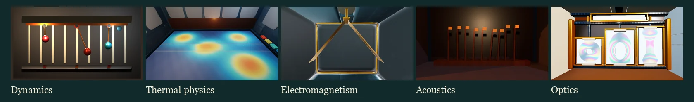
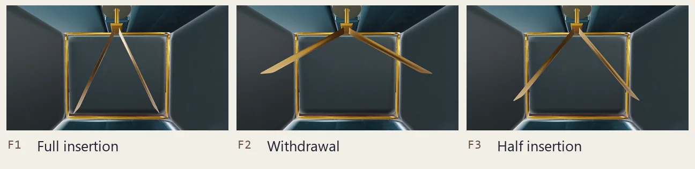

# CaveBench: Benchmarking Abductive Physical Reasoning from Internal Observations

[](https://pier-lab.github.io/CaveBench/#film)

Guanxin Lin<sup>∗</sup>, Chen Yang<sup>∗</sup>, Shenxiang Zeng, Honghui Zhu, Xin Li, Wenbo Deng, Jiansheng Fan, Chen Wang<sup>†</sup>

Tsinghua University  
<sup>∗</sup> Equal contribution · <sup>†</sup> Corresponding author

[Project page](https://pier-lab.github.io/CaveBench/) · [Paper](docs/papers/CaveBench.pdf) · [Supplement](docs/papers/Supplement.pdf) · [Hugging Face dataset](https://huggingface.co/datasets/linguanxin/CaveBench) · [Research film](https://pier-lab.github.io/CaveBench/#film) · [Model weights](https://github.com/PIER-Lab/CaveBench/releases/tag/cavebench-qwen35-adapters-v1)

## News

- **2026-11-23.** The project page now pairs the frames before and after each event in all [20 case studies](docs/assets/cases/README.md). You can also [compare two models](https://pier-lab.github.io/CaveBench/#leaderboard) across the six question lengths.

## Introduction

A camera rides on a carriage with three pendulums. As the carriage moves, the pendulums swing through different angles. Which of three motion profiles drove the carriage? In CaveBench, a vision–language model sees the apparatus from the inside, reads how its controls work, and reconstructs the external controls applied between successive frames. More than one control can act at the same time.

## Dataset

The 20 apparatuses cover dynamics, thermal physics, electromagnetism, acoustics and optics. The dataset contains 9,000 training episodes, 1,000 validation episodes and 200 test episodes. The test episodes yield 1,180 questions. A question with six events supplies seven images: the initial state and one observation after each event.

## Case studies

### S11 · Dielectric response

The camera sees two gold leaves inside an electroscope. Outside its view, a mica slab slides between the plates of a charged capacitor. Which of the three images shows the slab halfway in?

[](https://pier-lab.github.io/CaveBench/#S11)

**Claude Sonnet 5.5**

> The leaf opening angle in each frame identifies the dielectric endpoint, since more mica means higher capacitance, lower voltage and a smaller opening.

In F3 the leaves open wider than in F1 (full insertion) and less than in F2 (withdrawal). The model identified half insertion at F3 and recovered all six operations in the episode. [Read the case sheet](docs/assets/cases/S11.webp) · [Try the question](https://pier-lab.github.io/CaveBench/#try-S11)

### Explore the 20 apparatuses

[**Illustrated case index**](docs/assets/cases/README.md) · [Dynamics](docs/assets/cases/README.md#dynamics) · [Thermal physics](docs/assets/cases/README.md#thermal-physics) · [Electromagnetism](docs/assets/cases/README.md#electromagnetism) · [Acoustics](docs/assets/cases/README.md#acoustics) · [Optics](docs/assets/cases/README.md#optics)

[Editable PowerPoint](docs/assets/cases/CaveBench_Case_Studies.pptx) · [Supplementary PDF](docs/papers/Supplement.pdf) · [Episode files and full model responses](docs/examples/)

## Leaderboard

On the 200 six-event questions, GPT-6.1 Sol identified the correct set of controls at 1,035 of 1,200 events (86.25%). It recovered all six sets in 136 of the 200 questions (68.0%). The leaderboard ranks models by this whole-question score. MiniMax M3.1 Flash led the open-weight models with 25 complete sequences (12.5%). [Event counts by model and question length](results/domain_tables.md#event-by-length)

<details>
<summary>Six-event exact match for all 27 models</summary>

| Model or baseline | Type | Correct sequences | Exact match |
|---|---|---:|---:|
| GPT-6.1 Sol | Proprietary | 136 / 200 | 68.0% |
| GPT-6.1 Terra | Proprietary | 130 / 200 | 65.0% |
| GPT-6 Luna | Proprietary | 57 / 200 | 28.5% |
| Gemini 3.8 Flash | Proprietary | 43 / 200 | 21.5% |
| GPT-5.6 Luna | Proprietary | 39 / 200 | 19.5% |
| Gemini 3.6 Flash | Proprietary | 34 / 200 | 17.0% |
| Claude Sonnet 5.5 | Proprietary | 33 / 200 | 16.5% |
| Qwen3.8 Flash | Proprietary | 28 / 200 | 14.0% |
| Claude Haiku 5.5 | Proprietary | 27 / 200 | 13.5% |
| Qwen3.7 Plus | Proprietary | 23 / 200 | 11.5% |
| Seed-2.0-Lite | Proprietary | 11 / 200 | 5.5% |
| Seed 2.1 Turbo | Proprietary | 8 / 200 | 4.0% |
| Claude Sonnet 5 | Proprietary | 6 / 200 | 3.0% |
| Seed-2.0-Mini | Proprietary | 6 / 200 | 3.0% |
| GLM 5V Turbo | Proprietary | 5 / 200 | 2.5% |
| Gemini 3.5 Flash Lite | Proprietary | 2 / 200 | 1.0% |
| MiniMax M3.1 Flash | Open-weight | 25 / 200 | 12.5% |
| Qwen3.8 27B | Open-weight | 21 / 200 | 10.5% |
| GLM 5.3 Flash | Open-weight | 18 / 200 | 9.0% |
| DeepSeek V4.1 Flash | Open-weight | 13 / 200 | 6.5% |
| MiniMax M3 | Open-weight | 10 / 200 | 5.0% |
| Gemma 4 31B | Open-weight | 9 / 200 | 4.5% |
| Kimi K2.6 | Open-weight | 7 / 200 | 3.5% |
| Kimi K2.5 | Open-weight | 4 / 200 | 2.0% |
| DeepSeek V4 Flash | Open-weight | 1 / 200 | 0.5% |
| Llama 4 Maverick | Open-weight | 1 / 200 | 0.5% |
| Qwen3.5-9B | Open-weight | 1 / 200 | 0.5% |
| Uniform choice among legal control sets | Analytic reference | — | 0.0193% expected |

</details>

## Installation

Install the dataset tools with Python 3.9 or newer.

```sh
git clone https://github.com/PIER-Lab/CaveBench.git
cd CaveBench
python -m pip install -r requirements.txt
```

## Load the dataset

Download the test questions, reference labels and internal frames. Add `--all` to include the development episodes and dual-view videos.

```sh
python prepare_media.py --repo linguanxin/CaveBench --data ./dataset
```

Read the first question and its recorded controls.

```python
import json
from pathlib import Path

data = Path("dataset")
with (data / "questions.jsonl").open(encoding="utf-8") as stream:
    question = json.loads(next(stream))
with (data / "labels.jsonl").open(encoding="utf-8") as stream:
    reference = next(row for row in map(json.loads, stream) if row["id"] == question["id"])
print(question["id"], question["prompt"])
print(question["images"], reference["operations"])
```

## Run an evaluation

### Chat-completions endpoint

Use the model ID and URL of your image-capable chat-completions endpoint. Set `CAVEBENCH_API_KEY` if the endpoint requires authentication.

```sh
python run.py --data ./dataset --model MODEL_ID --endpoint https://HOST/v1/chat/completions --output predictions.jsonl
python score.py --data ./dataset --predictions predictions.jsonl
```

To score predictions from another runner, write one JSON object per question to `predictions.jsonl`. In this example from the driven-pendulum episode, the first carriage motion follows profile B.

```json
{"id":"scene_11/sample_0001/k1","response":"{\"operations\":[[\"TrajectoryB\"]]}"}
```

List events in time order. Controls applied together can appear in any order within their event. The scorer counts a question as correct when every event matches the record. Missing or invalid answers score zero. In the output, `exact_match_percent.overall` covers all questions and `k1` through `k6` give accuracy at each length.

### Local Qwen checkpoints

Download the SFT adapter for all trained models. For preference-trained models, also download the adapter for the method and seed you want to evaluate.

| Adapter | Training seed | Six-event exact match | Weights |
|---|---:|---:|---|
| SFT | 20261102 | 40/200 (20.0%) | [Download ZIP](https://github.com/PIER-Lab/CaveBench/releases/download/cavebench-qwen35-adapters-v1/CaveBench-Qwen3.5-9B-SFT-20261102.zip) |
| DPO | 20261106 | 61/200 (30.5%) | [Download ZIP](https://github.com/PIER-Lab/CaveBench/releases/download/cavebench-qwen35-adapters-v1/CaveBench-Qwen3.5-9B-DPO-20261106.zip) |
| SimPO | 20261108 | 63/200 (31.5%) | [Download ZIP](https://github.com/PIER-Lab/CaveBench/releases/download/cavebench-qwen35-adapters-v1/CaveBench-Qwen3.5-9B-SimPO-20261108.zip) |
| SimPO | 20261109 | 64/200 (32.0%) | [Download ZIP](https://github.com/PIER-Lab/CaveBench/releases/download/cavebench-qwen35-adapters-v1/CaveBench-Qwen3.5-9B-SimPO-20261109.zip) |
| KTO | 20261107 | 29/200 (14.5%) | [Download ZIP](https://github.com/PIER-Lab/CaveBench/releases/download/cavebench-qwen35-adapters-v1/CaveBench-Qwen3.5-9B-KTO-20261107.zip) |
| KTO | 20261108 | 29/200 (14.5%) | [Download ZIP](https://github.com/PIER-Lab/CaveBench/releases/download/cavebench-qwen35-adapters-v1/CaveBench-Qwen3.5-9B-KTO-20261108.zip) |

To evaluate the SimPO adapter trained with seed 20261108, run the following commands.

```sh
python -m pip install -r requirements-local.txt
python -m zipfile -e CaveBench-Qwen3.5-9B-SFT-20261102.zip weights/sft
python -m zipfile -e CaveBench-Qwen3.5-9B-SimPO-20261108.zip weights/simpo-20261108
python run_local.py --data ./dataset --sft weights/sft --preference weights/simpo-20261108 --output simpo.jsonl
python score.py --data ./dataset --predictions simpo.jsonl
```

The runner loads `Qwen/Qwen3.5-9B`, merges the SFT adapter, then loads the selected preference adapter. For SFT alone, omit `--preference`. To evaluate the base model, omit both adapter arguments. Training used PyTorch 2.10.0, torchvision 0.25.0, Transformers 5.22.1, PEFT 0.20.0 and Accelerate 1.15.0.

### Other models with VLMEvalKit

Choose a registered multi-image model in [VLMEvalKit](https://github.com/open-compass/VLMEvalKit). The runner sends the prompt followed by the internal frames in chronological order.

```sh
python run_vlmevalkit.py --data ./dataset --model Qwen2.5-VL-7B-Instruct --output predictions-vlmevalkit.jsonl
python score.py --data ./dataset --predictions predictions-vlmevalkit.jsonl
```

### Reproduce result tables

- `python verify_results.py` recomputes the leaderboard, adaptation and reasoning-effort scores from the question-level results.
- `python compare_training_runs.py --check` pairs each preference-training seed with SFT by question ID.
- `python render_result_tables.py --check` compares the Markdown tables with their source CSV files.

## Detailed results

**Accuracy by physical domain.** There are 190 questions each at one and two events, and 200 each at three through six events.

| Events per question | One | Two | Three | Four | Five | Six |
|---|---|---|---|---|---|---|
| Main evaluation · GitHub | [k = 1](results/domain_tables.md#domain-k1) | [k = 2](results/domain_tables.md#domain-k2) | [k = 3](results/domain_tables.md#domain-k3) | [k = 4](results/domain_tables.md#domain-k4) | [k = 5](results/domain_tables.md#domain-k5) | [k = 6](results/domain_tables.md#domain-k6) |
| Main evaluation · project page | [k = 1](https://pier-lab.github.io/CaveBench/#domain-k1) | [k = 2](https://pier-lab.github.io/CaveBench/#domain-k2) | [k = 3](https://pier-lab.github.io/CaveBench/#domain-k3) | [k = 4](https://pier-lab.github.io/CaveBench/#domain-k4) | [k = 5](https://pier-lab.github.io/CaveBench/#domain-k5) | [k = 6](https://pier-lab.github.io/CaveBench/#domain-k6) |
| Adaptation · GitHub | [k = 1](results/adaptation_domains.md#adaptation-k1) | [k = 2](results/adaptation_domains.md#adaptation-k2) | [k = 3](results/adaptation_domains.md#adaptation-k3) | [k = 4](results/adaptation_domains.md#adaptation-k4) | [k = 5](results/adaptation_domains.md#adaptation-k5) | [k = 6](results/adaptation_domains.md#adaptation-k6) |
| Adaptation · project page | [k = 1](https://pier-lab.github.io/CaveBench/#table-adaptation_by_domain-k1) | [k = 2](https://pier-lab.github.io/CaveBench/#table-adaptation_by_domain-k2) | [k = 3](https://pier-lab.github.io/CaveBench/#table-adaptation_by_domain-k3) | [k = 4](https://pier-lab.github.io/CaveBench/#table-adaptation_by_domain-k4) | [k = 5](https://pier-lab.github.io/CaveBench/#table-adaptation_by_domain-k5) | [k = 6](https://pier-lab.github.io/CaveBench/#table-adaptation_by_domain-k6) |

**Accuracy by apparatus.** Each apparatus contributes ten questions at each available length. Dielectric response (S11) begins at three events. [GitHub tables](results/apparatus_tables.md) · [Interactive tables](https://pier-lab.github.io/CaveBench/#apparatus-S01)

To compare the 20 apparatuses at one question length, choose a column below. Each view shows the 27 models against the same apparatuses.

| All apparatuses at one length | 1 event | 2 events | 3 events | 4 events | 5 events | 6 events |
|---|---|---|---|---|---|---|
| GitHub | [k = 1](results/tasks_by_length.md#tasks-k1) | [k = 2](results/tasks_by_length.md#tasks-k2) | [k = 3](results/tasks_by_length.md#tasks-k3) | [k = 4](results/tasks_by_length.md#tasks-k4) | [k = 5](results/tasks_by_length.md#tasks-k5) | [k = 6](results/tasks_by_length.md#tasks-k6) |
| Project page | [k = 1](https://pier-lab.github.io/CaveBench/#tasks-k1) | [k = 2](https://pier-lab.github.io/CaveBench/#tasks-k2) | [k = 3](https://pier-lab.github.io/CaveBench/#tasks-k3) | [k = 4](https://pier-lab.github.io/CaveBench/#tasks-k4) | [k = 5](https://pier-lab.github.io/CaveBench/#tasks-k5) | [k = 6](https://pier-lab.github.io/CaveBench/#tasks-k6) |

| Results and underlying counts | Data |
|---|---|
| Main leaderboard by domain, apparatus and question length | [Domain × length](docs/assets/results/domain_by_length.csv) · [Apparatus × length](docs/assets/results/scene_by_length.csv) · [Overall by length](docs/assets/length.csv) |
| Correct control sets at each question length, across 4,170 event predictions per model | [Event accuracy for all 27 models](results/domain_tables.md#event-by-length) · [Correct and scored event counts](docs/assets/results/main_event_by_length.csv) |
| SFT, DPO, SimPO and KTO on Qwen3.5-9B, plus ReAct, Visual Sketchpad and ViperGPT on Gemini 3.8 Flash | [Domains](results/adaptation_domains.md) · [Individual apparatuses](results/adaptation_tables.md) · [Domain counts (CSV)](docs/assets/results/adaptation_by_domain.csv) · [Run and length (CSV)](docs/assets/results/adaptation_by_length.csv) · [Apparatus (CSV)](docs/assets/results/adaptation_by_scene.csv) · [Method summary](docs/assets/methods.csv) |
| Preference training vs. SFT on matched question IDs | [Paired outcomes for each seed and question length](docs/assets/results/paired_training.csv) · [Interactive comparison](https://pier-lab.github.io/CaveBench/#table-paired_training) |
| Accuracy at events 1–6 for the 11 adaptation runs and baselines | [Per-run table](results/adaptation_tables.md#event-positions) · [Interactive comparison](https://pier-lab.github.io/CaveBench/#table-adaptation_by_position) · [Correct events and denominators (CSV)](docs/assets/results/adaptation_by_position.csv) |
| Evaluation settings for the 27 leaderboard configurations | [Browse model protocols](https://pier-lab.github.io/CaveBench/#table-model_protocols) · [Download CSV](docs/assets/results/model_protocols.csv) |
| Data for the figures | [Figure 1 · model scores](results/figure_tables.md#figure-1) · [Figure 3 · dataset construction](results/figure_tables.md#figure-3) · [Figure 5 · dielectric-response predictions](results/figure_tables.md#figure-5) · [Figure 6 · reasoning effort](results/figure_tables.md#figure-6) · [Error categories](results/figure_tables.md#error-categories) |
| Event-position accuracy on six-event questions, single- and two-label questions, and error classifications | [Event positions](docs/assets/results/event_positions.csv) · [Control composition](docs/assets/results/compound_by_length.csv) · [Error counts](docs/assets/results/error_categories.csv) |
| Candidate-control vocabulary, uniform-choice probability and related benchmark tasks | [Apparatus statistics](docs/assets/results/scene_controls.csv) · [Uniform-choice reference](docs/assets/results/uniform_reference.csv) · [Benchmark comparison with sources](docs/assets/results/benchmark_comparison.csv) |

[Interactive result tables](https://pier-lab.github.io/CaveBench/#detailed-results) · Question-level scores for [27 models on 1,180 questions](results/question_scores.csv), [11 adaptation runs and baselines](results/adaptation_question_scores.csv) and [three reasoning-effort settings](results/effort_question_scores.csv).

## Project page

Run the project page locally, then open [localhost:8000](http://localhost:8000/).

```sh
python -m http.server 8000 --directory docs
```

## Citation

```bibtex
@misc{lin2026cavebench,
  title  = {{CaveBench}: Benchmarking Abductive Physical Reasoning from Internal Observations},
  author = {Lin, Guanxin and Yang, Chen and Zeng, Shenxiang and Zhu, Honghui and Li, Xin and Deng, Wenbo and Fan, Jiansheng and Wang, Chen},
  year   = {2026},
  url    = {https://pier-lab.github.io/CaveBench/}
}
```

## Acknowledgments

The case studies follow the presentation of questions and model answers in [SSI-Bench](https://github.com/PIER-Lab/SSI-Bench). The research film uses a script by GPT-6.2-Astra and narration synthesized with [Sci2Video](https://github.com/BioTender-max/sci2video).

## License

The [MIT license](LICENSE) covers the original CaveBench code.

## Contact

For questions about the data, evaluation or training results, [open a repository issue](https://github.com/PIER-Lab/CaveBench/issues).

