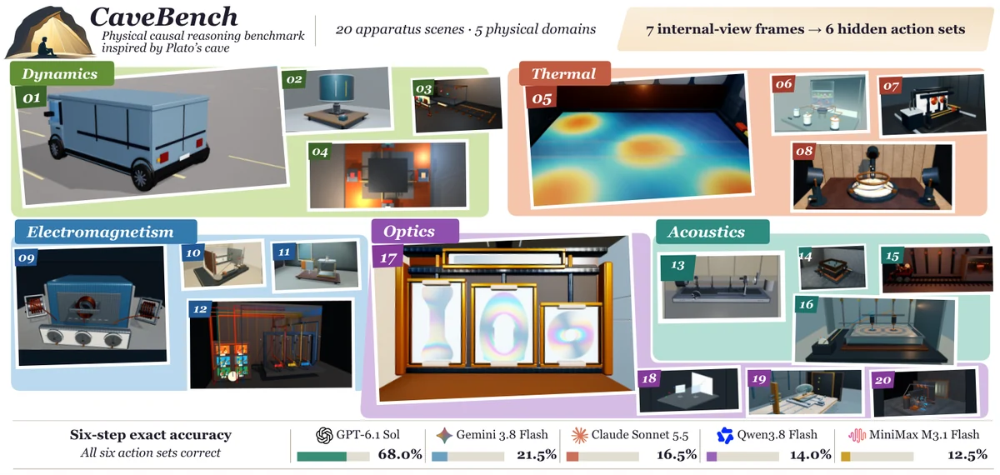

<div align="center">


<h1 align="center">CaveBench: Benchmarking Abductive Physical Reasoning from Internal Observations</h1>

<p align="center">Guanxin Lin<sup>1,*</sup>, Chen Yang<sup>1,*</sup>, Shenxiang Zeng<sup>1</sup>, Honghui Zhu<sup>1</sup>, Xin Li<sup>1</sup>, Wenbo Deng<sup>1</sup>, Jiansheng Fan<sup>1</sup>, Chen Wang<sup>1,†</sup></p>

<p align="center"><sup>1</sup>Tsinghua University<br>
Guanxin Lin and Chen Yang contributed equally.<br>
Chen Wang is the corresponding author.</p>

<p align="center">
  <a href="https://pier-lab.github.io/CaveBench/"></a>
  <a href="https://arxiv.org/abs/2611.32251"></a>
  <a href="https://pier-lab.github.io/CaveBench/papers/Supplement.pdf"></a>
  <a href="https://huggingface.co/datasets/linguanxin/CaveBench"></a>
  <a href="https://github.com/PIER-Lab/CaveBench/releases/tag/cavebench-qwen35-adapters-v1"></a>
  <a href="https://pier-lab.github.io/CaveBench/#film"></a>
</p>

</div>

## CaveBench

A model sees the response inside a physical apparatus and infers which external controls produced it. Each question supplies the apparatus description, permitted controls and ordered internal observations. An answer gives the complete set of controls at each event. [Paper on arXiv](https://arxiv.org/abs/2611.32251) · [Appendix](https://arxiv.org/pdf/2611.32251#page=12)

[](docs/assets/teaser.png)

## Dataset

CaveBench has 10,200 simulated episodes across 20 apparatuses in five physical domains. Each episode contains an initial frame and six subsequent observations.

| Split | Episodes per apparatus | Total episodes |
| --- | ---: | ---: |
| Train | 450 | 9,000 |
| Validation | 50 | 1,000 |
| Test | 10 | 200 |

The test set contains 1,180 questions: 190 each at lengths one and two, and 200 each at lengths three through six. For dielectric response (S11), the first three events provide the comparison between full insertion, partial insertion and withdrawal. Each question is evaluated separately using its own prefix of frames. `paper_scene` is the apparatus number in the paper; the `scene_XX` component of each episode ID is its original generator number.

| Dynamics | Thermal physics | Electromagnetism | Acoustics | Optics |
| --- | --- | --- | --- | --- |
| [S01–S04](docs/assets/cases/dynamics.md) | [S05–S08](docs/assets/cases/thermal-physics.md) | [S09–S12](docs/assets/cases/electromagnetism.md) | [S13–S16](docs/assets/cases/acoustics.md) | [S17–S20](docs/assets/cases/optics.md) |

To generate new episodes, open the [CaveBench-Gen Unity simulator](https://github.com/PIER-Lab/CaveBench-Gen) and select an apparatus by its paper ID (S01–S20).

[Project page and scene videos](https://pier-lab.github.io/CaveBench/) · [Dataset files and schema](https://huggingface.co/datasets/linguanxin/CaveBench)

## Reproduce the evaluation

Clone the repository, install the dataset dependency, and download the fixed test questions, reference answers and internal frames.

```bash
git clone https://github.com/PIER-Lab/CaveBench.git
cd CaveBench
python -m pip install -r requirements.txt
python prepare_media.py --repo linguanxin/CaveBench --data ./dataset
```

Use `--all` on the same download command to retrieve all three episode manifests, original frames and dual-view videos. The extraction script checks archive SHA-256 digests. The model receives only the internal frames. `questions.jsonl` contains the evaluated prompt and image paths; `labels.jsonl` records the corresponding controls under the same question ID.

### Published results

The main comparison evaluates 27 model configurations on the same 1,180 questions. A sequence is correct when the model recovers every event's control set. At six events, GPT-6.1 Sol scores 68.0%, GPT-6.1 Terra scores 65.0% and MiniMax M3.1 Flash leads the open-weight configurations at 12.5%. Table 3 pools questions of all lengths for its Overall score.

```bash
python verify_results.py --data ./dataset
python render_result_tables.py --check
```

| Paper result | Released records |
| --- | --- |
| Main model comparison and six lengths | [Six-event domain scores](results/domain_tables.md#domain-k6) · [Scores by question length](docs/assets/length.csv) · [Question scores](results/question_scores.csv) |
| Model accuracy on each apparatus at each length | [Tables 6–11](results/tasks_by_length.md) |
| Seven adaptation baselines and preference-training seeds | [Methods and runs](results/adaptation_tables.md) · [Question scores](results/adaptation_question_scores.csv) |
| Reasoning effort | [Results](results/figure_tables.md#reasoning-effort) · [Question scores](results/effort_question_scores.csv) |

### Evaluate a model

The following command runs the published GPT-6.1 Sol configuration. Set `CAVEBENCH_API_KEY` for the endpoint. The runner reads the original prompts and uses the recorded reasoning settings, output limits and answer-completion rules.

```bash
python run.py --data ./dataset --model openai/gpt-6.1-sol --paper-settings --endpoint https://openrouter.ai/api/v1/chat/completions --output predictions.jsonl
python score.py --data ./dataset --predictions predictions.jsonl
```

### Adaptation

Section 4.3 compares SFT, DPO, SimPO and KTO on Qwen3.5-9B, and ReAct, Visual Sketchpad and ViperGPT on Gemini 3.8 Flash. The supervised recipe and preference runs are specified in Appendix F.3. Checkpoint selection uses 100 validation episodes.

[Training inputs and commands](baselines/training/README.md) · [Training-free methods and commands](baselines/training_free/README.md) · [Download adapters and checksums](https://github.com/PIER-Lab/CaveBench/releases/tag/cavebench-qwen35-adapters-v1)

To evaluate a released adapter locally, download and extract the SFT weights and, for a preference model, the matching preference adapter. For example:

```bash
python -m pip install -r requirements-local.txt
python -m zipfile -e CaveBench-Qwen3.5-9B-SFT-20261102.zip weights/sft
python -m zipfile -e CaveBench-Qwen3.5-9B-SimPO-20261108.zip weights/simpo
python run_local.py --data ./dataset --sft weights/sft --preference weights/simpo --output simpo.jsonl
python score.py --data ./dataset --predictions simpo.jsonl
```

The local runner loads the pinned Qwen3.5-9B base revision, merges the SFT adapter and then applies the preference adapter. For SFT alone, omit `--preference`.

## Citation

```bibtex
@misc{lin2026cavebench,
  title  = {{CaveBench}: Benchmarking Abductive Physical Reasoning from Internal Observations},
  author = {Lin, Guanxin and Yang, Chen and Zeng, Shenxiang and Zhu, Honghui and Li, Xin and Deng, Wenbo and Fan, Jiansheng and Wang, Chen},
  year   = {2026},
  eprint = {2611.32251},
  archivePrefix = {arXiv},
  primaryClass = {cs.CV},
  url    = {https://arxiv.org/abs/2611.32251}
}
```

## License

The [MIT license](LICENSE) covers the original CaveBench code.
