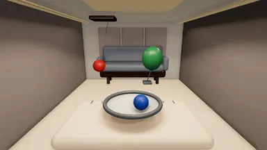
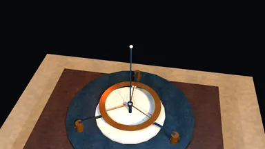
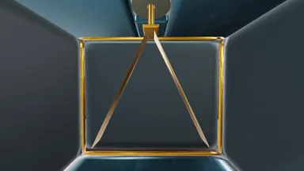
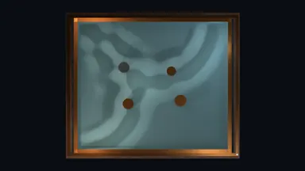
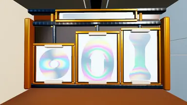

<h1 align="center">CaveBench Case Studies</h1>

<a href="CaveBench_Case_Studies.pptx">Editable case plates</a> · <a href="../../papers/Supplement.pdf">Supplementary PDF</a> · <a href="https://pier-lab.github.io/CaveBench/#viewer">Interactive cases</a>

Each case follows one apparatus through six events. Read the seven internal frames from left to right, starting at F0. Open a case to see the complete prompt, watch the interior and exterior views together, and compare the model’s response with the recorded controls.

## Dynamics

<table>

<tr>
<td align="center" width="50%"><a href="dynamics.md#s01"> <strong>S01 · Cabin inertia</strong></a></td>
<td align="center" width="50%"><a href="dynamics.md#s02"> <strong>S02 · Rotation &amp; gas</strong></a></td>
</tr>
<tr>
<td align="center" width="50%"><a href="dynamics.md#s03"> <strong>S03 · Driven pendulums</strong></a></td>
<td align="center" width="50%"><a href="dynamics.md#s04"> <strong>S04 · Tray impact</strong></a></td>
</tr>
</table>

## Thermal physics

<table>

<tr>
<td align="center" width="50%"><a href="thermal-physics.md#s05"> <strong>S05 · Moving heat source</strong></a></td>
<td align="center" width="50%"><a href="thermal-physics.md#s06"> <strong>S06 · Layered liquids</strong></a></td>
</tr>
<tr>
<td align="center" width="50%"><a href="thermal-physics.md#s07"> <strong>S07 · Heated gas bulbs</strong></a></td>
<td align="center" width="50%"><a href="thermal-physics.md#s08"> <strong>S08 · Bimetal supports</strong></a></td>
</tr>
</table>

## Electromagnetism

<table>

<tr>
<td align="center" width="50%"><a href="electromagnetism.md#s09"> <strong>S09 · Magnetic coils</strong></a></td>
<td align="center" width="50%"><a href="electromagnetism.md#s10"> <strong>S10 · Electric dipoles</strong></a></td>
</tr>
<tr>
<td align="center" width="50%"><a href="electromagnetism.md#s11"> <strong>S11 · Dielectric response</strong></a></td>
<td align="center" width="50%"><a href="electromagnetism.md#s12"> <strong>S12 · Conducting wires</strong></a></td>
</tr>
</table>

## Acoustics

<table>

<tr>
<td align="center" width="50%"><a href="acoustics.md#s13"> <strong>S13 · Standing waves</strong></a></td>
<td align="center" width="50%"><a href="acoustics.md#s14"> <strong>S14 · Wave scattering</strong></a></td>
</tr>
<tr>
<td align="center" width="50%"><a href="acoustics.md#s15"> <strong>S15 · Doppler response</strong></a></td>
<td align="center" width="50%"><a href="acoustics.md#s16"> <strong>S16 · Two-source ripples</strong></a></td>
</tr>
</table>

## Optics

<table>

<tr>
<td align="center" width="50%"><a href="optics.md#s17"> <strong>S17 · Photoelastic load</strong></a></td>
<td align="center" width="50%"><a href="optics.md#s18"> <strong>S18 · Double reflection</strong></a></td>
</tr>
<tr>
<td align="center" width="50%"><a href="optics.md#s19"> <strong>S19 · Graded refraction</strong></a></td>
<td align="center" width="50%"><a href="optics.md#s20"> <strong>S20 · Double-slit fringes</strong></a></td>
</tr>
</table>
