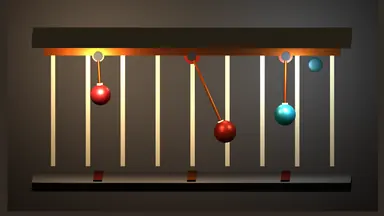
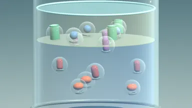
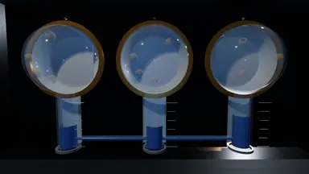
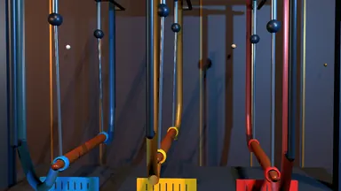
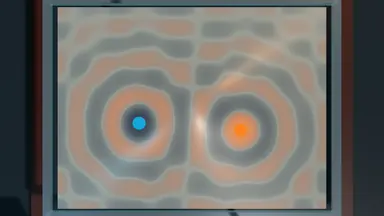
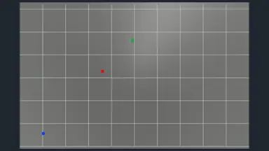
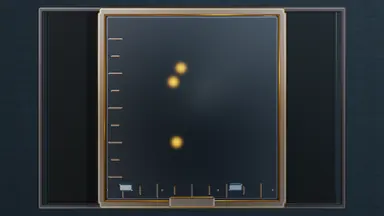

# CaveBench case studies

Select an image to read the one-page case sheet. The apparatus name opens the experiment, full prompt and model response.

[Editable PowerPoint](CaveBench_Case_Studies.pptx) · [Supplementary PDF](../../papers/Supplement.pdf)

[Dynamics](#dynamics) · [Thermal physics](#thermal-physics) · [Electromagnetism](#electromagnetism) · [Acoustics](#acoustics) · [Optics](#optics)

## Dynamics

| [S01 · Cabin inertia](https://pier-lab.github.io/CaveBench/#S01) | [S02 · Rotation & gas](https://pier-lab.github.io/CaveBench/#S02) |
| --- | --- |
|  |  |

| [S03 · Driven pendulums](https://pier-lab.github.io/CaveBench/#S03) | [S04 · Tray impact](https://pier-lab.github.io/CaveBench/#S04) |
| --- | --- |
|  |  |

## Thermal physics

| [S05 · Moving heat source](https://pier-lab.github.io/CaveBench/#S05) | [S06 · Layered liquids](https://pier-lab.github.io/CaveBench/#S06) |
| --- | --- |
|  |  |

| [S07 · Heated gas bulbs](https://pier-lab.github.io/CaveBench/#S07) | [S08 · Bimetal supports](https://pier-lab.github.io/CaveBench/#S08) |
| --- | --- |
|  |  |

## Electromagnetism

| [S09 · Magnetic coils](https://pier-lab.github.io/CaveBench/#S09) | [S10 · Electric dipoles](https://pier-lab.github.io/CaveBench/#S10) |
| --- | --- |
|  |  |

| [S11 · Dielectric response](https://pier-lab.github.io/CaveBench/#S11) | [S12 · Conducting wires](https://pier-lab.github.io/CaveBench/#S12) |
| --- | --- |
|  |  |

## Acoustics

| [S13 · Standing waves](https://pier-lab.github.io/CaveBench/#S13) | [S14 · Wave scattering](https://pier-lab.github.io/CaveBench/#S14) |
| --- | --- |
|  |  |

| [S15 · Doppler response](https://pier-lab.github.io/CaveBench/#S15) | [S16 · Two-source ripples](https://pier-lab.github.io/CaveBench/#S16) |
| --- | --- |
|  |  |

## Optics

| [S17 · Photoelastic load](https://pier-lab.github.io/CaveBench/#S17) | [S18 · Double reflection](https://pier-lab.github.io/CaveBench/#S18) |
| --- | --- |
|  |  |

| [S19 · Graded refraction](https://pier-lab.github.io/CaveBench/#S19) | [S20 · Double-slit fringes](https://pier-lab.github.io/CaveBench/#S20) |
| --- | --- |
|  |  |
