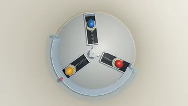
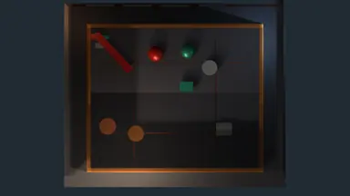
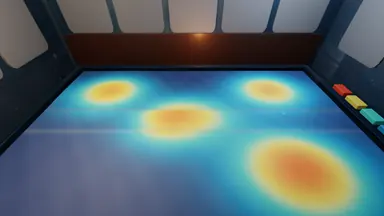
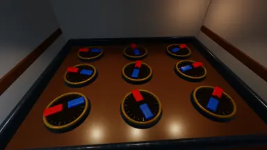
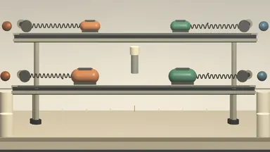
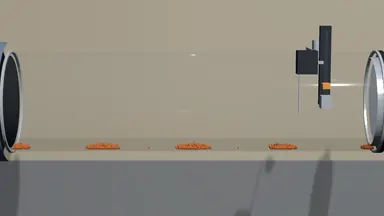
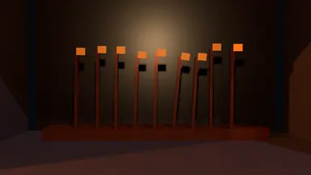
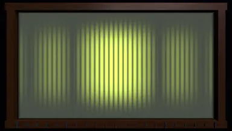

# CaveBench case studies

Each apparatus has one six-event case. Read the seven internal frames from left to right, starting at F0. The experiment log gives the controls applied between frames. Compare those controls with the model’s explanation and answer for each event. Open a case for its complete prompt and the video showing the interior and exterior views together.

[Editable case plates](CaveBench_Case_Studies.pptx) · [Supplementary PDF](../../papers/Supplement.pdf) · [Interactive cases](https://pier-lab.github.io/CaveBench/#viewer)

## Dynamics

<table>

<tr>
<td><a href="dynamics.md#s01"> <strong>S01 · Cabin inertia</strong></a></td>
<td><a href="dynamics.md#s02"> <strong>S02 · Rotation &amp; gas</strong></a></td>
</tr>
<tr>
<td><a href="dynamics.md#s03"> <strong>S03 · Driven pendulums</strong></a></td>
<td><a href="dynamics.md#s04"> <strong>S04 · Tray impact</strong></a></td>
</tr>
</table>

## Thermal physics

<table>

<tr>
<td><a href="thermal-physics.md#s05"> <strong>S05 · Moving heat source</strong></a></td>
<td><a href="thermal-physics.md#s06"> <strong>S06 · Layered liquids</strong></a></td>
</tr>
<tr>
<td><a href="thermal-physics.md#s07"> <strong>S07 · Heated gas bulbs</strong></a></td>
<td><a href="thermal-physics.md#s08"> <strong>S08 · Bimetal supports</strong></a></td>
</tr>
</table>

## Electromagnetism

<table>

<tr>
<td><a href="electromagnetism.md#s09"> <strong>S09 · Magnetic coils</strong></a></td>
<td><a href="electromagnetism.md#s10"> <strong>S10 · Electric dipoles</strong></a></td>
</tr>
<tr>
<td><a href="electromagnetism.md#s11"> <strong>S11 · Dielectric response</strong></a></td>
<td><a href="electromagnetism.md#s12"> <strong>S12 · Conducting wires</strong></a></td>
</tr>
</table>

## Acoustics

<table>

<tr>
<td><a href="acoustics.md#s13"> <strong>S13 · Standing waves</strong></a></td>
<td><a href="acoustics.md#s14"> <strong>S14 · Wave scattering</strong></a></td>
</tr>
<tr>
<td><a href="acoustics.md#s15"> <strong>S15 · Doppler response</strong></a></td>
<td><a href="acoustics.md#s16"> <strong>S16 · Two-source ripples</strong></a></td>
</tr>
</table>

## Optics

<table>

<tr>
<td><a href="optics.md#s17"> <strong>S17 · Photoelastic load</strong></a></td>
<td><a href="optics.md#s18"> <strong>S18 · Double reflection</strong></a></td>
</tr>
<tr>
<td><a href="optics.md#s19"> <strong>S19 · Graded refraction</strong></a></td>
<td><a href="optics.md#s20"> <strong>S20 · Double-slit fringes</strong></a></td>
</tr>
</table>
