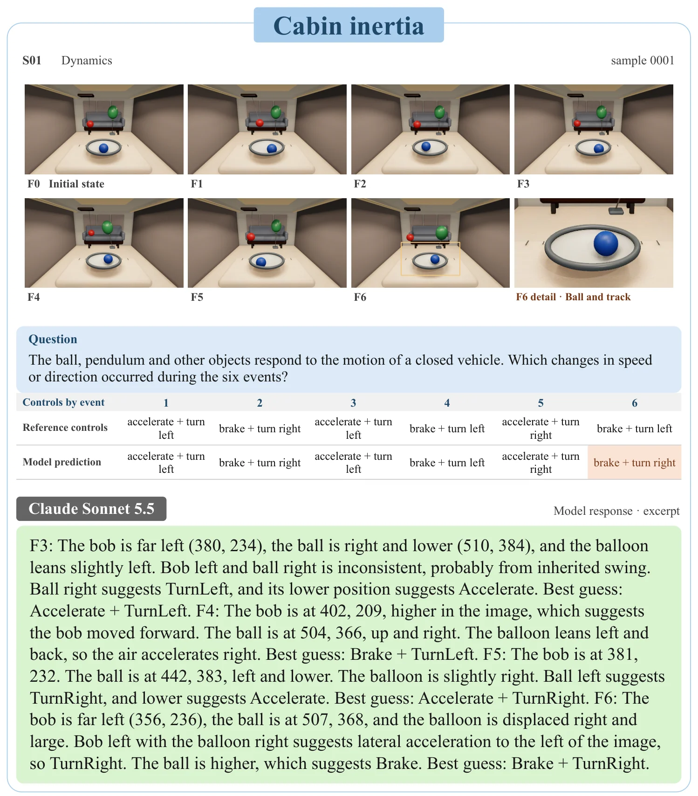
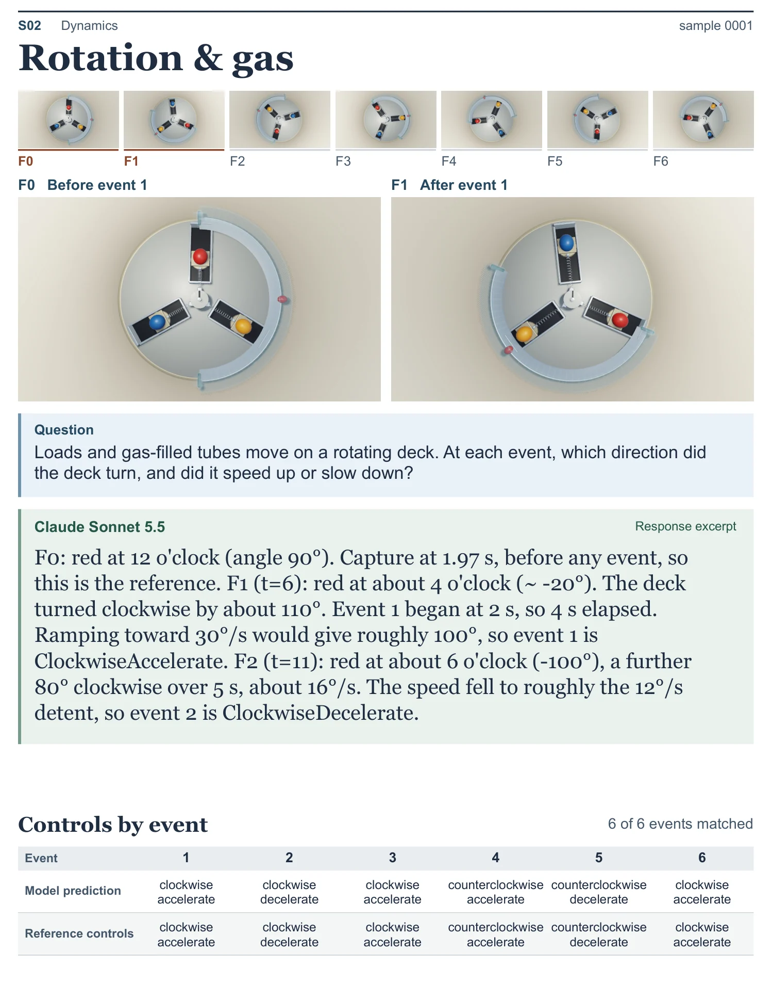
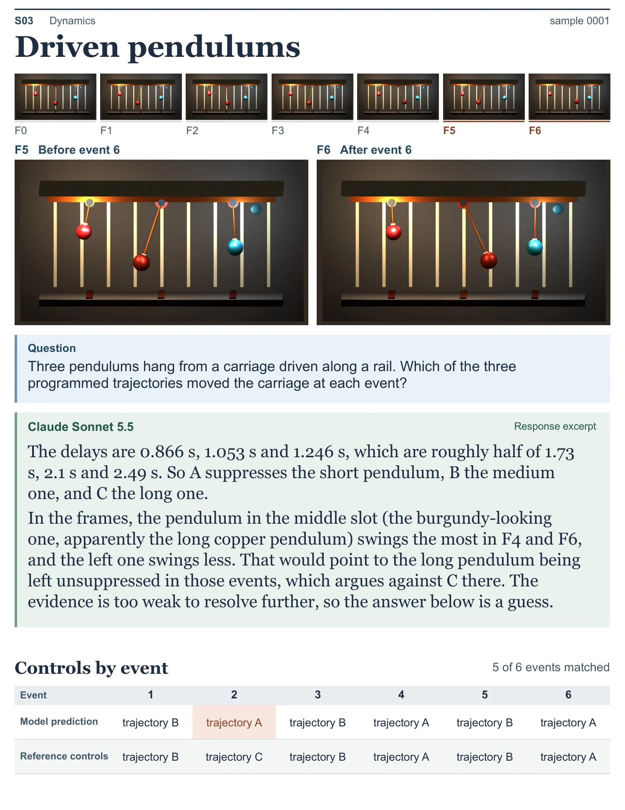
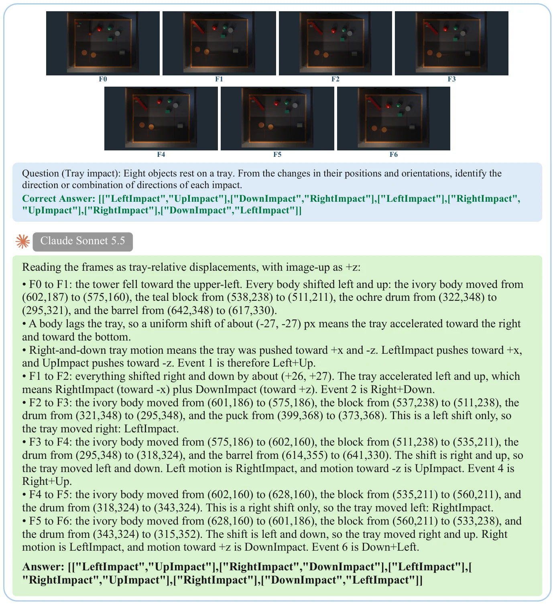

<h1 align="center">Dynamics</h1>

<a href="README.md">All case studies</a> · <a href="#s01">S01</a> · <a href="#s02">S02</a> · <a href="#s03">S03</a> · <a href="#s04">S04</a>

## S01 · Cabin inertia

The ball, pendulum and other objects respond to the motion of a closed vehicle. Which changes in speed or direction occurred during the six events?

[Solve the six-event question](https://pier-lab.github.io/CaveBench/#try-S01) · [Watch the episode](../../examples/S01/dual_view.mp4)

Full evaluation prompt

Infer exactly 6 hidden events from exactly 7 chronological interior images F0-F6. F0 is the initial evidence frame before the first event. Each subsequent image adds one new event. Use only these supplied images and the public apparatus description. Reconstruct the complete unordered set of controls at every supplied event; events are ordered in time.

APPARATUS AND PUBLIC CONTROL DEFINITIONS
Apparatus and coordinates. A fixed camera near the rear of a closed cabin looks toward its front. Vehicle-local+z is forward, away from the camera; +x is the vehicle's right. Image-left/right roughly follow vehicle-left/right, but perspective and object height affect projection. An upward image displacement is not by itself a forward displacement. Fixed cabin edges, table, bowl, roof supports and tether base are spatial references. The blue ball and its shallow bowl are on the central longitudinal line of the table, not on its right side. A red pendulum bob, when present, hangs from a roof support toward the far-left; a green helium balloon, when present, is tethered to a fixed anchor toward the far-right. There is NO yellow block, slider tray, linear guide or passive slider spring in any sample. A sample contains all three response bodies, or omits one complete red-bob, green-balloon or blue-ball body/force assembly before the experiment starts. An empty bowl may remain when the blue ball is absent. Establish which bodies actually exist in F0, track those same bodies and their fixed supports, and never infer a control from an absent object. Body existence is fixed throughout one sample and is not itself an event. Small supported module positions and initial positions can vary between experiments.

Physics. Gravity is downward. The vehicle moves forward throughout and never reverses or resets between events. The dense bob and ball respond through inertia, gravity, their suspension or bowl constraints, friction and real contacts. The lighter-than-air balloon responds to cabin-air acceleration, the associated pressure gradient, drag and its tether; its transient need not follow a dense body. Air/buoyancy is a reduced-order physical model, not full CFD. Steering and speed changes can act simultaneously. Pendulum oscillation, rolling, balloon motion and real contacts persist into later events. No object is repositioned at an event boundary. The ball's curved support and the pendulum/tether constraints turn different components of effective acceleration into different movements, so compare fore-aft and lateral changes relative to supports, combine the remaining response bodies and account for inherited motion. A coloured body is not a direction lamp or a painted operation label. In a single still, neither one body's largest image displacement nor its apparent height uniquely specifies both controls.

Hidden controls. The only allowed labels are Accelerate, Brake, TurnLeft and TurnRight. Accelerate increases forward speed; Brake reduces it without reversing. TurnLeft and TurnRight steer relative to the vehicle's own forward direction. In a top view with forward upward, left steering is counterclockwise and right steering clockwise. An event applies one primitive or two simultaneous primitives. A pair contains at most one longitudinal control, Accelerate or Brake, and at most one steering control, TurnLeft or TurnRight. Duplicate or opposite controls on the same axis never occur together. For each event report the unordered set, including both labels if two controls occurred. No fixed ordering or repetition pattern is promised.

OBSERVATION PROTOCOL FOR THIS PREFIX
Each evidence image is a true single-camera frame from the corresponding active response window, starting 0.30 s after onset and ending before ramp-down. A fixed geometric visibility rule chooses a frame with available bodies moving, balancing fore-aft and lateral clues. The images are not deliberately delayed settled snapshots; capture times are not uniformly spaced. Constraints, inherited motion, rotation, perspective and absent bodies still require interpretation.
Capture times (physical simulation clock; the F0 image precedes event 1): F1=3.133347 s; F2=7.399973 s; F3=12.266565 s; F4=18.233141 s; F5=21.333094 s; F6=27.366335 s.

ALLOWED ATOMIC LABELS
Accelerate, Brake, TurnLeft, TurnRight

ALLOWED EVENT LABEL SETS
[["Accelerate"],["Brake"],["TurnLeft"],["TurnRight"],["Accelerate","TurnLeft"],["Accelerate","TurnRight"],["Brake","TurnLeft"],["Brake","TurnRight"]]

REQUIRED OUTPUT
Return only one valid JSON object with exactly one root field, "operations". Its value must contain exactly 6 nonempty lists, in chronological event order. Every inner list must equal one allowed event label set and comply with the control rules above. Order within an event list does not matter. Even if uncertain, select your best-supported allowed answer for every event. Never return an empty list, null, unknown, abstention, or a missing event. Do not output markdown, commentary, or additional fields.
FINAL ANSWER CONTRACT: Give exactly 6 chronological event arrays under the sole JSON key "operations". Choose the most likely legal answer for EVERY event even when uncertain. Do not abstain, return an empty answer, or omit simultaneous actions. Your final visible answer must be only the JSON object. Legal action sets for one event: [["Accelerate"], ["Brake"], ["TurnLeft"], ["TurnRight"], ["Accelerate", "TurnLeft"], ["Accelerate", "TurnRight"], ["Brake", "TurnLeft"], ["Brake", "TurnRight"]].

### Model Response · Claude Sonnet 5.5

This is a best-supported guess from rough image cues, not a rigorous derivation.

Assumed response rules:
- Accelerate: the bob swings backward (toward the camera, appearing lower in the image), the ball rolls backward, and the balloon leans forward.
- Brake: the opposite of Accelerate.
- TurnLeft: the vehicle accelerates leftward, so dense bodies move right in the image relative to the cabin; for a right turn they move left. The balloon moves opposite to the dense bodies.

Frame-by-frame readings (F0 baseline: bob at x≈395, y≈237; ball at 477, 383; balloon upright):
- **F1:** The bob moves right and lower (435, 231) and the ball moves right and lower (508, 384). The balloon is unchanged. Rightward dense motion suggests TurnLeft. The bob's lower position suggests a mild Accelerate, but the bob's height is ambiguous. Best guess: Accelerate + TurnLeft.
- **F2:** The bob is at 398, 240 and the ball has moved left and up (452, 372). The bob is near center and the ball is left and forward. Forward ball motion suggests Brake. Left ball motion suggests TurnRight. Best guess: Brake + TurnRight.
- **F3:** The bob is far left (380, 234), the ball is right and lower (510, 384), and the balloon leans slightly left. Bob left and ball right is inconsistent, probably from inherited swing. Ball right suggests TurnLeft, and its lower position suggests Accelerate. Best guess: Accelerate + TurnLeft.
- **F4:** The bob is at 402, 209, higher in the image, which suggests the bob moved forward. The ball is at 504, 366, up and right. The balloon leans left and back, so the air accelerates right. Best guess: Brake + TurnLeft.
- **F5:** The bob is at 381, 232. The ball is at 442, 383, left and lower. The balloon is slightly right. Ball left suggests TurnRight, and lower suggests Accelerate. Best guess: Accelerate + TurnRight.
- **F6:** The bob is far left (356, 236), the ball is at 507, 368, and the balloon is displaced right and large. Bob left with the balloon right suggests lateral acceleration to the left of the image, so TurnRight. The ball is higher, which suggests Brake. Best guess: Brake + TurnRight.

### Model Answer and Experiment Log

| Event | Model answer | Recorded control |
| ---: | --- | --- |
| 1 | Accelerate + TurnLeft | Accelerate + TurnLeft |
| 2 | Brake + TurnRight | Brake + TurnRight |
| 3 | Accelerate + TurnLeft | Accelerate + TurnLeft |
| 4 | Brake + TurnLeft | Brake + TurnLeft |
| 5 | Accelerate + TurnRight | Accelerate + TurnRight |
| 6 | Brake + TurnRight | Brake + TurnLeft |

## S02 · Rotation & gas

Loads and gas-filled tubes move on a rotating deck. At each event, which direction did the deck turn, and did it speed up or slow down?

[Solve the six-event question](https://pier-lab.github.io/CaveBench/#try-S02) · [Watch the episode](../../examples/S02/dual_view.mp4)

Full evaluation prompt

Infer exactly 6 hidden events from exactly 7 chronological interior images F0-F6. F0 is the initial evidence frame before the first event. Each subsequent image adds one new event. Use only these supplied images and the public apparatus description. Reconstruct the complete unordered set of controls at every supplied event; events are ordered in time.

APPARATUS AND PUBLIC CONTROL DEFINITIONS
Apparatus and view: a circular deck rotates about its vertical central shaft inside an opaque cabin. The interior camera is fixed above the deck, looking downward; it does not rotate with the deck. Two or three radial assemblies lie inside the rim. Each contains a solid coloured load on a sliding carriage, a radial guide, and a spring connecting the carriage to an inner anchor. Red, blue and amber load assemblies have masses of 0.65, 0.80 and 1.00 kg and spring stiffnesses of 1.0625, 1.53 and 2.21 N/m respectively. A small mechanical pointer near the central spindle is mounted on the stationary shaft, with a torsion spring and viscous coupling to the deck.

A transparent, sealed, water-filled semicircular channel is fixed near the outer edge of the deck. Its ends are closed. It contains one small red, gas-filled thin-shell sphere, approximately 96 mm in diameter and 4 g in combined shell-and-gas mass. The sphere is separate from the larger loads on the radial carriages. The outer motor and its four-detent controller are outside the supplied interior view. The deck starts at rest. No positions, velocities, spring states or liquid-object states are reset between events.

Controls: clockwise and counterclockwise are defined as viewed from above. ClockwiseAccelerate sets the motor to the clockwise high-speed detent, nominally 30 degrees/s. ClockwiseDecelerate changes clockwise rotation to the low-speed detent, nominally 12 degrees/s. CounterclockwiseAccelerate sets the counterclockwise high-speed detent, nominally 30 degrees/s. CounterclockwiseDecelerate changes counterclockwise rotation to the low-speed detent, nominally 12 degrees/s. Selecting a high-speed detent may reverse the previous direction. Each event selects one complete motor setting.

OBSERVATION PROTOCOL FOR THIS PREFIX
The evidence frame for each event is selected from its 2.2-4.0 s response window. Motor commands are 5.0 s apart. The deck starts at rest and all mechanical and liquid-object states subsequently continue as described above.
Capture times (physical/native capture time in seconds): F0=1.966667 s; F1=6.000000 s; F2=11.000000 s; F3=16.000000 s; F4=21.000000 s; F5=26.000000 s; F6=31.000000 s.
Supplied event start times: 2 s, 7 s, 12 s, 17 s, 22 s, 27 s.

ALLOWED ATOMIC LABELS
ClockwiseAccelerate, ClockwiseDecelerate, CounterclockwiseAccelerate, CounterclockwiseDecelerate

ALLOWED EVENT LABEL SETS
[["ClockwiseAccelerate"],["ClockwiseDecelerate"],["CounterclockwiseAccelerate"],["CounterclockwiseDecelerate"]]

REQUIRED OUTPUT
Return only one valid JSON object with exactly one root field, "operations". Its value must contain exactly 6 nonempty lists, in chronological event order. Every inner list must equal one allowed event label set and comply with the control rules above. Order within an event list does not matter. Even if uncertain, select your best-supported allowed answer for every event. Never return an empty list, null, unknown, abstention, or a missing event. Do not output markdown, commentary, or additional fields.
FINAL ANSWER CONTRACT: Give exactly 6 chronological event arrays under the sole JSON key "operations". Choose the most likely legal answer for EVERY event even when uncertain. Do not abstain, return an empty answer, or omit simultaneous actions. Your final visible answer must be only the JSON object. Legal action sets for one event: [["ClockwiseAccelerate"], ["ClockwiseDecelerate"], ["CounterclockwiseAccelerate"], ["CounterclockwiseDecelerate"]].

### Model Response · Claude Sonnet 5.5

Estimating deck angle from the red assembly position (viewed from above):
- F0: red at 12 o'clock (angle 90°). Capture at 1.97 s, before any event, so this is the reference.
- F1 (t=6): red at about 4 o'clock (~ -20°). The deck turned clockwise by about 110°. Event 1 began at 2 s, so 4 s elapsed. Ramping toward 30°/s would give roughly 100°, so event 1 is ClockwiseAccelerate.
- F2 (t=11): red at about 6 o'clock (-100°), a further 80° clockwise over 5 s, about 16°/s. The speed fell to roughly the 12°/s detent, so event 2 is ClockwiseDecelerate.
- F3 (t=16): red at about 11 o'clock (~125°). Going from -100° to 125° clockwise is -100 → -235, i.e. 135° clockwise, about 27°/s. That fits ClockwiseAccelerate, so event 3 is ClockwiseAccelerate.
- F4 (t=21): red at about 9 o'clock (~180°). From 125° clockwise would go to about 125 - 60 = 65°, but the observed 180° is 55° counterclockwise, which could also be 305° clockwise. The channel position also shifted: the channel in F3 spans the right side, and in F4 it spans the top-left. Using the red assembly (F3 at about 125°, F4 at about 180°), a counterclockwise move of 55° over 5 s is about 11°/s, matching the low detent in the counterclockwise direction. Event 4 would be CounterclockwiseDecelerate, but that would require counterclockwise motion already in progress, so it must be CounterclockwiseAccelerate with the transient still ramping. The measured 55° is less than the 150° expected at 30°/s, so the ramp-up is slow. At 12°/s, 60° would fit well. I'll choose CounterclockwiseAccelerate since a reversal needs a high-speed detent.
- F5 (t=26): red at about 6 o'clock (-100°=260°). From 180° that is 80° counterclockwise, about 16°/s, which is a lower speed. Event 5 is CounterclockwiseDecelerate.
- F6 (t=31): red at about 9 o'clock (180°). From 260° to 180° is 80° clockwise, so the direction reversed to clockwise. Event 6 is ClockwiseAccelerate.

### Model Answer and Experiment Log

| Event | Model answer | Recorded control |
| ---: | --- | --- |
| 1 | ClockwiseAccelerate | ClockwiseAccelerate |
| 2 | ClockwiseDecelerate | ClockwiseDecelerate |
| 3 | ClockwiseAccelerate | ClockwiseAccelerate |
| 4 | CounterclockwiseAccelerate | CounterclockwiseAccelerate |
| 5 | CounterclockwiseDecelerate | CounterclockwiseDecelerate |
| 6 | ClockwiseAccelerate | ClockwiseAccelerate |

## S03 · Driven pendulums

Three pendulums hang from a carriage driven along a rail. Which of the three programmed trajectories moved the carriage at each event?

[Solve the six-event question](https://pier-lab.github.io/CaveBench/#try-S03) · [Watch the episode](../../examples/S03/dual_view.mp4)

Full evaluation prompt

Infer exactly 6 hidden events from exactly 7 chronological interior images F0-F6. F0 is the initial evidence frame before the first event. Each subsequent image adds one new event. Use only these supplied images and the public apparatus description. Reconstruct the complete unordered set of controls at every supplied event; events are ordered in time.

APPARATUS AND PUBLIC CONTROL DEFINITIONS
A carriage moves along a horizontal straight rail. Three rigid pendulums hang from its overhead beam: the burgundy pendulum has a suspension length of 0.72 m, the teal pendulum 1.08 m, and the copper-coloured pendulum 1.52 m. Their suspension slots may be permuted between experiments but remain fixed within one experiment. Some experiments also contain a smaller ivory-coloured passive pendulum. The camera is fixed to the carriage; image-right corresponds to its horizontal +x direction. The walls, floor and beam belong to the carriage. Gravitational acceleration is 9.81 m/s^2, and the pendulum pivots have passive damping.

For each event, an external controller selects one fixed profile A, B or C. After the selector has moved, the carriage translates 4.40 m using that profile. In the following expression, t is time since the translation starts, x0 is its starting position, and s is +1 or -1 for rightward or leftward travel. Travel directions alternate, starting with rightward travel in the first event. Travel direction is not the label to predict.

Define Q(u) = 0 for u <= 0, Q(u) = 10u^3 - 15u^4 + 6u^5 for 0 < u < 1, and Q(u) = 1 for u >= 1.
All three profiles have the form
x_j(t) = x0 + s * 4.40 * [Q(t/2.50) + w_j * Q((t-d_j)/2.50)] / (1+w_j), in metres.

A: d_A = 0.865523 s, w_A = 0.833172; label TrajectoryA.
B: d_B = 1.052630 s, w_B = 0.814545; label TrajectoryB.
C: d_C = 1.245535 s, w_C = 0.793962; label TrajectoryC.
Each profile remains at its endpoint after t = 2.50 + d_j seconds. The controller makes no additional changes to the profile in response to the pendulums' instantaneous state. The carriage and pendulums are not reset between events.

OBSERVATION PROTOCOL FOR THIS PREFIX
Each evidence image is taken after the selected carriage translation has stopped and before the next selection. Selections are 6.0 s apart; translation begins 0.80 s after selection. Use the supplied physical-clock capture times with the public profile equations. Pendulum oscillations persist between events.
Capture times (physical simulation clock declared in the public apparatus protocol): F0=2.000000 s; F1=7.200000 s; F2=13.200000 s; F3=19.200000 s; F4=25.200000 s; F5=31.200000 s; F6=37.200000 s.
Supplied event start times: 2 s, 8 s, 14 s, 20 s, 26 s, 32 s.

ALLOWED ATOMIC LABELS
TrajectoryA, TrajectoryB, TrajectoryC

ALLOWED EVENT LABEL SETS
[["TrajectoryA"],["TrajectoryB"],["TrajectoryC"]]

REQUIRED OUTPUT
Return only one valid JSON object with exactly one root field, "operations". Its value must contain exactly 6 nonempty lists, in chronological event order. Every inner list must equal one allowed event label set and comply with the control rules above. Order within an event list does not matter. Even if uncertain, select your best-supported allowed answer for every event. Never return an empty list, null, unknown, abstention, or a missing event. Do not output markdown, commentary, or additional fields.
FINAL ANSWER CONTRACT: Give exactly 6 chronological event arrays under the sole JSON key "operations". Choose the most likely legal answer for EVERY event even when uncertain. Do not abstain, return an empty answer, or omit simultaneous actions. Your final visible answer must be only the JSON object. Legal action sets for one event: [["TrajectoryA"], ["TrajectoryB"], ["TrajectoryC"]].

### Model Response · Claude Sonnet 5.5

I could not derive these labels by simulation or measurement. They are a best guess from a rough reading of the frames, with no reliable evidence behind any individual event.

The physics suggests residual oscillation after each move depends on the profile's delay and weight relative to each pendulum's period. The three periods are about 1.69 s (0.72 m), 2.08 s (1.08 m) and 2.48 s (1.52 m). A double-pulse profile cancels a mode when its delay is about half that mode's period. The delays are 0.866 s, 1.053 s and 1.246 s, which are roughly half of 1.73 s, 2.1 s and 2.49 s. So A suppresses the short pendulum, B the medium one, and C the long one.

In the frames, the pendulum in the middle slot (the burgundy-looking one, apparently the long copper pendulum) swings the most in F4 and F6, and the left one swings less. That would point to the long pendulum being left unsuppressed in those events, which argues against C there. The evidence is too weak to resolve further, so the answer below is a guess.

### Model Answer and Experiment Log

| Event | Model answer | Recorded control |
| ---: | --- | --- |
| 1 | TrajectoryB | TrajectoryB |
| 2 | TrajectoryA | TrajectoryC |
| 3 | TrajectoryB | TrajectoryB |
| 4 | TrajectoryA | TrajectoryA |
| 5 | TrajectoryB | TrajectoryB |
| 6 | TrajectoryA | TrajectoryA |

## S04 · Tray impact

Eight objects rest on a tray. From the changes in their positions and orientations, identify the direction or combination of directions of each impact.

[Solve the six-event question](https://pier-lab.github.io/CaveBench/#try-S04) · [Watch the episode](../../examples/S04/worked/dual_view.mp4)

Full evaluation prompt

Infer exactly 6 hidden events from exactly 7 chronological interior images F0-F6. F0 is the initial evidence frame before the first event. Each subsequent image adds one new event. Use only these supplied images and the public apparatus description. Reconstruct the complete unordered set of controls at every supplied event; events are ordered in time.

APPARATUS AND PUBLIC CONTROL DEFINITIONS
The rigid rectangular tray supports eight free physical response bodies: a tall burgundy tower toward the upper-left, a teal sphere toward the upper-middle/right, an ivory body toward the upper-right that can be a sphere, box, or cylinder, an ochre sliding drum toward the lower-left, a low brass puck toward the lower-middle, a short teal block right of the middle, a rolling ivory barrel toward the lower-right, and a ruby-colored ball toward the upper-middle/left. Those positions are approximate and can vary; establish the actual identities and positions from F0 and track them through the sequence. Fixed tray lines and the rim are spatial references, not control indicators. Small colored pieces near the upper-left or upper-right rim are stationary, non-colliding layout references rather than response bodies; their count and arrangement can vary across samples but do not change with the hidden controls. The camera is rigidly carried by the struck tray, looks straight down, and preserves its tray-relative pose. Image-right is tray-local +x, image-up is tray-local +z. Screen-left/right/up/down are not world gravitational up/down.

Four exterior hammers can strike four different sides of the tray. IMPORTANT: operation names indicate the struck side, not the direction of the inward force. LeftImpact means the west/left hammer strikes inward toward +x; RightImpact means the east/right hammer strikes inward toward -x. UpImpact means the far/top (+z) hammer strikes inward toward -z; DownImpact means the near/bottom (-z) hammer strikes inward toward +z. An event contains either one primitive or two different perpendicular primitives applied simultaneously. The first event always uses two perpendicular primitives so the tower can fall clear of the adjacent wall; each later event may use one or two. This is a common protocol constraint, not a cue to either first-event direction. Opposite pairs and repeated identical primitives within one event are not permitted. The permitted primitive labels are LeftImpact, RightImpact, UpImpact, and DownImpact.

The hammers physically collide with the dynamically supported tray; they do not directly push the free response bodies. The tray recoils, and its carried camera observes how the bodies lag relative to the accelerating tray through inertia, contact friction, rolling, sliding, and possible tipping. Two hammers can jointly produce two recoil components. The tray's passive return springs and dampers also affect the later trajectory. A sphere can retain rolling velocity and a toppled tower remains toppled; no body is reset between events. Do not identify later events from the already fallen tower alone. Compare new tray-relative changes in several separated low bodies with rolling-body changes, while accounting for history and contacts. Neither one instantaneous position nor a world-frame displacement alone determines the hidden controls.

OBSERVATION PROTOCOL FOR THIS PREFIX
The experiment has an initial 3.0 s hold, then 5.5 s event intervals. Hammer contact occurs about 2.067 s into an interval. Images show the evolving tray-carried view, not contact instants or guaranteed equilibrium. Existing rolling velocity, contacts and a fallen tower persist.
Capture times (physical/native capture time in seconds): F0=2.966667 s; F1=7.333333 s; F2=11.500000 s; F3=17.000000 s; F4=22.500000 s; F5=28.000000 s; F6=33.500000 s.
Supplied event start times: 3 s, 8.5 s, 14 s, 19.5 s, 25 s, 30.5 s. The first event's evidence is sampled about 4.333 s into its interval; the other supplied event images are about 3.000 s into their intervals.

ALLOWED ATOMIC LABELS
LeftImpact, RightImpact, UpImpact, DownImpact

ALLOWED EVENT LABEL SETS
[["LeftImpact"],["RightImpact"],["UpImpact"],["DownImpact"],["LeftImpact","UpImpact"],["DownImpact","LeftImpact"],["RightImpact","UpImpact"],["DownImpact","RightImpact"]]

REQUIRED OUTPUT
Return only one valid JSON object with exactly one root field, "operations". Its value must contain exactly 6 nonempty lists, in chronological event order. Every inner list must equal one allowed event label set and comply with the control rules above. Order within an event list does not matter. Even if uncertain, select your best-supported allowed answer for every event. Never return an empty list, null, unknown, abstention, or a missing event. Do not output markdown, commentary, or additional fields.
FINAL ANSWER CONTRACT: Give exactly 6 chronological event arrays under the sole JSON key "operations". Choose the most likely legal answer for EVERY event even when uncertain. Do not abstain, return an empty answer, or omit simultaneous actions. Your final visible answer must be only the JSON object. Legal action sets for one event: [["LeftImpact"], ["RightImpact"], ["UpImpact"], ["DownImpact"], ["LeftImpact", "UpImpact"], ["DownImpact", "LeftImpact"], ["RightImpact", "UpImpact"], ["DownImpact", "RightImpact"]].

### Model Response · Claude Sonnet 5.5

Reading the frames as tray-relative displacements, with image-up as +z:

- **F0 to F1:** the tower fell toward the upper-left. Every body shifted left and up: the ivory body moved from (602,187) to (575,160), the teal block from (538,238) to (511,211), the ochre drum from (322,348) to (295,321), and the barrel from (642,348) to (617,330).
- A body lags the tray, so a uniform shift of about (-27, -27) px means the tray accelerated toward the right and toward the bottom.
- Right-and-down tray motion means the tray was pushed toward +x and -z. LeftImpact pushes toward +x, and UpImpact pushes toward -z. Event 1 is therefore Left+Up.
- **F1 to F2:** everything shifted right and down by about (+26, +27). The tray accelerated left and up, which means RightImpact (toward -x) plus DownImpact (toward +z). Event 2 is Right+Down.
- **F2 to F3:** the ivory body moved from (601,186) to (575,186), the block from (537,238) to (511,238), the drum from (321,348) to (295,348), and the puck from (399,368) to (373,368). This is a left shift only, so the tray moved right: LeftImpact.
- **F3 to F4:** the ivory body moved from (575,186) to (602,160), the block from (511,238) to (535,211), the drum from (295,348) to (318,324), and the barrel from (614,355) to (641,330). The shift is right and up, so the tray moved left and down. Left motion is RightImpact, and motion toward -z is UpImpact. Event 4 is Right+Up.
- **F4 to F5:** the ivory body moved from (602,160) to (628,160), the block from (535,211) to (560,211), and the drum from (318,324) to (343,324). This is a right shift only, so the tray moved left: RightImpact.
- **F5 to F6:** the ivory body moved from (628,160) to (601,186), the block from (560,211) to (533,238), and the drum from (343,324) to (315,352). The shift is left and down, so the tray moved right and up. Right motion is LeftImpact, and motion toward +z is DownImpact. Event 6 is Down+Left.

### Model Answer and Experiment Log

| Event | Model answer | Recorded control |
| ---: | --- | --- |
| 1 | LeftImpact + UpImpact | LeftImpact + UpImpact |
| 2 | RightImpact + DownImpact | DownImpact + RightImpact |
| 3 | LeftImpact | LeftImpact |
| 4 | RightImpact + UpImpact | RightImpact + UpImpact |
| 5 | RightImpact | RightImpact |
| 6 | DownImpact + LeftImpact | DownImpact + LeftImpact |
