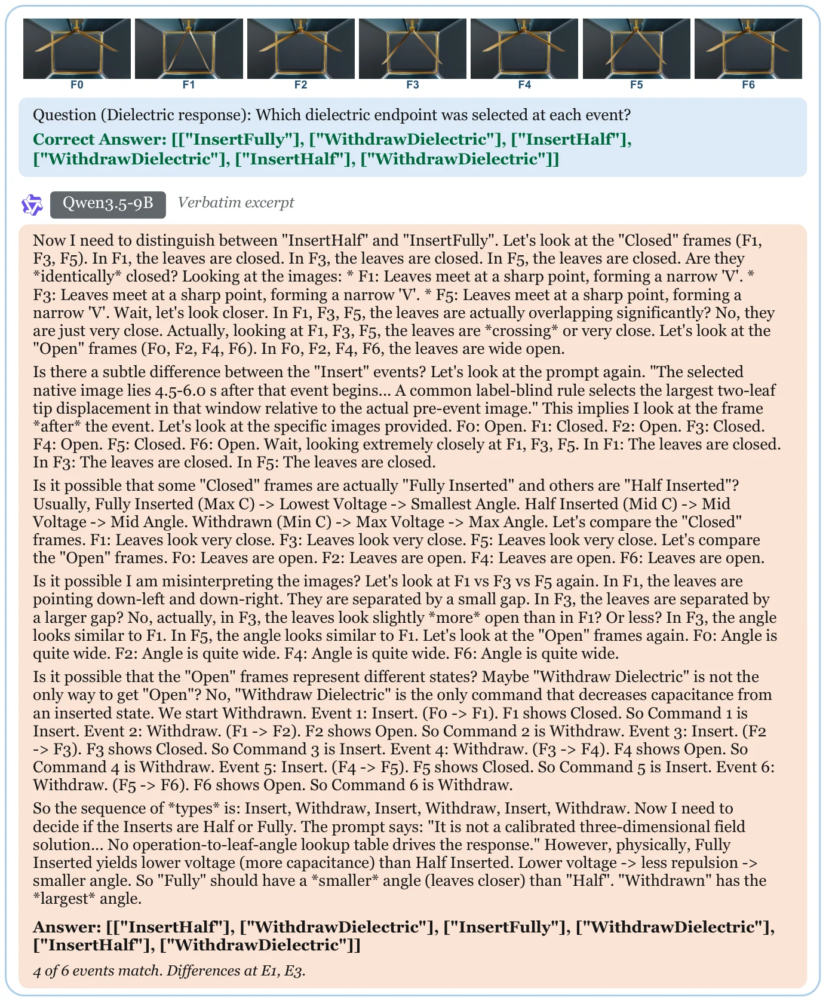

# Electromagnetism

[All case studies](README.md) · [S09](#s09) · [S10](#s10) · [S11](#s11) · [S12](#s12)

## S09 · Magnetic coils

Compass needles respond to three coils beneath the apparatus. Which coil or coils were energized at each event, and with which polarity?

[Solve the six-event question](https://pier-lab.github.io/CaveBench/#try-S09) · [Watch the episode](../../examples/S09/dual_view.mp4)

Read the full explanation by Claude Sonnet 5.5

I could not work this out rigorously, so these are best guesses from rough visual cues.

**F0 to F1.** The left column rotated strongly. The near-left needle now points red to the left and blue to the right. The middle-near needle also changed, with red toward the upper left. The other needles changed little. Coil1 sits on the left, so it is the likely source. Coil1 Positive would push north rightward and toward the far edge, but the red end went left, so this looks like Coil1Negative.

**F1 to F2.** The left column changed again: the near-left needle now has blue toward the far edge and red toward the near edge. That means north points toward the near edge, which is the opposite of Coil2Positive's far-edge direction. The left-middle needle also flipped, with blue up and red down. The middle-near needle is still tilted red toward the upper left. This fits Coil2Negative, whose north end would point toward the near edge. A coil with a negative sign is the better fit here, though Coil1 and Coil2 are both plausible.

**F2 to F3.** The right column changed: the right-middle needle now has red up and blue down, and the right-near needle has red to the upper left and blue to the lower right. That suggests Coil3, and the red end pointing upper left matches Coil3Positive.

**F3 to F4.** Most needles flipped, with blue now pointing up in the left and middle columns and red toward the near edge. The near-middle needle has red pointing down. This suggests Coil2Negative, which would point north toward the near edge.

**F4 to F5.** The near-middle needle has blue on the left and red on the right, so north points right. Coil1Positive pushes north rightward and toward the far edge, so this fits Coil1Positive.

**F5 to F6.** The right-near needle has blue on the left and red on the right, so north points right. Coil3Negative would point north rightward and toward the near edge, so this fits Coil3Negative.

Full evaluation prompt

Infer exactly 6 hidden events from exactly 7 chronological interior images F0-F6. F0 is the initial evidence frame before the first event. Each subsequent image adds one new event. Use only these supplied images and the public apparatus description. Reconstruct the complete unordered set of controls at every supplied event; events are ordered in time.

APPARATUS AND PUBLIC CONTROL DEFINITIONS
APPARATUS
The interior camera looks down at red-and-blue compass needles on brass pivots and fixed circular bases. The red end is NORTH and the blue end is SOUTH. Image-right is table +x; the far edge of the table is +z; upward from the tabletop is +y. The nominal compass slots form three columns at x=-2.60, 0 and +2.60 m and near/middle/far rows at z=-1.40, +0.45 and +2.30 m. Installed bases can have up to 0.06 m of horizontal placement variation. Some slots may be empty. The needle magnetic centres are at y=0.970 m. Base positions and needle identities remain fixed within an experiment.

Three external electromagnets are outside the interior view. Coil1 is beyond the left-near side of the table, Coil2 is beyond the middle of the near edge, and Coil3 is beyond the right-near side. Their centres, in the same table coordinates, are approximately (-7.20, 2.42, -3.26), (0, 3.55, -5.95) and (+7.20, 2.42, -3.26) m. Their magnetic axes are horizontal. With Positive current, Coil1's north end points rightward and toward the far edge, along (0.84, 0, 0.55); Coil2's north end points toward the far edge, along (0, 0, 1); Coil3's north end points leftward and toward the far edge, along (-0.84, 0, 0.55). Negative current reverses the named coil's pole orientation. These are fixed winding and connection conventions, not observations of the hidden events.

All installed compass rotors have the same mechanical response: mass 0.12 kg, yaw inertia approximately 0.0164 kg m^2, angular damping 1.40/s and the same magnetic moment setting. The simulation uses three softened dipole sources with common distance softening 0.72 m and normalized-field scale 70. The common rotor torque scale is 0.030 N m per normalized field unit, with a field-magnitude cap of 2.4 units and a rotor angular-speed limit of 5.5 rad/s. Powered Coil1 and Coil3 approach current magnitude 2.00 A; Coil2 approaches 2.05 A. Current has a second-order electrical response with natural frequency 9.2/s and damping ratio 0.92. Positions, currents and residual needle motion are not reset between events.

CONTROLS
Coil1Positive and Coil1Negative energize Coil1 with the respective polarity. Coil2Positive and Coil2Negative do the same for Coil2; Coil3Positive and Coil3Negative do the same for Coil3. Exactly one coil is selected in each event; the other selectors remain in their unpowered neutral positions. Each selected contact is commanded for 2.4 s, followed by 3.2 s with all selectors neutral. Actual current and needle motion evolve continuously rather than being reset when a selector returns to neutral.

OBSERVATION PROTOCOL FOR THIS PREFIX
The recording starts with a 2.0 s initial hold. Each event image is a native interior frame from its powered response window. A contact is commanded for 2.4 s, followed by 3.2 s with selectors neutral; currents and compass motion continue evolving.
Capture times (physical simulation clock; the F0 image precedes event 1): F1=4.133356 s; F2=9.733271 s; F3=15.333185 s; F4=20.933100 s; F5=26.533014 s; F6=32.132957 s.
Supplied event start times: 2 s, 7.6 s, 13.2 s, 18.8 s, 24.4 s, 30 s.

ALLOWED ATOMIC LABELS
Coil1Positive, Coil1Negative, Coil2Positive, Coil2Negative, Coil3Positive, Coil3Negative

ALLOWED EVENT LABEL SETS
[["Coil1Positive"],["Coil1Negative"],["Coil2Positive"],["Coil2Negative"],["Coil3Positive"],["Coil3Negative"]]

REQUIRED OUTPUT
Return only one valid JSON object with exactly one root field, "operations". Its value must contain exactly 6 nonempty lists, in chronological event order. Every inner list must equal one allowed event label set and comply with the control rules above. Order within an event list does not matter. Even if uncertain, select your best-supported allowed answer for every event. Never return an empty list, null, unknown, abstention, or a missing event. Do not output markdown, commentary, or additional fields.
FINAL ANSWER CONTRACT: Give exactly 6 chronological event arrays under the sole JSON key "operations". Choose the most likely legal answer for EVERY event even when uncertain. Do not abstain, return an empty answer, or omit simultaneous actions. Your final visible answer must be only the JSON object. Legal action sets for one event: [["Coil1Positive"], ["Coil1Negative"], ["Coil2Positive"], ["Coil2Negative"], ["Coil3Positive"], ["Coil3Negative"]].

Model answer and experiment log

| Event | Model answer | Recorded control |
| --- | --- | --- |
| 1 | Coil1Negative | Coil1Negative |
| 2 | Coil2Negative | Coil1Positive |
| 3 | Coil3Positive | Coil3Positive |
| 4 | Coil2Negative | Coil2Negative |
| 5 | Coil1Positive | Coil2Positive |
| 6 | Coil3Negative | Coil3Negative |

## S10 · Electric dipoles

Horizontal probe pairs respond to two electric dipoles. At each event, which dipole charges increased or decreased in magnitude?

[Solve the six-event question](https://pier-lab.github.io/CaveBench/#try-S10) · [Watch the episode](../../examples/S10/dual_view.mp4)

Read the full explanation by Claude Sonnet 5.5

I read each event from how far the probes moved between consecutive frames. In each row the left probe is light and the right probe is dark. The probes sit at their equilibrium positions, so closer together means stronger attraction. Probe positions are approximate pixel x-coordinates read from the images.

**Positions per frame**

| Frame | Upper left | Upper right | Lower left | Lower right |
|---|---|---|---|---|
| F0 | 327 | 634 | 332 | 619 |
| F1 | 320 | 641 | 302 | 649 |
| F2 | 327 | 634 | 332 | 618 |
| F3 | 320 | 641 | 302 | 649 |
| F4 | 348 | 613 | 347 | 604 |
| F5 | 394 | 567 | 396 | 555 |
| F6 | 348 | 613 | 345 | 606 |

**Reading the changes**

- **F0 to F1:** The upper pair moved apart slightly (gap 307 to 321), and the lower pair moved apart more (gap 287 to 347). Both dipoles weakened, but B changed more, so I take this as a decrease of both A and B.
- **F1 to F2:** Both rows returned to their F0 positions, so this is the reverse of the previous event: an increase of both A and B.
- **F2 to F3:** The positions match F1 again, so this is a decrease of both A and B.
- **F3 to F4:** The upper gap shrank to 265 and the lower gap to 257, both tighter than F0 (307 and 287). Relative to F3 that is a strong increase in both. Starting from A=12.5 and B=25 after F3, A rose to 37.5 or 62.5 and B rose to 75, which fits increasing both. A and B each get one step, so the pair is IncreaseChargeA with IncreaseChargeB.
- **F4 to F5:** The upper gap shrank to 173 and the lower gap to 159, so both dipoles strengthened further. This is another increase of both.
- **F5 to F6:** Both rows returned to F4-like positions, so both dipoles weakened. This is a decrease of both.

**Checking the charge levels**

- After F0, A=37.5 and B=75.
- After event 1 (decrease both), A=12.5 and B=25.
- After event 2 (increase both), A=37.5 and B=75, matching F0.
- After event 3 (decrease both), A=12.5 and B=25, matching F1.
- After event 4 (increase both), A=37.5 and B=75, which should match F0, but F4 is tighter than F0. This conflicts with the readings, so the F4 increase may be larger than one step, or the sequence differs from this simple model.
- After event 5 (increase both), A=62.5 and B=125, and the probes are closer still, which is consistent with F5.
- After event 6 (decrease both), A=37.5 and B=75, but F6 is nearly the same as F4, which is also inconsistent with F0.

The F4 and F6 positions agree with each other, and F4 differs from F0 by a consistent offset. That offset is probably a persistent-motion or neutral-body effect, so I keep the sequence as read from the frame-to-frame changes.

Full evaluation prompt

Infer exactly 6 hidden events from exactly 7 chronological interior images F0-F6. F0 is the initial evidence frame before the first event. Each subsequent image adds one new event. Use only these supplied images and the public apparatus description. Reconstruct the complete unordered set of controls at every supplied event; events are ordered in time.

APPARATUS AND PUBLIC CONTROL DEFINITIONS
APPARATUS
The fixed camera looks at two horizontal rows; image-right is world +x and image-up is +y. The upper row is Dipole A and the lower row is Dipole B. Each row has a light probe on the left and a dark probe on the right, both sliding horizontally between fixed outer spring anchors. A and B are separate, spatially distinct dipoles. In each dipole, the copper electrode is on the left and the blue electrode is on the right. A small neutral ivory body is fixed between the rows. The dipoles and the neutral body remain part of the apparatus throughout the sequence.

CALIBRATION FACTS FOR THIS APPARATUS
At the start of every sample, the hidden source magnitudes are A=37.5 microC and B=75.0 microC. A single source control changes A by 25.0 microC or B by 50.0 microC in the indicated direction; the sign of each source does not change. The four light probes have charge signs +, -, +, - from upper-left to lower-right. The two upper probes have mass 0.025 kg and spring damping 0.305 N s/m; the two lower probes have mass 0.550 kg and damping 1.20 N s/m. The neutral ivory body has mass 0.120 kg. These values are calibration information about the fixed apparatus, not labels for the hidden events.

ALLOWED LABELS
IncreaseChargeA: increase the magnitude of upper Dipole A while preserving its electrode signs.
DecreaseChargeA: decrease the magnitude of upper Dipole A while preserving its electrode signs.
IncreaseChargeB: increase the magnitude of lower Dipole B while preserving its electrode signs.
DecreaseChargeB: decrease the magnitude of lower Dipole B while preserving its electrode signs.
An event contains one label or one A label together with one B label. Do not add a label merely because a probe is still moving from an earlier event.

OBSERVATION PROTOCOL FOR THIS PREFIX
The evidence frame is taken about 3.5 s after its corresponding event, before the next one. Use fixed anchors, row identity, probe signs, relative displacement and persistent motion; one probe or colour alone does not identify an event.
Capture times (physical/native capture time in seconds): F0=1.966667 s; F1=5.500000 s; F2=11.000000 s; F3=16.500000 s; F4=22.000000 s; F5=27.500000 s; F6=33.000000 s.

ALLOWED ATOMIC LABELS
IncreaseChargeA, DecreaseChargeA, IncreaseChargeB, DecreaseChargeB

ALLOWED EVENT LABEL SETS
[["IncreaseChargeA"],["DecreaseChargeA"],["IncreaseChargeB"],["DecreaseChargeB"],["IncreaseChargeA","IncreaseChargeB"],["DecreaseChargeB","IncreaseChargeA"],["DecreaseChargeA","IncreaseChargeB"],["DecreaseChargeA","DecreaseChargeB"]]

REQUIRED OUTPUT
Return only one valid JSON object with exactly one root field, "operations". Its value must contain exactly 6 nonempty lists, in chronological event order. Every inner list must equal one allowed event label set and comply with the control rules above. Order within an event list does not matter. Even if uncertain, select your best-supported allowed answer for every event. Never return an empty list, null, unknown, abstention, or a missing event. Do not output markdown, commentary, or additional fields.
FINAL ANSWER CONTRACT: Give exactly 6 chronological event arrays under the sole JSON key "operations". Choose the most likely legal answer for EVERY event even when uncertain. Do not abstain, return an empty answer, or omit simultaneous actions. Your final visible answer must be only the JSON object. Legal action sets for one event: [["IncreaseChargeA"], ["DecreaseChargeA"], ["IncreaseChargeB"], ["DecreaseChargeB"], ["IncreaseChargeA", "IncreaseChargeB"], ["DecreaseChargeB", "IncreaseChargeA"], ["DecreaseChargeA", "IncreaseChargeB"], ["DecreaseChargeA", "DecreaseChargeB"]].

Model answer and experiment log

| Event | Model answer | Recorded control |
| --- | --- | --- |
| 1 | DecreaseChargeA + DecreaseChargeB | DecreaseChargeB + IncreaseChargeA |
| 2 | IncreaseChargeA + IncreaseChargeB | DecreaseChargeA + IncreaseChargeB |
| 3 | DecreaseChargeA + DecreaseChargeB | DecreaseChargeB + IncreaseChargeA |
| 4 | IncreaseChargeA + IncreaseChargeB | IncreaseChargeB |
| 5 | IncreaseChargeA + IncreaseChargeB | IncreaseChargeA + IncreaseChargeB |
| 6 | DecreaseChargeA + DecreaseChargeB | DecreaseChargeA + DecreaseChargeB |

## S11 · Dielectric response

A charged capacitor is connected to an electroscope. Use the leaf positions to identify full insertion, half insertion or withdrawal of the dielectric at each event.

[Solve the six-event question](https://pier-lab.github.io/CaveBench/#try-S11) · [Watch the episode](../../examples/S11/dual_view.mp4)

Read the full explanation by Claude Sonnet 5.5

The leaf opening angle in each frame identifies the dielectric endpoint, since more mica means higher capacitance, lower voltage and a smaller opening.

**Leaf states from the images**
- F0, 0 coverage: wide opening (tips near y=295).
- F1: nearly closed (tips near y=460), so the most coverage, which is full.
- F2: identical to F0, so withdrawn.
- F3: intermediate (tips near y=410), which is half coverage.
- F4: identical to F0, so withdrawn.
- F5: identical to F3, so half.
- F6: identical to F0, so withdrawn.

**Event sequence**
1. F0 to F1: the slab goes from withdrawn to full, so InsertFully.
2. F1 to F2: back to the F0 state, so WithdrawDielectric.
3. F2 to F3: intermediate opening, so InsertHalf.
4. F3 to F4: back to wide opening, so WithdrawDielectric.
5. F4 to F5: intermediate opening, so InsertHalf.
6. F5 to F6: back to wide opening, so WithdrawDielectric.

Full evaluation prompt

Infer exactly 6 hidden events from exactly 7 chronological interior images F0-F6. F0 is the initial evidence frame before the first event. Each subsequent image adds one new event. Use only these supplied images and the public apparatus description. Reconstruct the complete unordered set of controls at every supplied event; events are ordered in time.

APPARATUS AND PUBLIC CONTROL DEFINITIONS
APPARATUS AND VIEW
Outside the receiver is a charged, isolated parallel-plate capacitor. One intact conducting wire connects its charged terminal to the electroscope stem, crosshead, two narrow conductive gold necks and the two gold leaves. The counter-electrode is grounded. The isolated charged assembly is not connected to a battery during the sequence. Its positive initial total charge is about 27.83 nanocoulombs. A very small passive leakage through 5e15 ohms is present, not a charge reset or a separately selected operation.

One actual pair of gold leaves hangs from the crosshead inside the glazed cabinet: the left leaf is attached to the left neck and the right leaf to the right neck. Gravity points downward. Both leaves carry charge of the same sign and open away from the centre; opening angle means each leaf's deflection from its own downward vertical, not an image-space rotation of the camera. The gold colour does not encode an operation. The brass frame, graphite backdrop, fixed illumination and glass walls are passive and unchanged during a sample. There are no answer indicators, numerical scales or event-dependent marker colours.

The interior camera is physically inside the front observation window and looks inward toward both leaves and the opaque rear backdrop. Image-up is approximately laboratory-up; the view is not mirror-reversed. Its physical mounting can vary between samples by up to 8 degrees horizontally and from -3 to +5 degrees in elevation. The mounting and an 80-degree vertical field of view stay fixed throughout each sample. Both complete leaf envelopes and attachment points remain in view. The external carriage is blocked by real opaque cabinet surfaces, not another hidden input. Use each leaf relative to its own attachment and compare the two sides; modest perspective can make their projected lengths or deflections unequal.

PHYSICAL COUPLING
The capacitor has plate area 0.002304 square metres and an 0.008-metre air gap. An 0.0068-metre-thick mica slab, relative permittivity 4.8, slides sideways into that gap without contacting either plate. Its plate-overlap fraction is u: 0 when fully withdrawn, 0.5 for half coverage and 1 for full coverage. The capacitance is the parallel sum of uncovered and mica-covered areas:
Cplate = epsilon0*A*((1-u)/gap + u/(gap-thickness+thickness/4.8)).
There is also 2.8 picofarads of fixed stray capacitance and a small, continuous contribution from the two actual leaf configurations. Increasing actual dielectric overlap increases capacitance. Because charge is approximately retained rather than held at constant voltage, this tends to lower voltage and electrostatic opening force; withdrawing tends to do the reverse. The mechanical response is not instantaneous: gold-strip elasticity, gravity, actual foil inertia and passive damping determine the subsequent leaf motion. Opening depends on the evolving charge/voltage and preceding mechanical state, not simply the name of the most recent command.

The leaves are thin gold foils, approximately 6 by 39.2 millimetres, 0.36 micrometres thick and about 1.636 milligrams each, attached through 6-millimetre-wide, 2-millimetre-long conductive necks of the same thickness. Gold density is 19,320 kilograms per cubic metre; Young's modulus is 77.91 gigapascals. Gravity is 9.81 metres per second squared. This apparatus uses a declared reduced, inextensible one-coordinate gold-flexure energy model with mass and inertia measured from its actual rendered foil mesh, geometric electrostatic work, gravity, elasticity and a fixed passive air-loss surrogate. It is not a calibrated three-dimensional field solution or full foil-shell FEM. No operation-to-leaf-angle lookup table drives the response.

ALLOWED COMMANDS
Return exactly one of these labels per event:
InsertHalf: set the single carriage so mica covers half of the capacitor plate area.
InsertFully: set it so mica covers the full plate area.
WithdrawDielectric: pull it completely clear, leaving zero plate overlap.
These are absolute physical endpoints, not relative increments. Half coverage is not half of the carriage's complete clearance travel. There is only one carriage, so simultaneously selecting two different endpoints is not a physically permitted double operation. Initially the slab is fully withdrawn. Every event changes the preceding endpoint; the first event therefore cannot be WithdrawDielectric. A type can recur after another type. The carriage moves at 0.52 scene units per second (0.0208 metres per second); the full clearance travel is 1.30 scene units, at most 2.5 seconds. It then holds its selected position.

OBSERVATION PROTOCOL FOR THIS PREFIX
The first command follows a one-second initial hold. Each event lasts 6.1 s. The selected native image lies 4.5-6.0 s after that event begins, after carriage travel and at low leaf angular speed. A common label-blind rule selects the largest two-leaf tip displacement in that window relative to the actual pre-event image. Compare each leaf relative to its own attachment and preserve the inferred endpoint history.
Capture times (physical/native capture time in seconds): F0=0.966667 s; F1=7.000000 s; F2=11.600000 s; F3=19.166666 s; F4=23.833334 s; F5=31.400000 s; F6=36.000000 s.
Supplied event start times: 1 s, 7.1 s, 13.2 s, 19.3 s, 25.4 s, 31.5 s.

ALLOWED ATOMIC LABELS
InsertHalf, InsertFully, WithdrawDielectric

ALLOWED EVENT LABEL SETS
[["InsertHalf"],["InsertFully"],["WithdrawDielectric"]]

REQUIRED OUTPUT
Return only one valid JSON object with exactly one root field, "operations". Its value must contain exactly 6 nonempty lists, in chronological event order. Every inner list must equal one allowed event label set and comply with the control rules above. Order within an event list does not matter. Even if uncertain, select your best-supported allowed answer for every event. Never return an empty list, null, unknown, abstention, or a missing event. Do not output markdown, commentary, or additional fields.
FINAL ANSWER CONTRACT: Give exactly 6 chronological event arrays under the sole JSON key "operations". Choose the most likely legal answer for EVERY event even when uncertain. Do not abstain, return an empty answer, or omit simultaneous actions. Your final visible answer must be only the JSON object. Legal action sets for one event: [["InsertHalf"], ["InsertFully"], ["WithdrawDielectric"]].

Model answer and experiment log

| Event | Model answer | Recorded control |
| --- | --- | --- |
| 1 | InsertFully | InsertFully |
| 2 | WithdrawDielectric | WithdrawDielectric |
| 3 | InsertHalf | InsertHalf |
| 4 | WithdrawDielectric | WithdrawDielectric |
| 5 | InsertHalf | InsertHalf |
| 6 | WithdrawDielectric | WithdrawDielectric |

## S12 · Conducting wires

Three suspended conductors move when current flows. Which pair carried current at each event, and did the two currents run in the same or opposite directions?

[Solve the six-event question](https://pier-lab.github.io/CaveBench/#try-S12) · [Watch the episode](../../examples/S12/dual_view.mp4)

Read the full explanation by Claude Sonnet 5.5

I could not extract precise motion data from the images, so this sequence is a best-supported guess rather than a firm reconstruction.

The slot order is blue (C) on the left, amber (B) in the middle, and red (A) on the right.

What I could read from the frames:

- **F0 to F1:** Blue's bottom end moves slightly right, amber's bottom end moves slightly left, and red barely changes. Blue and amber moving toward each other would mean attraction in a same-direction BC pair, so I chose BCSame.
- **F1 to F2:** Red's end moves left, and its rods lean left at the bottom. Blue and amber look roughly unchanged. A red move toward amber suggests attraction in ABSame.
- **F2 to F3:** Red moves back right, while blue and amber move back left. Blue returning left, away from amber, suggests repulsion, so I chose BCOpposite. Red moving right, away from amber, would also fit ABOpposite, but BCOpposite also accounts for the blue motion, so I chose it.
- **F3 to F4:** Blue moves right and amber moves right and forward, with its rods swinging. Red is stable. I could not separate the candidates, so I chose BCSame.
- **F4 to F5:** Red moves left, and amber and blue change little. I chose ABSame.
- **F5 to F6:** Red returns right and blue returns slightly right. I chose ABOpposite.

Full evaluation prompt

Infer exactly 6 hidden events from exactly 7 chronological interior images F0-F6. F0 is the initial evidence frame before the first event. Each subsequent image adds one new event. Use only these supplied images and the public apparatus description. Reconstruct the complete unordered set of controls at every supplied event; events are ordered in time.

APPARATUS AND PUBLIC CONTROL DEFINITIONS
Apparatus and view: three parallel, horizontal hollow copper conductors hang from pairs of nonmagnetic rods. A has red collars and leads, B amber-yellow collars and leads, and C blue collars and leads. These colours identify the conductor, not current polarity. The conductors occupy three left/middle/right installation slots, spaced 0.12 m apart; their suspension heights differ by increments of 0.009 m. Identity-to-slot and identity-to-height assignments can vary between samples, but remain fixed within one sample. The camera looks obliquely from the front at the suspended bars and their supports; image-right is approximately laboratory right and image-up approximately upward. The external switchboard is to the left of the apparatus and is not included in the supplied interior images. Each bar has two real flexible copper-braid connections to its closed circuit. The overhead anchors, support frame and background fixtures are fixed parts. The small colours and material finishes are constant.

Each copper bar is 0.235 m long, and each suspension rod is 0.162 m long. A selected pair has a 350 A supply preset when its initial centre-to-centre distance is at most 0.18 m, otherwise 500 A; the same magnitude rule applies to both relative current directions. The external isolated supplies have 8 V compliance and 3 mH series inductance. A branch whose supply is not selected remains connected through a passive 0.001 ohm flyback load; it is not an open circuit. These are lumped circuit elements of the simulated apparatus. The experiment does not reset its conductor positions, velocities, currents or temperatures between events.

Controls: ABSame selects the A and B supplies with their currents commanded in the same direction along the two bars; ABOpposite selects A and B with opposite directions. BCSame and BCOpposite do the same for B and C; ACSame and ACOpposite for A and C. Each event chooses one of these six complete settings. The actual contacts change over before establishing the newly selected sources.

OBSERVATION PROTOCOL FOR THIS PREFIX
Each event image is the native interior frame nearest 2.00 s into its event period, after selected contacts and currents are established. Inherited bar motion, currents and temperature remain physical state, so the image need not be a fresh equilibrium.
Capture times (physical/native capture time in seconds): F0=0.333333 s; F1=2.000000 s; F2=5.600000 s; F3=9.200000 s; F4=15.200000 s; F5=18.799999 s; F6=24.799999 s.
Durations of the supplied event periods: 3.6 s, 3.6 s, 6 s, 3.6 s, 6 s, 9.6 s.

ALLOWED ATOMIC LABELS
ABSame, ABOpposite, BCSame, BCOpposite, ACSame, ACOpposite

ALLOWED EVENT LABEL SETS
[["ABSame"],["ABOpposite"],["BCSame"],["BCOpposite"],["ACSame"],["ACOpposite"]]

REQUIRED OUTPUT
Return only one valid JSON object with exactly one root field, "operations". Its value must contain exactly 6 nonempty lists, in chronological event order. Every inner list must equal one allowed event label set and comply with the control rules above. Order within an event list does not matter. Even if uncertain, select your best-supported allowed answer for every event. Never return an empty list, null, unknown, abstention, or a missing event. Do not output markdown, commentary, or additional fields.
FINAL ANSWER CONTRACT: Give exactly 6 chronological event arrays under the sole JSON key "operations". Choose the most likely legal answer for EVERY event even when uncertain. Do not abstain, return an empty answer, or omit simultaneous actions. Your final visible answer must be only the JSON object. Legal action sets for one event: [["ABSame"], ["ABOpposite"], ["BCSame"], ["BCOpposite"], ["ACSame"], ["ACOpposite"]].

Model answer and experiment log

| Event | Model answer | Recorded control |
| --- | --- | --- |
| 1 | BCSame | BCSame |
| 2 | ABSame | ACSame |
| 3 | BCOpposite | ABOpposite |
| 4 | BCSame | BCOpposite |
| 5 | ABSame | ABSame |
| 6 | ABOpposite | ACOpposite |

