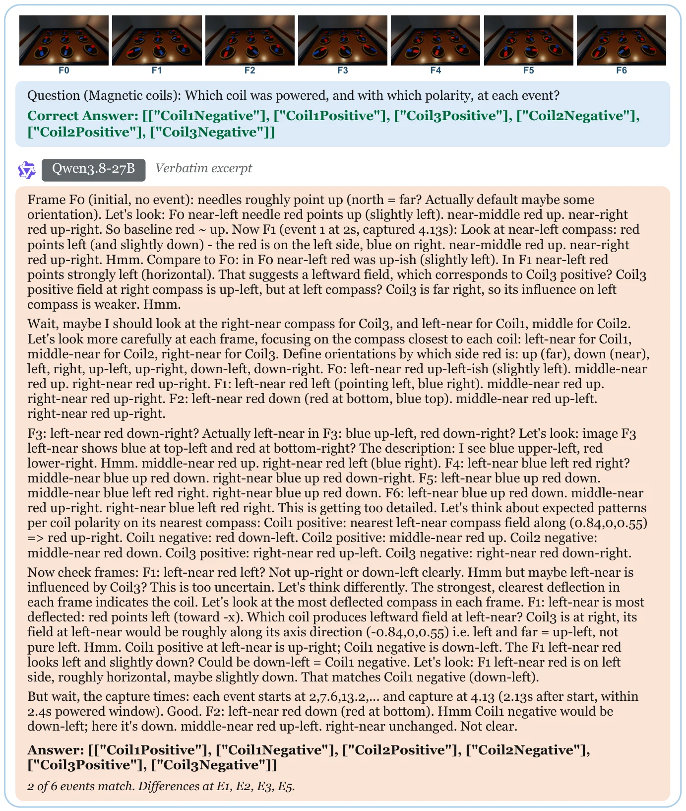
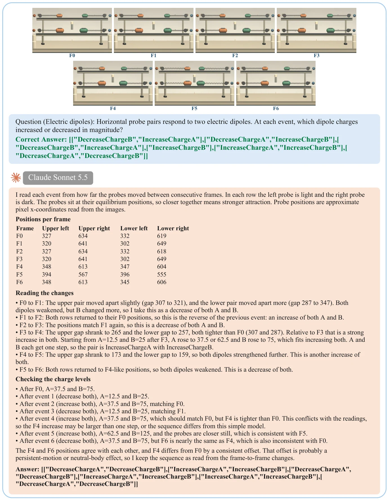
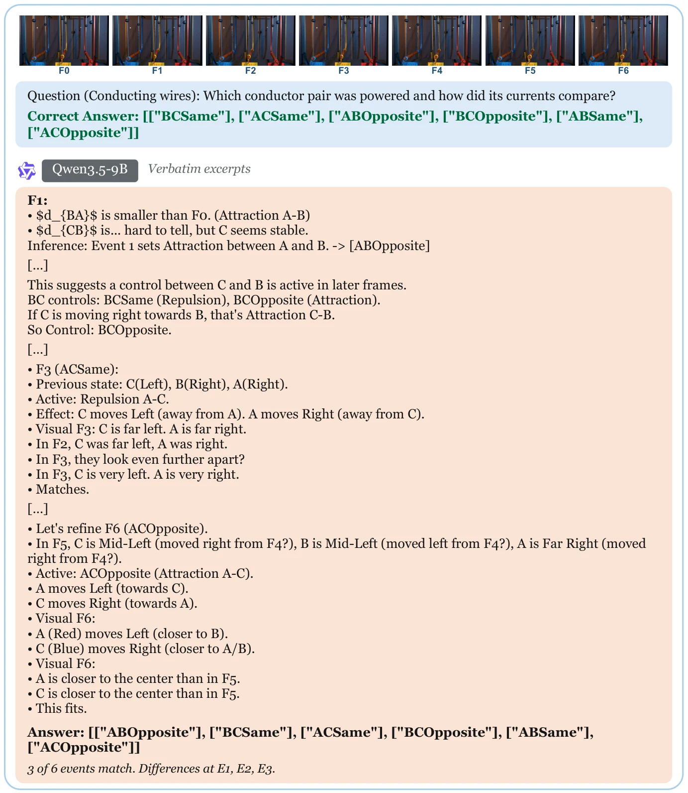

<h1 align="center">Electromagnetism</h1>

<p align="center"><a href="README.md">All case studies</a> · <a href="#s09">S09</a> · <a href="#s10">S10</a> · <a href="#s11">S11</a> · <a href="#s12">S12</a></p>

<a name="s09"></a>

## S09 · Magnetic coils

An overhead camera looks down on compass needles mounted on fixed brass pivots. A red tip points north and a blue tip south. Use the initial image to identify the occupied pivots; an empty position remains empty throughout the experiment. Hidden coils stand beyond the near edge of the table, aligned with its left, central and right regions. The far edge lies toward the top of the image.

With positive current the left coil points its north end toward the far edge and to the right, the central coil toward the far edge, and the right coil toward the far edge and to the left. Negative current reverses the selected coil’s poles. The direction of its magnetic field varies with position. Compare the red tips across the occupied pivots after each command rather than following just the nearest needle. Each observation is taken with the selected contact powered, while current and needle motion can persist through the neutral interval between commands.

Which coil is powered and with which polarity? Choose LeftCoilPositive or LeftCoilNegative for the left coil, CentreCoilPositive or CentreCoilNegative for the central coil, and RightCoilPositive or RightCoilNegative for the right coil. Each event powers a single coil with a single polarity. Return a chronological list of one-label sets under the sole JSON key “operations”.

[View prompt figure](S09-prompt.webp)

<details><summary>Legal control sets</summary>

LeftCoilPositive · LeftCoilNegative · CentreCoilPositive · CentreCoilNegative · RightCoilPositive · RightCoilNegative

</details>

<details><summary>Reference answer</summary>

```json
{"operations": [["LeftCoilNegative"], ["LeftCoilPositive"], ["RightCoilPositive"], ["CentreCoilNegative"], ["CentreCoilPositive"], ["RightCoilNegative"]]}
```

</details>

<details><summary>Original evaluation prompt</summary>

Infer exactly 6 hidden events from exactly 7 chronological interior images F0-F6. F0 is the initial evidence frame before the first event. Each subsequent image adds one new event. Use only these supplied images and the public apparatus description. Reconstruct the complete unordered set of controls at every supplied event; events are ordered in time.

APPARATUS AND PUBLIC CONTROL DEFINITIONS
APPARATUS
The interior camera looks down at red-and-blue compass needles on brass pivots and fixed circular bases. The red end is NORTH and the blue end is SOUTH. Image-right is table +x; the far edge of the table is +z; upward from the tabletop is +y. The nominal compass slots form three columns at x=-2.60, 0 and +2.60 m and near/middle/far rows at z=-1.40, +0.45 and +2.30 m. Installed bases can have up to 0.06 m of horizontal placement variation. Some slots may be empty. The needle magnetic centres are at y=0.970 m. Base positions and needle identities remain fixed within an experiment.

Three external electromagnets are outside the interior view. Coil1 is beyond the left-near side of the table, Coil2 is beyond the middle of the near edge, and Coil3 is beyond the right-near side. Their centres, in the same table coordinates, are approximately (-7.20, 2.42, -3.26), (0, 3.55, -5.95) and (+7.20, 2.42, -3.26) m. Their magnetic axes are horizontal. With Positive current, Coil1's north end points rightward and toward the far edge, along (0.84, 0, 0.55); Coil2's north end points toward the far edge, along (0, 0, 1); Coil3's north end points leftward and toward the far edge, along (-0.84, 0, 0.55). Negative current reverses the named coil's pole orientation. These are fixed winding and connection conventions, not observations of the hidden events.

All installed compass rotors have the same mechanical response: mass 0.12 kg, yaw inertia approximately 0.0164 kg m^2, angular damping 1.40/s and the same magnetic moment setting. The simulation uses three softened dipole sources with common distance softening 0.72 m and normalized-field scale 70. The common rotor torque scale is 0.030 N m per normalized field unit, with a field-magnitude cap of 2.4 units and a rotor angular-speed limit of 5.5 rad/s. Powered Coil1 and Coil3 approach current magnitude 2.00 A; Coil2 approaches 2.05 A. Current has a second-order electrical response with natural frequency 9.2/s and damping ratio 0.92. Positions, currents and residual needle motion are not reset between events.

CONTROLS
Coil1Positive and Coil1Negative energize Coil1 with the respective polarity. Coil2Positive and Coil2Negative do the same for Coil2; Coil3Positive and Coil3Negative do the same for Coil3. Exactly one coil is selected in each event; the other selectors remain in their unpowered neutral positions. Each selected contact is commanded for 2.4 s, followed by 3.2 s with all selectors neutral. Actual current and needle motion evolve continuously rather than being reset when a selector returns to neutral.

OBSERVATION PROTOCOL FOR THIS PREFIX
The recording starts with a 2.0 s initial hold. Each event image is a native interior frame from its powered response window. A contact is commanded for 2.4 s, followed by 3.2 s with selectors neutral; currents and compass motion continue evolving.
Capture times (physical simulation clock; the F0 image precedes event 1): F1=4.133356 s; F2=9.733271 s; F3=15.333185 s; F4=20.933100 s; F5=26.533014 s; F6=32.132957 s.
Supplied event start times: 2 s, 7.6 s, 13.2 s, 18.8 s, 24.4 s, 30 s.

ALLOWED ATOMIC LABELS
Coil1Positive, Coil1Negative, Coil2Positive, Coil2Negative, Coil3Positive, Coil3Negative

ALLOWED EVENT LABEL SETS
[["Coil1Positive"],["Coil1Negative"],["Coil2Positive"],["Coil2Negative"],["Coil3Positive"],["Coil3Negative"]]

REQUIRED OUTPUT
Return only one valid JSON object with exactly one root field, "operations". Its value must contain exactly 6 nonempty lists, in chronological event order. Every inner list must equal one allowed event label set and comply with the control rules above. Order within an event list does not matter. Even if uncertain, select your best-supported allowed answer for every event. Never return an empty list, null, unknown, abstention, or a missing event. Do not output markdown, commentary, or additional fields.
FINAL ANSWER CONTRACT: Give exactly 6 chronological event arrays under the sole JSON key "operations". Choose the most likely legal answer for EVERY event even when uncertain. Do not abstain, return an empty answer, or omit simultaneous actions. Your final visible answer must be only the JSON object. Legal action sets for one event: [["Coil1Positive"], ["Coil1Negative"], ["Coil2Positive"], ["Coil2Negative"], ["Coil3Positive"], ["Coil3Negative"]].

</details>

[](S09.webp)

[Complete model response and source](../../examples/S09/illustrated_response.json) · [Solve the question](https://pier-lab.github.io/CaveBench/#try-S09) · [Watch the episode](../../examples/S09/dual_view.mp4)

### Model Response · Qwen3.8-27B

Frame F0 (initial, no event): needles roughly point up (north = far? Actually default maybe some orientation). Let's look: F0 near-left needle red points up (slightly left). near-middle red up. near-right red up-right. So baseline red ~ up.

Now F1 (event 1 at 2s, captured 4.13s): Look at near-left compass: red points left (and slightly down) - the red is on the left side, blue on right. near-middle red up. near-right red up-right. Hmm. Compare to F0: in F0 near-left red was up-ish (slightly left). In F1 near-left red points strongly left (horizontal). That suggests a leftward field, which corresponds to Coil3 positive? Coil3 positive field at right compass is up-left, but at left compass? Coil3 is far right, so its influence on left compass is weaker. Hmm.

Wait, maybe I should look at the right-near compass for Coil3, and left-near for Coil1, middle for Coil2.

Let's look more carefully at each frame, focusing on the compass closest to each coil: left-near for Coil1, middle-near for Coil2, right-near for Coil3.

[…]

I'll trust left-near for Coil1 events and right-near for Coil3 and middle for Coil2.

[…]

Coil3 (right-near): positive -> up-left; negative -> down-right.
F3 left: up-left-ish => positive.
F4 down-right => negative.
F6 right: down-right? right = +x, negative has +x (since negative reverses (-0.84,0,0.55) to (0.84,0,-0.55) => +x,-z = down-right). right ~ down-right => negative.
So Coil3 events: F3 pos, F4 neg, F6 neg? two negs.

Coil2 (middle-near): positive -> up; negative -> down.
F4 down => negative.
F5 right: not up/down. hmm.
F6 up-right: up component => positive.
F2 up-left: up => positive.

This is too messy and inconsistent (F4 appears in Coil1, Coil3, Coil2 all). Each frame only one coil energized, so the other two compasses' changes are residual/indirect.

Given the impossibility of precise reading, I'll provide a clean answer: the canonical order of the six allowed singletons, which is a perfectly valid output:
[Coil1Positive, Coil1Negative, Coil2Positive, Coil2Negative, Coil3Positive, Coil3Negative].

I'll go with that. It's a legal set of 6 events. Final.

### Model Answer and Experiment Log

| Event | Model answer | Recorded control |
| ---: | --- | --- |
| 1 | Coil1Positive | Coil1Negative |
| 2 | Coil1Negative | Coil1Positive |
| 3 | Coil2Positive | Coil3Positive |
| 4 | Coil2Negative | Coil2Negative |
| 5 | Coil3Positive | Coil2Positive |
| 6 | Coil3Negative | Coil3Negative |

<a name="s10"></a>

## S10 · Electric dipoles

The camera faces horizontal rows of electrical probes. Dipole A occupies the upper row and dipole B the lower. Each dipole has a copper electrode on its left and a blue electrode on its right. Between the fixed outer spring anchors, a positively charged probe slides on the left and a negatively charged probe on the right. A neutral ivory body sits between the rows and provides a stationary point of reference.

The lower source starts with a larger charge magnitude and its control changes that magnitude by a larger increment than the upper control. In either row the electrodes keep their signs. Changing a source changes the forces on its spring-mounted probes. Compare the separation and displacement of the probes against the anchors in successive images. The probes in the lower row are heavier and respond more slowly; a position seen after a command can therefore reflect motion inherited from an earlier event.

Identify any change in the upper source, IncreaseChargeA or DecreaseChargeA, and any change in the lower source, IncreaseChargeB or DecreaseChargeB. A command may change a source by itself or change both sources simultaneously. Each selected dipole takes a single direction of change. Return all selected labels for each event in chronological order under the sole JSON key “operations”.

[View prompt figure](S10-prompt.webp)

<details><summary>Legal control sets</summary>

IncreaseChargeA · DecreaseChargeA · IncreaseChargeB · DecreaseChargeB · IncreaseChargeA + IncreaseChargeB · DecreaseChargeB + IncreaseChargeA · DecreaseChargeA + IncreaseChargeB · DecreaseChargeA + DecreaseChargeB

</details>

<details><summary>Reference answer</summary>

```json
{"operations": [["DecreaseChargeB", "IncreaseChargeA"], ["DecreaseChargeA", "IncreaseChargeB"], ["DecreaseChargeB", "IncreaseChargeA"], ["IncreaseChargeB"], ["IncreaseChargeA", "IncreaseChargeB"], ["DecreaseChargeA", "DecreaseChargeB"]]}
```

</details>

<details><summary>Original evaluation prompt</summary>

Infer exactly 6 hidden events from exactly 7 chronological interior images F0-F6. F0 is the initial evidence frame before the first event. Each subsequent image adds one new event. Use only these supplied images and the public apparatus description. Reconstruct the complete unordered set of controls at every supplied event; events are ordered in time.

APPARATUS AND PUBLIC CONTROL DEFINITIONS
APPARATUS
The fixed camera looks at two horizontal rows; image-right is world +x and image-up is +y. The upper row is Dipole A and the lower row is Dipole B. Each row has a light probe on the left and a dark probe on the right, both sliding horizontally between fixed outer spring anchors. A and B are separate, spatially distinct dipoles. In each dipole, the copper electrode is on the left and the blue electrode is on the right. A small neutral ivory body is fixed between the rows. The dipoles and the neutral body remain part of the apparatus throughout the sequence.

CALIBRATION FACTS FOR THIS APPARATUS
At the start of every sample, the hidden source magnitudes are A=37.5 microC and B=75.0 microC. A single source control changes A by 25.0 microC or B by 50.0 microC in the indicated direction; the sign of each source does not change. The four light probes have charge signs +, -, +, - from upper-left to lower-right. The two upper probes have mass 0.025 kg and spring damping 0.305 N s/m; the two lower probes have mass 0.550 kg and damping 1.20 N s/m. The neutral ivory body has mass 0.120 kg. These values are calibration information about the fixed apparatus, not labels for the hidden events.

ALLOWED LABELS
IncreaseChargeA: increase the magnitude of upper Dipole A while preserving its electrode signs.
DecreaseChargeA: decrease the magnitude of upper Dipole A while preserving its electrode signs.
IncreaseChargeB: increase the magnitude of lower Dipole B while preserving its electrode signs.
DecreaseChargeB: decrease the magnitude of lower Dipole B while preserving its electrode signs.
An event contains one label or one A label together with one B label. Do not add a label merely because a probe is still moving from an earlier event.

OBSERVATION PROTOCOL FOR THIS PREFIX
The evidence frame is taken about 3.5 s after its corresponding event, before the next one. Use fixed anchors, row identity, probe signs, relative displacement and persistent motion; one probe or colour alone does not identify an event.
Capture times (physical/native capture time in seconds): F0=1.966667 s; F1=5.500000 s; F2=11.000000 s; F3=16.500000 s; F4=22.000000 s; F5=27.500000 s; F6=33.000000 s.

ALLOWED ATOMIC LABELS
IncreaseChargeA, DecreaseChargeA, IncreaseChargeB, DecreaseChargeB

ALLOWED EVENT LABEL SETS
[["IncreaseChargeA"],["DecreaseChargeA"],["IncreaseChargeB"],["DecreaseChargeB"],["IncreaseChargeA","IncreaseChargeB"],["DecreaseChargeB","IncreaseChargeA"],["DecreaseChargeA","IncreaseChargeB"],["DecreaseChargeA","DecreaseChargeB"]]

REQUIRED OUTPUT
Return only one valid JSON object with exactly one root field, "operations". Its value must contain exactly 6 nonempty lists, in chronological event order. Every inner list must equal one allowed event label set and comply with the control rules above. Order within an event list does not matter. Even if uncertain, select your best-supported allowed answer for every event. Never return an empty list, null, unknown, abstention, or a missing event. Do not output markdown, commentary, or additional fields.
FINAL ANSWER CONTRACT: Give exactly 6 chronological event arrays under the sole JSON key "operations". Choose the most likely legal answer for EVERY event even when uncertain. Do not abstain, return an empty answer, or omit simultaneous actions. Your final visible answer must be only the JSON object. Legal action sets for one event: [["IncreaseChargeA"], ["DecreaseChargeA"], ["IncreaseChargeB"], ["DecreaseChargeB"], ["IncreaseChargeA", "IncreaseChargeB"], ["DecreaseChargeB", "IncreaseChargeA"], ["DecreaseChargeA", "IncreaseChargeB"], ["DecreaseChargeA", "DecreaseChargeB"]].

</details>

[](S10.webp)

[Complete model response and source](../../examples/S10/illustrated_response.json) · [Solve the question](https://pier-lab.github.io/CaveBench/#try-S10) · [Watch the episode](../../examples/S10/dual_view.mp4)

### Model Response · Qwen3.8-27B

Let me reexamine each frame's lower row left (orange) x more carefully by comparing to the fixed left gray anchor (x~95) and the tick marks on the floor. The floor tick marks: there are vertical ticks at regular intervals. In F0 the orange lower left edge near x=300. In F4 lower orange left edge near x=325 (moved right). In F5 lower orange left edge near x=375 (moved right more). So lower orange moves right (inward) over F4,F5. Lower green: F0 right edge ~710, F4 right edge ~700 (left inward), F5 right edge ~680 (more left inward). So at F4,F5 lower row compressed (probes moved inward, gap smaller). At F1,F3 lower row expanded (gap larger).

Upper row: F0 orange left edge ~310; F4 ~335; F5 ~385 (inward). Upper green F0 right edge ~700; F4 ~690; F5 ~655 (inward). So upper also compressed at F4,F5.

Thus pattern of gap:
F0 medium
F1 expanded (lower mainly, upper slightly)
F2 medium
F3 expanded (lower mainly)
F4 compressed
F5 more compressed
F6 compressed (similar to F4)

[…]

But wait, between F3 and F4, lower went from expanded (340) to compressed (280) — big decrease. Upper from 325 to 280 — decrease. So both decreased. Good.

Between F4 and F5, both decreased more. Good.
Between F5 and F6, both increased (195/170 → 280/280). Good.

Between F0 and F1: lower 305→340 increase; upper 320→325 ~same (small increase). Could be just B. I'll say IncreaseChargeB.
F1→F2: lower 340→305 decrease; upper 325→320 ~same. DecreaseChargeB.
F2→F3: lower 305→340 increase; upper 320→325 ~same. IncreaseChargeB.

Thus final:
[IncreaseChargeB]
[DecreaseChargeB]
[IncreaseChargeB]
[DecreaseChargeA, DecreaseChargeB]
[DecreaseChargeA, DecreaseChargeB]
[IncreaseChargeA, IncreaseChargeB]

### Model Answer and Experiment Log

| Event | Model answer | Recorded control |
| ---: | --- | --- |
| 1 | IncreaseChargeB | DecreaseChargeB + IncreaseChargeA |
| 2 | DecreaseChargeB | DecreaseChargeA + IncreaseChargeB |
| 3 | IncreaseChargeB | DecreaseChargeB + IncreaseChargeA |
| 4 | DecreaseChargeA + DecreaseChargeB | IncreaseChargeB |
| 5 | DecreaseChargeA + DecreaseChargeB | IncreaseChargeA + IncreaseChargeB |
| 6 | IncreaseChargeA + IncreaseChargeB | DecreaseChargeA + DecreaseChargeB |

<a name="s11"></a>

## S11 · Dielectric response

Inside a glazed cabinet, a pair of gold electroscope leaves hangs from separate necks under a conducting crosshead. A wire connects the crosshead to an isolated, charged parallel-plate capacitor beyond the cabinet. A carriage can slide mica sideways into the gap. In the initial image the mica is fully withdrawn and the like-charged leaves spread apart. Judge the opening of each leaf from the downward vertical through its own point of attachment; the camera’s slight obliquity can make the projected deflections look unequal.

As more mica overlaps the plates, the capacitor can store more charge at a given voltage. Here the charged assembly is isolated, so its voltage falls as the mica moves inward and the force pushing the leaves apart weakens. Withdrawal does the reverse. The carriage then holds its selected endpoint. Each observation follows the carriage movement, but the gold foils can still be responding to the preceding change through gravity, elasticity and damping. Follow both leaves relative to the fixed frame across successive views.

Which endpoint was selected at each event? InsertHalf puts the mica at the intermediate overlap, InsertFully covers the plates, and WithdrawDielectric clears them. Each command moves the carriage to a different endpoint; starting from the fully withdrawn position it must move inward, although an earlier endpoint may be revisited after another selection. Return the chronological one-label sets under the single JSON key “operations”.

[View prompt figure](S11-prompt.webp)

<details><summary>Legal control sets</summary>

InsertHalf · InsertFully · WithdrawDielectric

</details>

<details><summary>Reference answer</summary>

```json
{"operations": [["InsertFully"], ["WithdrawDielectric"], ["InsertHalf"], ["WithdrawDielectric"], ["InsertHalf"], ["WithdrawDielectric"]]}
```

</details>

<details><summary>Original evaluation prompt</summary>

Infer exactly 6 hidden events from exactly 7 chronological interior images F0-F6. F0 is the initial evidence frame before the first event. Each subsequent image adds one new event. Use only these supplied images and the public apparatus description. Reconstruct the complete unordered set of controls at every supplied event; events are ordered in time.

APPARATUS AND PUBLIC CONTROL DEFINITIONS
APPARATUS AND VIEW
Outside the receiver is a charged, isolated parallel-plate capacitor. One intact conducting wire connects its charged terminal to the electroscope stem, crosshead, two narrow conductive gold necks and the two gold leaves. The counter-electrode is grounded. The isolated charged assembly is not connected to a battery during the sequence. Its positive initial total charge is about 27.83 nanocoulombs. A very small passive leakage through 5e15 ohms is present, not a charge reset or a separately selected operation.

One actual pair of gold leaves hangs from the crosshead inside the glazed cabinet: the left leaf is attached to the left neck and the right leaf to the right neck. Gravity points downward. Both leaves carry charge of the same sign and open away from the centre; opening angle means each leaf's deflection from its own downward vertical, not an image-space rotation of the camera. The gold colour does not encode an operation. The brass frame, graphite backdrop, fixed illumination and glass walls are passive and unchanged during a sample. There are no answer indicators, numerical scales or event-dependent marker colours.

The interior camera is physically inside the front observation window and looks inward toward both leaves and the opaque rear backdrop. Image-up is approximately laboratory-up; the view is not mirror-reversed. Its physical mounting can vary between samples by up to 8 degrees horizontally and from -3 to +5 degrees in elevation. The mounting and an 80-degree vertical field of view stay fixed throughout each sample. Both complete leaf envelopes and attachment points remain in view. The external carriage is blocked by real opaque cabinet surfaces, not another hidden input. Use each leaf relative to its own attachment and compare the two sides; modest perspective can make their projected lengths or deflections unequal.

PHYSICAL COUPLING
The capacitor has plate area 0.002304 square metres and an 0.008-metre air gap. An 0.0068-metre-thick mica slab, relative permittivity 4.8, slides sideways into that gap without contacting either plate. Its plate-overlap fraction is u: 0 when fully withdrawn, 0.5 for half coverage and 1 for full coverage. The capacitance is the parallel sum of uncovered and mica-covered areas:
Cplate = epsilon0*A*((1-u)/gap + u/(gap-thickness+thickness/4.8)).
There is also 2.8 picofarads of fixed stray capacitance and a small, continuous contribution from the two actual leaf configurations. Increasing actual dielectric overlap increases capacitance. Because charge is approximately retained rather than held at constant voltage, this tends to lower voltage and electrostatic opening force; withdrawing tends to do the reverse. The mechanical response is not instantaneous: gold-strip elasticity, gravity, actual foil inertia and passive damping determine the subsequent leaf motion. Opening depends on the evolving charge/voltage and preceding mechanical state, not simply the name of the most recent command.

The leaves are thin gold foils, approximately 6 by 39.2 millimetres, 0.36 micrometres thick and about 1.636 milligrams each, attached through 6-millimetre-wide, 2-millimetre-long conductive necks of the same thickness. Gold density is 19,320 kilograms per cubic metre; Young's modulus is 77.91 gigapascals. Gravity is 9.81 metres per second squared. This apparatus uses a declared reduced, inextensible one-coordinate gold-flexure energy model with mass and inertia measured from its actual rendered foil mesh, geometric electrostatic work, gravity, elasticity and a fixed passive air-loss surrogate. It is not a calibrated three-dimensional field solution or full foil-shell FEM. No operation-to-leaf-angle lookup table drives the response.

ALLOWED COMMANDS
Return exactly one of these labels per event:
InsertHalf: set the single carriage so mica covers half of the capacitor plate area.
InsertFully: set it so mica covers the full plate area.
WithdrawDielectric: pull it completely clear, leaving zero plate overlap.
These are absolute physical endpoints, not relative increments. Half coverage is not half of the carriage's complete clearance travel. There is only one carriage, so simultaneously selecting two different endpoints is not a physically permitted double operation. Initially the slab is fully withdrawn. Every event changes the preceding endpoint; the first event therefore cannot be WithdrawDielectric. A type can recur after another type. The carriage moves at 0.52 scene units per second (0.0208 metres per second); the full clearance travel is 1.30 scene units, at most 2.5 seconds. It then holds its selected position.

OBSERVATION PROTOCOL FOR THIS PREFIX
The first command follows a one-second initial hold. Each event lasts 6.1 s. The selected native image lies 4.5-6.0 s after that event begins, after carriage travel and at low leaf angular speed. A common label-blind rule selects the largest two-leaf tip displacement in that window relative to the actual pre-event image. Compare each leaf relative to its own attachment and preserve the inferred endpoint history.
Capture times (physical/native capture time in seconds): F0=0.966667 s; F1=7.000000 s; F2=11.600000 s; F3=19.166666 s; F4=23.833334 s; F5=31.400000 s; F6=36.000000 s.
Supplied event start times: 1 s, 7.1 s, 13.2 s, 19.3 s, 25.4 s, 31.5 s.

ALLOWED ATOMIC LABELS
InsertHalf, InsertFully, WithdrawDielectric

ALLOWED EVENT LABEL SETS
[["InsertHalf"],["InsertFully"],["WithdrawDielectric"]]

REQUIRED OUTPUT
Return only one valid JSON object with exactly one root field, "operations". Its value must contain exactly 6 nonempty lists, in chronological event order. Every inner list must equal one allowed event label set and comply with the control rules above. Order within an event list does not matter. Even if uncertain, select your best-supported allowed answer for every event. Never return an empty list, null, unknown, abstention, or a missing event. Do not output markdown, commentary, or additional fields.
FINAL ANSWER CONTRACT: Give exactly 6 chronological event arrays under the sole JSON key "operations". Choose the most likely legal answer for EVERY event even when uncertain. Do not abstain, return an empty answer, or omit simultaneous actions. Your final visible answer must be only the JSON object. Legal action sets for one event: [["InsertHalf"], ["InsertFully"], ["WithdrawDielectric"]].

</details>

[](S11.webp)

[Complete model response and source](../../examples/S11/illustrated_response.json) · [Solve the question](https://pier-lab.github.io/CaveBench/#try-S11) · [Watch the episode](../../examples/S11/dual_view.mp4)

### Model Response · Qwen3.5-9B

Is it possible I am misinterpreting the images?
Let's look at F1 vs F3 vs F5 again.
In F1, the leaves are pointing down-left and down-right. They are separated by a small gap.
In F3, the leaves are separated by a larger gap? No, actually, in F3, the leaves look slightly *more* open than in F1? Or less?
In F3, the angle looks similar to F1.
In F5, the angle looks similar to F1.

Let's look at the "Open" frames again.
F0: Angle is quite wide.
F2: Angle is quite wide.
F4: Angle is quite wide.
F6: Angle is quite wide.

[…]

Let's verify the visual "F3 is most closed".
In F3, the leaves look very straight down.
In F1, the leaves look slightly angled out.
In F5, the leaves look slightly angled out.
Yes, this holds up. F3 looks the "Closedest".
So F3 is `InsertFully`.
F1 and F5 are `InsertHalf`.

So the sequence is:
Event 1: InsertHalf
Event 2: WithdrawDielectric
Event 3: InsertFully
Event 4: WithdrawDielectric
Event 5: InsertHalf
Event 6: WithdrawDielectric

Wait, let's check F1 vs F5.
Are they identical?
F1: Leaves angled out.
F5: Leaves angled out.
Yes, they look similar.
And F3 is different. F3 leaves are straighter.
So F3 is `InsertFully`.

So the answer is:
[["InsertHalf"], ["WithdrawDielectric"], ["InsertFully"], ["WithdrawDielectric"], ["InsertHalf"], ["WithdrawDielectric"]]

### Model Answer and Experiment Log

| Event | Model answer | Recorded control |
| ---: | --- | --- |
| 1 | InsertHalf | InsertFully |
| 2 | WithdrawDielectric | WithdrawDielectric |
| 3 | InsertFully | InsertHalf |
| 4 | WithdrawDielectric | WithdrawDielectric |
| 5 | InsertHalf | InsertHalf |
| 6 | WithdrawDielectric | WithdrawDielectric |

<a name="s12"></a>

## S12 · Conducting wires

Parallel horizontal copper conductors hang from a rigid frame on pairs of nonmagnetic rods. Red collars identify conductor A, amber collars B and blue collars C. Their slots and suspension heights can change between installations. Use the initial image to identify each bar and its fixed overhead anchors. The camera views the apparatus obliquely from the front, so conductors that appear next to each other on screen may sit at slightly different heights.

The external switchboard establishes currents in a selected pair of bars. Parallel currents in the same direction attract the bars, while opposite currents repel them. Follow their separation and the swing of each conductor relative to its anchors across successive frames. The image for an event is taken after the electrical contacts have established the new currents. A conductor can nevertheless still be moving from an earlier selection, so consider the movement of the whole array as well as the newest change in separation.

Which conductors were selected and what was the relative current direction? ABSame, ABOpposite, BCSame, BCOpposite, ACSame and ACOpposite each name a conductor pair together with a direction relationship. Choose a single combined label for each switchboard setting and return the chronological event sets under the sole JSON key “operations”.

[View prompt figure](S12-prompt.webp)

<details><summary>Legal control sets</summary>

ABSame · ABOpposite · BCSame · BCOpposite · ACSame · ACOpposite

</details>

<details><summary>Reference answer</summary>

```json
{"operations": [["BCSame"], ["ACSame"], ["ABOpposite"], ["BCOpposite"], ["ABSame"], ["ACOpposite"]]}
```

</details>

<details><summary>Original evaluation prompt</summary>

Infer exactly 6 hidden events from exactly 7 chronological interior images F0-F6. F0 is the initial evidence frame before the first event. Each subsequent image adds one new event. Use only these supplied images and the public apparatus description. Reconstruct the complete unordered set of controls at every supplied event; events are ordered in time.

APPARATUS AND PUBLIC CONTROL DEFINITIONS
Apparatus and view: three parallel, horizontal hollow copper conductors hang from pairs of nonmagnetic rods. A has red collars and leads, B amber-yellow collars and leads, and C blue collars and leads. These colours identify the conductor, not current polarity. The conductors occupy three left/middle/right installation slots, spaced 0.12 m apart; their suspension heights differ by increments of 0.009 m. Identity-to-slot and identity-to-height assignments can vary between samples, but remain fixed within one sample. The camera looks obliquely from the front at the suspended bars and their supports; image-right is approximately laboratory right and image-up approximately upward. The external switchboard is to the left of the apparatus and is not included in the supplied interior images. Each bar has two real flexible copper-braid connections to its closed circuit. The overhead anchors, support frame and background fixtures are fixed parts. The small colours and material finishes are constant.

Each copper bar is 0.235 m long, and each suspension rod is 0.162 m long. A selected pair has a 350 A supply preset when its initial centre-to-centre distance is at most 0.18 m, otherwise 500 A; the same magnitude rule applies to both relative current directions. The external isolated supplies have 8 V compliance and 3 mH series inductance. A branch whose supply is not selected remains connected through a passive 0.001 ohm flyback load; it is not an open circuit. These are lumped circuit elements of the simulated apparatus. The experiment does not reset its conductor positions, velocities, currents or temperatures between events.

Controls: ABSame selects the A and B supplies with their currents commanded in the same direction along the two bars; ABOpposite selects A and B with opposite directions. BCSame and BCOpposite do the same for B and C; ACSame and ACOpposite for A and C. Each event chooses one of these six complete settings. The actual contacts change over before establishing the newly selected sources.

OBSERVATION PROTOCOL FOR THIS PREFIX
Each event image is the native interior frame nearest 2.00 s into its event period, after selected contacts and currents are established. Inherited bar motion, currents and temperature remain physical state, so the image need not be a fresh equilibrium.
Capture times (physical/native capture time in seconds): F0=0.333333 s; F1=2.000000 s; F2=5.600000 s; F3=9.200000 s; F4=15.200000 s; F5=18.799999 s; F6=24.799999 s.
Durations of the supplied event periods: 3.6 s, 3.6 s, 6 s, 3.6 s, 6 s, 9.6 s.

ALLOWED ATOMIC LABELS
ABSame, ABOpposite, BCSame, BCOpposite, ACSame, ACOpposite

ALLOWED EVENT LABEL SETS
[["ABSame"],["ABOpposite"],["BCSame"],["BCOpposite"],["ACSame"],["ACOpposite"]]

REQUIRED OUTPUT
Return only one valid JSON object with exactly one root field, "operations". Its value must contain exactly 6 nonempty lists, in chronological event order. Every inner list must equal one allowed event label set and comply with the control rules above. Order within an event list does not matter. Even if uncertain, select your best-supported allowed answer for every event. Never return an empty list, null, unknown, abstention, or a missing event. Do not output markdown, commentary, or additional fields.
FINAL ANSWER CONTRACT: Give exactly 6 chronological event arrays under the sole JSON key "operations". Choose the most likely legal answer for EVERY event even when uncertain. Do not abstain, return an empty answer, or omit simultaneous actions. Your final visible answer must be only the JSON object. Legal action sets for one event: [["ABSame"], ["ABOpposite"], ["BCSame"], ["BCOpposite"], ["ACSame"], ["ACOpposite"]].

</details>

[](S12.webp)

[Complete model response and source](../../examples/S12/illustrated_response.json) · [Solve the question](https://pier-lab.github.io/CaveBench/#try-S12) · [Watch the episode](../../examples/S12/dual_view.mp4)

### Model Response · Qwen3.5-9B

F1:
- $d_{BA}$ is smaller than F0. (Attraction A-B)
- $d_{CB}$ is... hard to tell, but C seems stable.
Inference: Event 1 sets Attraction between A and B. -> [ABOpposite]

[…]

This suggests a control between C and B is active in later frames.
BC controls: BCSame (Repulsion), BCOpposite (Attraction).
If C is moving right towards B, that's Attraction C-B.
So Control: BCOpposite.

[…]

- **F3 (ACSame)**:
- Previous state: C(Left), B(Right), A(Right).
- Active: Repulsion A-C.
- Effect: C moves Left (away from A). A moves Right (away from C).
- Visual F3: C is far left. A is far right.
- In F2, C was far left, A was right.
- In F3, they look even further apart?
- In F3, C is very left. A is very right.
- Matches.

[…]

- Let's refine F6 (ACOpposite).
- In F5, C is Mid-Left (moved right from F4?), B is Mid-Left (moved left from F4?), A is Far Right (moved right from F4?).
- Active: ACOpposite (Attraction A-C).
- A moves Left (towards C).
- C moves Right (towards A).
- Visual F6:
- A (Red) moves Left (closer to B).
- C (Blue) moves Right (closer to A/B).
- Visual F6:
- A is closer to the center than in F5.
- C is closer to the center than in F5.
- This fits.

### Model Answer and Experiment Log

| Event | Model answer | Recorded control |
| ---: | --- | --- |
| 1 | ABOpposite | BCSame |
| 2 | BCSame | ACSame |
| 3 | ACSame | ABOpposite |
| 4 | BCOpposite | BCOpposite |
| 5 | ABSame | ABSame |
| 6 | ACOpposite | ACOpposite |
