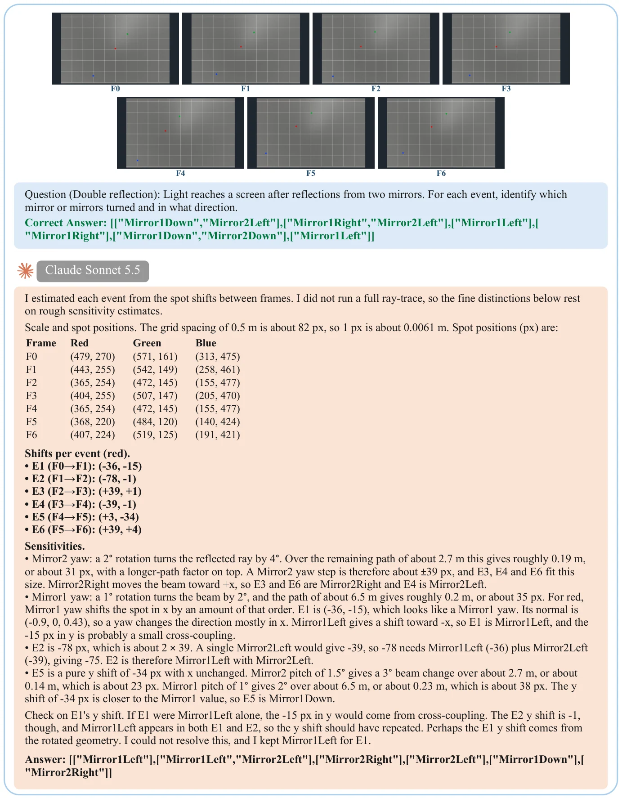
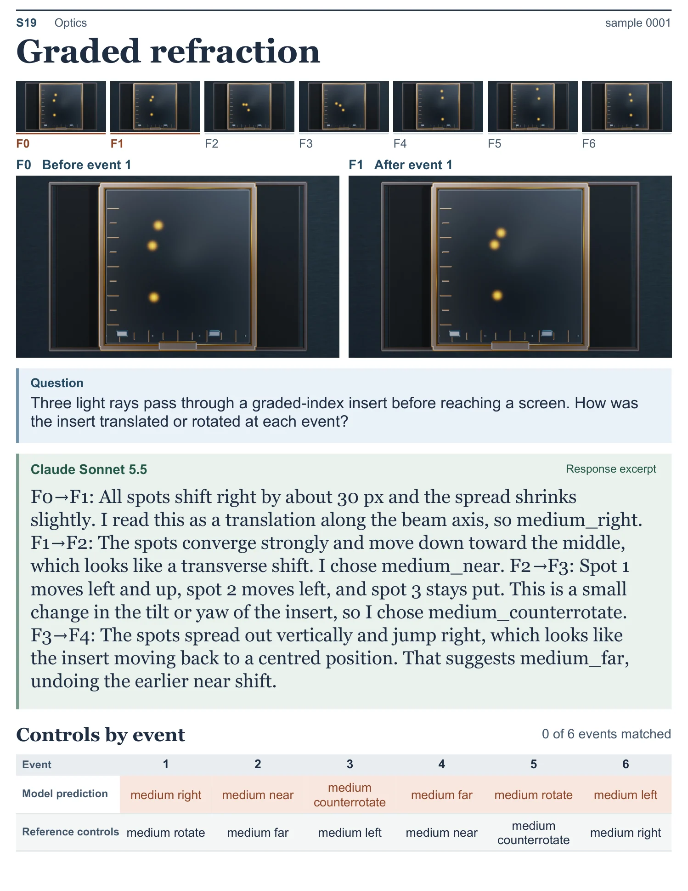

<h1 align="center">Optics</h1>

<p align="center"><a href="README.md">All case studies</a> · <a href="#s17">S17</a> · <a href="#s18">S18</a> · <a href="#s19">S19</a> · <a href="#s20">S20</a></p>

<a name="s17"></a>

## S17 · Photoelastic load

A fixed camera looks through crossed polarizers at a press holding transparent specimens of different shapes. Locate the narrow-waisted dogbone, the arch and the perforated disk in the initial view; their order can vary. The upper crosshead presses them against a fixed lower anvil. A narrow optical strip above the crosshead lies outside the load path. Its material axes turn progressively across its width, giving the camera a reference for the orientation of the shared polarizers.

A turn of the polarizers changes the strip’s brightness pattern as well as the appearance of the specimens. A change in press load changes stress in the specimens but leaves the strip optically unchanged. Compare these responses from one observation to the next, following the patterns around the neck, arch legs and hole. The dogbone responds fastest and the disk retains stress longest. Images are taken after the drive ends, so colours or fringes left by an earlier load can persist.

Which single control was operated at each event? IncreaseLoad and DecreaseLoad change compression. RotateClockwise and RotateCounterclockwise describe turns viewed from outside the right wall, facing inward. A clockwise turn of that wheel increases the optical angle measured counterclockwise from image-right in the camera view; a counterclockwise turn decreases it. Give a single label per event and return the chronological sets under the sole JSON key “operations”.

[View prompt figure](S17-prompt.webp)

<details><summary>Legal control sets</summary>

IncreaseLoad · DecreaseLoad · RotateClockwise · RotateCounterclockwise

</details>

<details><summary>Reference answer</summary>

```json
{"operations": [["IncreaseLoad"], ["RotateCounterclockwise"], ["RotateClockwise"], ["RotateCounterclockwise"], ["DecreaseLoad"], ["RotateCounterclockwise"]]}
```

</details>

<details><summary>Original evaluation prompt</summary>

Infer exactly 6 hidden events from exactly 7 chronological interior images F0-F6. F0 is the initial evidence frame before the first event. Each subsequent image adds one new event. Use only these supplied images and the public apparatus description. Reconstruct the complete unordered set of controls at every supplied event; events are ordered in time.

APPARATUS AND PUBLIC CONTROL DEFINITIONS
The complete optical calibration module is mounted 0.50 m forward of its original backplate plane so that the opaque loading beams do not block it. This is a fixed physical installation, not a display overlay or selectively hidden beam. The camera framing includes this upper reference and all three specimens.

Apparatus and camera. A fixed camera inside the enclosure faces the rear optical bench nearly straight on, from a slightly elevated position. Apparatus +x is image-right, +y is upward, and +z points away from the camera. Three separate framed transparent specimens stand between upper and lower loading pads: a narrow-waisted dogbone, an arch with two legs, and a circular disk with a central hole. All three are present, but their left-to-right order varies between samples. Identify them by shape in F0 rather than assuming a fixed order. A shared upper press crosshead moves their upper pads; their lower pads remain on the fixed anvil. A fourth, narrow horizontal optical calibration strip is mounted above the crosshead, centred over the specimens. It is not a fourth specimen under the press. Brass frames, the dark backplate, the bench, and fixed guide columns provide stationary references.

The optical arrangement uses a crossed polarizer/analyzer pair rotating together. The upper calibration strip has fixed birefringent retardance independent of press load, and a known slowly varying principal-axis direction from about 10 to 40 degrees counterclockwise from image-right across its left-to-right extent. Its changing brightness pattern is therefore a passive optical reference for the common polarizer angle, not a control lamp or answer display. The three loaded specimens additionally have shape-dependent stress concentration, principal-axis patterns and stress-relaxation histories. A material color is not a fixed operation code. In a plane polariscope, transmitted intensity depends on both the angle factor sin^2(2(theta-alpha)) and the stress-dependent retardance factor sin^2(delta/2), where theta is the local material principal-axis angle and alpha is the common optical-pair angle. Thus brightness or a particular hue alone is not a monotonic measure of load.

Allowed operations. each event applies exactly ONE of IncreaseLoad, DecreaseLoad, RotateClockwise, or RotateCounterclockwise. The first two increase or decrease the compressive load by moving the common press linkage. The last two turn the external right-wall optical-pair control wheel clockwise or counterclockwise as viewed from outside on the apparatus +x side, looking inward along -x. This is a side-view wheel convention, not clockwise motion of a specimen in the supplied camera image. The known linkage maps RotateClockwise to increasing alpha and RotateCounterclockwise to decreasing alpha; positive alpha is counterclockwise from image-right in the front-facing specimen optical coordinates. The initial alpha is 12 degrees. Each rotation changes it by approximately 38 degrees, including the short drive ramp, without wrapping. Each load command changes the normalized load by approximately 0.29, starting from 0.32. No specimen is translated to encode a rotation, and no event directly repaints an object. 

Physical response and model scope. The press is an ideal prescribed mechanical linkage, not a simulation of hydraulic-fluid flow. Load is measured from its actual crosshead displacement. This load drives a reduced-order viscoelastic response with different loading, unloading and memory time scales for the three shapes, and a shape-dependent analytical photoelastic rendering model; this is not a resolved finite-element stress solution. The dogbone responds fastest, the arch is intermediate and the perforated disk retains stress longest. Unloading need not instantly erase a colored pattern. The specimens also shorten slightly under compression while remaining seated between their pads. The upper reference strip has fixed retardance, so load-only operations do not change its optical state. Rotating the common optical pair affects both the reference strip and all three specimens, while retained specimen stress can continue relaxing. Compare the independent reference and loaded-specimen changes across frames rather than equating one object's color with a command. All states evolve continuously; neither press nor material memory is reset between events.

OBSERVATION PROTOCOL FOR THIS PREFIX
The first operation follows a 1.2 s initial hold. Each event has a 1.2 s drive and a 3.8 s observation period. The evidence image is selected from 0.5 s after that drive ends until shortly before the next drive. Frames need not represent mechanical or optical equilibrium; older stress can remain.
Capture times (physical simulation clock; the F0 image precedes event 1): F1=2.900010 s; F2=11.099916 s; F3=15.933176 s; F4=21.133097 s; F5=22.933069 s; F6=31.132944 s.
Supplied event start times: 1.2 s, 6.2 s, 11.2 s, 16.2 s, 21.2 s, 26.2 s.

ALLOWED ATOMIC LABELS
IncreaseLoad, DecreaseLoad, RotateClockwise, RotateCounterclockwise

ALLOWED EVENT LABEL SETS
[["IncreaseLoad"],["DecreaseLoad"],["RotateClockwise"],["RotateCounterclockwise"]]

REQUIRED OUTPUT
Return only one valid JSON object with exactly one root field, "operations". Its value must contain exactly 6 nonempty lists, in chronological event order. Every inner list must equal one allowed event label set and comply with the control rules above. Order within an event list does not matter. Even if uncertain, select your best-supported allowed answer for every event. Never return an empty list, null, unknown, abstention, or a missing event. Do not output markdown, commentary, or additional fields.
FINAL ANSWER CONTRACT: Give exactly 6 chronological event arrays under the sole JSON key "operations". Choose the most likely legal answer for EVERY event even when uncertain. Do not abstain, return an empty answer, or omit simultaneous actions. Your final visible answer must be only the JSON object. Legal action sets for one event: [["IncreaseLoad"], ["DecreaseLoad"], ["RotateClockwise"], ["RotateCounterclockwise"]].

</details>

[](S17.webp)

[Complete model response and source](../../examples/S17/illustrated_response.json) · [Solve the question](https://pier-lab.github.io/CaveBench/#try-S17) · [Watch the episode](../../examples/S17/dual_view.mp4)

### Model Response · Qwen3.8-27B

Setup: Three specimens left-to-right in F0: disk (left), arch (middle), dogbone (right). Wait, let me look. F0 left specimen is a circular disk with central hole. Middle is an arch (egg-shaped with two legs at bottom). Right is a narrow-waisted dogbone. Yes.

Upper calibration strip is at top (the brass-framed horizontal strip above crosshead). It has fixed retardance and slowly varying principal axis 10-40 deg CCW from image-right across left-to-right. Its brightness pattern is a passive reference for common polarizer angle alpha.

[…]

This is getting too uncertain. Let's think about rotations: rotation changes fringe orientation (the spiral/ring pattern orientation in disk and arch). The disk in F0 shows simple concentric (radial symmetric-ish) pattern. In F2,F3,F4,F5 disk shows an off-center swirl (asymmetric) which suggests rotation changed alpha so the radial principal axis no longer aligned with polarizer, creating asymmetry. In F1 disk shows concentric ring. In F6 disk returns to concentric (like F0).

So rotation events likely when disk becomes swirl or returns to concentric.

Sequence of disk pattern:
F0 concentric
F1 concentric (ring)
F2 swirl
F3 swirl
F4 swirl
F5 swirl
F6 concentric

[…]

E1 IncreaseLoad
E2 RotateCounterclockwise
E3 DecreaseLoad
E4 IncreaseLoad
E5 RotateClockwise
E6 DecreaseLoad

Check load: 0.32 ->0.61(E1) ->rot(E2,0.61) ->0.32(E3) ->0.61(E4) ->rot(E5,0.61) ->0.32(E6). Then F5 and F6 same load 0.61; dogbone F5 bright F6 faint mismatch but F6 similar to F0 (0.32) not 0.61. Hmm.

I'll just commit to:
[IncreaseLoad, RotateCounterclockwise, DecreaseLoad, IncreaseLoad, DecreaseLoad, RotateClockwise]

Rationale: rotations at 2 and 6 to return disk to concentric; loads alternate to vary intensity. Good enough.

Final JSON.

### Model Answer and Experiment Log

| Event | Model answer | Recorded control |
| ---: | --- | --- |
| 1 | IncreaseLoad | IncreaseLoad |
| 2 | RotateCounterclockwise | RotateCounterclockwise |
| 3 | DecreaseLoad | RotateClockwise |
| 4 | IncreaseLoad | RotateCounterclockwise |
| 5 | DecreaseLoad | DecreaseLoad |
| 6 | RotateClockwise | RotateCounterclockwise |

<a name="s18"></a>

## S18 · Double reflection

A fixed red ray, green ray and blue ray reach a flat receiver after reflecting from an upstream mirror and then a downstream mirror. The upstream mirror stands to the left of the downstream mirror. The camera is near the outgoing part of the optical path and looks toward the receiver; it sees the illuminated spots and the rectangular grid, while the mirrors and their supports are outside its field of view. In the initial image both stages are at their reference yaw and pitch settings. Identify the coloured spots against the grid and retain their identities throughout the sequence.

The red ray starts in line with the upstream mirror and travels straight downstream. The green source is lower and farther to the left, sending its ray upward and toward the right. The blue source is higher and farther to the right, sending its ray downward and toward the left. These distinct launch paths strike the same mirrors at different places. When the upstream mirror turns, it changes the outgoing direction and the point where each ray meets the downstream mirror; the rays must then reflect again before reaching the grid. When the downstream mirror turns alone, the incoming rays still follow their previous paths up to that mirror. A rightward yaw turns the downstream axis toward image-right; an upward pitch tips the selected mirror’s normal upward. The upstream mirror uses the same size of increment for yaw and pitch. The downstream mirror moves farther per command, and its yaw increment is larger than its pitch increment. Read horizontal and vertical spot shifts against the fixed grid, comparing the group displacement and changes in relative spacing. Each image follows completion of the commanded turn. An unselected axis retains its preceding orientation, so use the previous spot pattern as the starting point for the next comparison.

Which mirror turned, and in what direction? For the upstream stage choose UpstreamMirrorLeft, UpstreamMirrorRight, UpstreamMirrorUp or UpstreamMirrorDown. For the downstream stage choose DownstreamMirrorLeft, DownstreamMirrorRight, DownstreamMirrorUp or DownstreamMirrorDown. Each stage can take a single turn per event. A stage may act by itself, or both may turn simultaneously. Return every selected turn in chronological event sets under the sole JSON key “operations”.

[View prompt figure](S18-prompt.webp)

<details><summary>Legal control sets</summary>

UpstreamMirrorLeft · UpstreamMirrorRight · UpstreamMirrorUp · UpstreamMirrorDown · DownstreamMirrorLeft · DownstreamMirrorRight · DownstreamMirrorUp · DownstreamMirrorDown · UpstreamMirrorLeft + DownstreamMirrorLeft · UpstreamMirrorLeft + DownstreamMirrorRight · UpstreamMirrorLeft + DownstreamMirrorUp · UpstreamMirrorLeft + DownstreamMirrorDown · UpstreamMirrorRight + DownstreamMirrorLeft · UpstreamMirrorRight + DownstreamMirrorRight · UpstreamMirrorRight + DownstreamMirrorUp · UpstreamMirrorRight + DownstreamMirrorDown · UpstreamMirrorUp + DownstreamMirrorLeft · UpstreamMirrorUp + DownstreamMirrorRight · UpstreamMirrorUp + DownstreamMirrorUp · UpstreamMirrorUp + DownstreamMirrorDown · UpstreamMirrorDown + DownstreamMirrorLeft · UpstreamMirrorDown + DownstreamMirrorRight · UpstreamMirrorDown + DownstreamMirrorUp · UpstreamMirrorDown + DownstreamMirrorDown

</details>

<details><summary>Reference answer</summary>

```json
{"operations": [["UpstreamMirrorDown", "DownstreamMirrorLeft"], ["UpstreamMirrorRight", "DownstreamMirrorLeft"], ["UpstreamMirrorLeft"], ["UpstreamMirrorRight"], ["UpstreamMirrorDown", "DownstreamMirrorDown"], ["UpstreamMirrorLeft"]]}
```

</details>

<details><summary>Original evaluation prompt</summary>

Infer exactly 6 hidden events from exactly 7 chronological interior images F0-F6. F0 is the initial evidence frame before the first event. Each subsequent image adds one new event. Use only these supplied images and the public apparatus description. Reconstruct the complete unordered set of controls at every supplied event; events are ordered in time.

APPARATUS AND PUBLIC CONTROL DEFINITIONS
APPARATUS
Three fixed sources produce red, green and blue rays. Each ray travels from its source to Mirror1, then Mirror2, then one flat receiver screen. Mirror1 is left of and upstream of Mirror2; the screen is farther downstream. Both plane mirrors are 1.90 m wide and 1.40 m high and rotate about fixed centres without translating. The interior camera shows only the receiver screen and three spots, not the sources or mirrors. The screen grid spacing is 0.50 m. Colours distinguish rays, not operations.

Use the apparatus frame: +x is image-right, +y image-up, and +z downstream toward the screen. The screen centre is (0, 1.55, 4.532677) m; the camera faces approximately along +z with a small fixed calibration offset. Mirror1 is centred at (-1.20, 1.55, 0) m; Mirror2 at (1.00, 1.55, 1.80) m. Both stages have zero yaw and pitch at F0. Their oriented unit normals at zero are:
Mirror1: (-0.903670, 0.000000, 0.428230)
Mirror2: (0.964532, 0.000000, -0.263965)
The sources have these fixed positions in metres and unit launch directions:
Red: position (-1.200000, 1.550000, -3.000000); direction (-0.000000, 0.000000, 1.000000)
Green: position (-1.727366, 0.794434, -3.320348); direction (0.116074, 0.156897, 0.980770)
Blue: position (-0.455998, 2.598389, -2.467658); direction (-0.188286, -0.254505, 0.948565)
These rounded values specify the fixed apparatus, including geometry outside the camera view, not any event measurement.

CONTROLS
An event applies one action to one mirror, or one action on each mirror simultaneously. Mirror1's yaw and pitch increments are both 1.00 degree. Mirror2's yaw increment is 2.00 degrees and its pitch increment is 1.50 degrees. A selected stage completes its increment in 1.20 seconds; simultaneously selected stages start together. All settings accumulate without resets.

Mirror1Right and Mirror2Right increase the selected mirror's yaw about +y, the rotation taking +z toward +x; Mirror1Left and Mirror2Left decrease it. Mirror1Up and Mirror2Up increase pitch, tilting the chosen oriented normal toward +y from its horizontal zero-pitch heading; Mirror1Down and Mirror2Down decrease pitch. Unselected axes retain their settings.

OBSERVATION PROTOCOL FOR THIS PREFIX
Each event image is a native interior frame 3.50 s after its command begins. Event commands are 5.50 s apart. Mirror settings accumulate, and a single event may change both mirrors.
Capture times (physical/native capture time in seconds): F0=1.966667 s; F1=5.500000 s; F2=11.000000 s; F3=16.500000 s; F4=22.000000 s; F5=27.500000 s; F6=33.000000 s.
Supplied event start times: 2 s, 7.5 s, 13 s, 18.5 s, 24 s, 29.5 s.

ALLOWED ATOMIC LABELS
Mirror1Left, Mirror1Right, Mirror1Up, Mirror1Down, Mirror2Left, Mirror2Right, Mirror2Up, Mirror2Down

ALLOWED EVENT LABEL SETS
[["Mirror1Left"],["Mirror1Right"],["Mirror1Up"],["Mirror1Down"],["Mirror2Left"],["Mirror2Right"],["Mirror2Up"],["Mirror2Down"],["Mirror1Left","Mirror2Left"],["Mirror1Left","Mirror2Right"],["Mirror1Left","Mirror2Up"],["Mirror1Left","Mirror2Down"],["Mirror1Right","Mirror2Left"],["Mirror1Right","Mirror2Right"],["Mirror1Right","Mirror2Up"],["Mirror1Right","Mirror2Down"],["Mirror1Up","Mirror2Left"],["Mirror1Up","Mirror2Right"],["Mirror1Up","Mirror2Up"],["Mirror1Up","Mirror2Down"],["Mirror1Down","Mirror2Left"],["Mirror1Down","Mirror2Right"],["Mirror1Down","Mirror2Up"],["Mirror1Down","Mirror2Down"]]

REQUIRED OUTPUT
Return only one valid JSON object with exactly one root field, "operations". Its value must contain exactly 6 nonempty lists, in chronological event order. Every inner list must equal one allowed event label set and comply with the control rules above. Order within an event list does not matter. Even if uncertain, select your best-supported allowed answer for every event. Never return an empty list, null, unknown, abstention, or a missing event. Do not output markdown, commentary, or additional fields.
FINAL ANSWER CONTRACT: Give exactly 6 chronological event arrays under the sole JSON key "operations". Choose the most likely legal answer for EVERY event even when uncertain. Do not abstain, return an empty answer, or omit simultaneous actions. Your final visible answer must be only the JSON object. Legal action sets for one event: [["Mirror1Left"], ["Mirror1Right"], ["Mirror1Up"], ["Mirror1Down"], ["Mirror2Left"], ["Mirror2Right"], ["Mirror2Up"], ["Mirror2Down"], ["Mirror1Left", "Mirror2Left"], ["Mirror1Left", "Mirror2Right"], ["Mirror1Left", "Mirror2Up"], ["Mirror1Left", "Mirror2Down"], ["Mirror1Right", "Mirror2Left"], ["Mirror1Right", "Mirror2Right"], ["Mirror1Right", "Mirror2Up"], ["Mirror1Right", "Mirror2Down"], ["Mirror1Up", "Mirror2Left"], ["Mirror1Up", "Mirror2Right"], ["Mirror1Up", "Mirror2Up"], ["Mirror1Up", "Mirror2Down"], ["Mirror1Down", "Mirror2Left"], ["Mirror1Down", "Mirror2Right"], ["Mirror1Down", "Mirror2Up"], ["Mirror1Down", "Mirror2Down"]].

</details>

[](S18.webp)

[Complete model response and source](../../examples/S18/illustrated_response.json) · [Solve the question](https://pier-lab.github.io/CaveBench/#try-S18) · [Watch the episode](../../examples/S18/worked/dual_view.mp4)

### Model Response · Qwen3.8-27B

The ray path: source -> M1 -> M2 -> screen. The orientation of M1 changes the direction of the ray after M1, which then hits M2 at a different point and direction, then M2 reflects to screen. Similarly M2 orientation changes the final direction.

Effect of M1 yaw (rotation about +y): changes horizontal component. Effect of M1 pitch: changes vertical component. Similarly M2.

But because M2 also reflects, a M1 change propagates through M2 and affects screen in both x and y possibly. This is too detailed.

Given the difficulty, maybe the intended solution is simpler: The spots all move together in a translation that indicates a particular mirror axis. Because all three rays pass through both mirrors, a pure yaw change on M1 shifts all three spots horizontally on screen (left/right) by some amount; a pitch change shifts them vertically; M2 changes also shift but maybe opposite sign or different magnitude.

Let's look at vertical (y) movements: In F0->F1 all three move up a bit. F1->F2: red same, green up tiny, blue down. F2->F3: red same, green up, blue up. F3->F4: red same, green up, blue down. F4->F5: all up. F5->F6: all up tiny.

Horizontal: F0->F1 all left. F1->F2 all left. F2->F3 all right. F3->F4 all left. F4->F5: red ~same, green right, blue left (small). F5->F6 all right.

[…]

Wait T6 right+? red y 248->253 down slight, green 138->143 down, blue 473->478 down: small down. And right. Could be Mirror1Right + Mirror?Down. But small.

I'll finalize with these. Honestly I'll commit.

Let me reconsider T1: left+up. If horizontal is M2Left (80px) then T1 red 500->460 is only 40, not 80. So horizontal not M2. So horizontal = M1Left (40). Then vertical up must be M2Up or M1Up but M1 already used. So M2Up. So E1 = [Mirror1Left, Mirror2Up]. Good.

T2 left 80 = M2Left.
T3 right 40 = M1Right.
T4 left 40 = M1Left.
T5 up 35 = M2Up (since M1 up would be ~15). Good.
T6 right 50 = M1Right (40-50) with small down maybe noise.

Thus:
E1: Mirror1Left, Mirror2Up
E2: Mirror2Left
E3: Mirror1Right
E4: Mirror1Left
E5: Mirror2Up
E6: Mirror1Right

### Model Answer and Experiment Log

| Event | Model answer | Recorded control |
| ---: | --- | --- |
| 1 | Mirror1Left + Mirror2Up | Mirror1Down + Mirror2Left |
| 2 | Mirror2Left | Mirror1Right + Mirror2Left |
| 3 | Mirror1Right | Mirror1Left |
| 4 | Mirror1Left | Mirror1Right |
| 5 | Mirror2Up | Mirror1Down + Mirror2Down |
| 6 | Mirror1Right | Mirror1Left |

<a name="s19"></a>

## S19 · Graded refraction

Fixed collimated rays travel from a source on the left through a transparent graded-index insert to a receiver on the right. The insert starts near the optical centre and is carried by a movable support. The camera is near the receiver, looking back toward the source. Locate the amber spots against the receiver border and fixed reference marks in the initial image. The spots have a similar colour, so follow their relative positions across the sequence.

The refractive index varies smoothly within the insert and approaches that of the surrounding medium near its boundary. Translating the insert changes the part of this profile traversed by each ray. Rotating it changes the profile’s orientation across the paths. Compare the whole spot pattern with its preceding position after each carriage movement. The carriage keeps the pose reached at the end of an event; the following change therefore acts on rays already passing through a shifted or rotated profile.

Which single carriage control acted at each event? medium_left and medium_right translate the insert along the beam toward the source or the receiver. medium_near and medium_far move it across the beam toward or away from the camera. medium_rotate and medium_counterrotate turn it in the positive or negative sense about the vertical axis. Return the chronological one-label sets under the sole JSON key “operations”.

[View prompt figure](S19-prompt.webp)

<details><summary>Legal control sets</summary>

medium_left · medium_right · medium_near · medium_far · medium_rotate · medium_counterrotate

</details>

<details><summary>Reference answer</summary>

```json
{"operations": [["medium_rotate"], ["medium_far"], ["medium_left"], ["medium_near"], ["medium_counterrotate"], ["medium_right"]]}
```

</details>

<details><summary>Original evaluation prompt</summary>

Infer exactly 6 hidden events from exactly 7 chronological interior images F0-F6. F0 is the initial evidence frame before the first event. Each subsequent image adds one new event. Use only these supplied images and the public apparatus description. Reconstruct the complete unordered set of controls at every supplied event; events are ordered in time.

APPARATUS AND PUBLIC CONTROL DEFINITIONS
APPARATUS
Three fixed collimated rays travel from a source assembly on the left toward one finite receiver panel on the right. The receiver is a fixed rectangular screen with a visible border and fixed reference marks; the three visible spots come from the same rays in every frame. A single finite transparent graded-index insert lies between source and receiver and all three rays pass through it. The insert starts near the optical centre, is supported by one rigid carriage, and retains its accumulated pose between events. The camera is near the receiver looking back toward the source: image-right is the receiver/source-axis direction and image-up is laboratory +y; the near transverse side is toward the camera and the far side is away from it. The insert has approximate half-extents 0.90 m along the beam, 0.39 m vertically and 0.54 m transversely, with a smooth superellipsoidal boundary.

The effective index inside the insert follows the calibrated finite profile n=1+0.10(1-q)^2 where q is the superellipsoidal normalized radius (and n=1 outside). The three rays are integrated through this field and then meet the same finite receiver. This calibration describes the apparatus; it does not give a direct answer mapping from one spot displacement to one label. Small shape changes between samples are physical radius/exponent variations, not extra events.

ALLOWED LABELS
medium_left: translate the insert toward the source side along the optical axis.
medium_right: translate it toward the receiver side along the optical axis.
medium_near: translate it toward the camera-side transverse direction.
medium_far: translate it away from the camera-side transverse direction.
medium_rotate: rotate the insert with positive yaw about the laboratory vertical axis.
medium_counterrotate: rotate it with negative yaw about that same axis.
Each transition contains exactly one of these controls. The insert is not reset between transitions. Motion can leave residual pose or optical response from an earlier transition.


CURRENT INTERIOR DISPLAY
In the current delivered interior images, all three spots have a similar yellow/amber appearance. Their colours do not identify separate rays. Track the three-spot geometry relative to the fixed receiver border and reference marks; do not assume red, amber and blue identities are visibly available.

OBSERVATION PROTOCOL FOR THIS PREFIX
Each event image shows the response to exactly one new insert-control event. The insert retains its accumulated pose. Track the shared three-spot geometry relative to the fixed receiver border and reference marks, including the preceding state.
Capture times (physical/native capture time in seconds): F0=0.000000 s; F1=8.500000 s; F2=14.666667 s; F3=20.866669 s; F4=27.066668 s; F5=33.266670 s; F6=39.466667 s.

ALLOWED ATOMIC LABELS
medium_left, medium_right, medium_near, medium_far, medium_rotate, medium_counterrotate

ALLOWED EVENT LABEL SETS
[["medium_left"],["medium_right"],["medium_near"],["medium_far"],["medium_rotate"],["medium_counterrotate"]]

REQUIRED OUTPUT
Return only one valid JSON object with exactly one root field, "operations". Its value must contain exactly 6 nonempty lists, in chronological event order. Every inner list must equal one allowed event label set and comply with the control rules above. Order within an event list does not matter. Even if uncertain, select your best-supported allowed answer for every event. Never return an empty list, null, unknown, abstention, or a missing event. Do not output markdown, commentary, or additional fields.
FINAL ANSWER CONTRACT: Give exactly 6 chronological event arrays under the sole JSON key "operations". Choose the most likely legal answer for EVERY event even when uncertain. Do not abstain, return an empty answer, or omit simultaneous actions. Your final visible answer must be only the JSON object. Legal action sets for one event: [["medium_left"], ["medium_right"], ["medium_near"], ["medium_far"], ["medium_rotate"], ["medium_counterrotate"]].

</details>

[](S19.webp)

[Complete model response and source](../../examples/S19/illustrated_response.json) · [Solve the question](https://pier-lab.github.io/CaveBench/#try-S19) · [Watch the episode](../../examples/S19/dual_view.mp4)

### Model Response · Gemma 4 31B IT

*Is there a better fit?*
Could F3->F4 be `medium_rotate`?
Rotation about the vertical axis (yaw) would move the spots laterally and change their relative positions. In F3, they were almost horizontal (top and mid). In F4, they are vertical. This is a 90-degree-like change in the pattern. However, rotation usually doesn't change the *vertical* spread that much, only the *horizontal* spread. But wait, the vertical spread in F4 (220 to 730) is much larger than in F3 (450 to 520). This strongly suggests moving the insert along the optical axis (x-axis) again.

Wait, if F1->F2 was `medium_left` (making them converge), then F3->F4 being `medium_right` (making them spread out again) makes perfect sense.

*Wait, let me look at F0 again.*
F0: top(410, 270), mid(400, 380), bot(410, 650)
F4: top(520, 220), mid(520, 340), bot(520, 730)
F0 and F4 are both "spread out" and "mostly vertical". F4 is just shifted right and slightly more spread out. This supports the idea that F1->F2 and F3->F4 were opposite movements along the x-axis.

*Let's refine:*
F0 -> F1: `medium_near` (All shift right)
F1 -> F2: `medium_left` (Spots converge)
F2 -> F3: `medium_far` (All shift left)
F3 -> F4: `medium_right` (Spots spread out)
F4 -> F5: `medium_near` (All shift right)
F5 -> F6: `medium_far` (All shift left)

[…]

Wait, let me double-check the convergence again.
F1: y=280, 370, 650 (spread = 370)
F2: y=450, 450, 520 (spread = 70)
F3: y=450, 450, 520 (spread = 70)
F4: y=220, 340, 730 (spread = 510)
Yes, the convergence in F2 and spread in F4 is very clear.

Final sequence:
1.  `medium_near`
2.  `medium_left`
3.  `medium_far`
4.  `medium_right`
5.  `medium_near`
6.  `medium_far`

### Model Answer and Experiment Log

| Event | Model answer | Recorded control |
| ---: | --- | --- |
| 1 | medium_near | medium_rotate |
| 2 | medium_left | medium_far |
| 3 | medium_far | medium_left |
| 4 | medium_right | medium_near |
| 5 | medium_near | medium_counterrotate |
| 6 | medium_far | medium_right |

<a name="s20"></a>

## S20 · Double-slit fringes

A coherent light source illuminates a pair of parallel vertical slits. Opaque knife edges form the openings. A width mechanism adjusts the slits equally, while a separate mechanism adjusts the distance between their centres. Beyond them the camera faces a fixed receiver carrying a pattern of fine bright fringes inside a much broader diffraction envelope. Use the fixed screen edges and marks to locate both features in the initial image and in subsequent observations.

When the slit centres move farther apart, neighbouring bright fringes are closer together; moving the centres closer together spreads the fringes apart. Slit width affects the broader envelope: narrowing the slits spreads its minima outward and widening them brings the minima inward. Changing either setting can alter how many bright bands are visible. Compare their spacing as well as where the envelope dims, since a simultaneous movement can change these features in different directions. Each image shows the completed adjustment, with an unselected mechanism holding its preceding position.

Which controls moved? NarrowSlits and WidenSlits act on the common slit width. IncreaseSpacing and DecreaseSpacing act on the distance between the centres. A mechanism may act alone, or a width adjustment and a spacing adjustment may be made together. Return all selected labels in chronological event sets under the sole JSON key “operations”.

[View prompt figure](S20-prompt.webp)

<details><summary>Legal control sets</summary>

NarrowSlits · WidenSlits · IncreaseSpacing · DecreaseSpacing · IncreaseSpacing + NarrowSlits · DecreaseSpacing + NarrowSlits · IncreaseSpacing + WidenSlits · DecreaseSpacing + WidenSlits

</details>

<details><summary>Reference answer</summary>

```json
{"operations": [["IncreaseSpacing", "NarrowSlits"], ["DecreaseSpacing", "WidenSlits"], ["IncreaseSpacing", "NarrowSlits"], ["DecreaseSpacing", "WidenSlits"], ["NarrowSlits"], ["WidenSlits"]]}
```

</details>

<details><summary>Original evaluation prompt</summary>

Infer exactly 6 hidden events from exactly 7 chronological interior images F0-F6. F0 is the initial evidence frame before the first event. Each subsequent image adds one new event. Use only these supplied images and the public apparatus description. Reconstruct the complete unordered set of controls at every supplied event; events are ordered in time.

APPARATUS AND PUBLIC CONTROL DEFINITIONS
APPARATUS AND VIEW
One fixed coherent monochromatic light source illuminates two parallel vertical slits made by four real opaque knife edges. The four edges share a width-adjustment mechanism and a separate centre-spacing adjustment mechanism. Both slit widths are equal. A single fixed flat receiver behind the slits shows vertical interference fringes inside a broader diffraction envelope. Source, receiver, wavelength, camera, illumination and exposure are fixed throughout one sample. The two slits are not independently illuminated or independently resized.

Laboratory-up is positive y. Light propagates approximately along positive z from the source toward the receiver; slit width and centre spacing lie along x. The interior camera is at approximately (0,1.99,0.82), looking along positive z toward the receiver centred at (0,1.99,3.78) in scene units. The image is not mirrored: positive x is image-right and positive y is up. The receiver front is5.1 scene units wide and2.76 high. It is an enlarged instrument display of the optical distribution, not a literal5.1m-wide optical propagation experiment. No hidden handwheels, blades or mechanisms are visible in this receiver-only camera. Fixed frame edges and neutral fiducials are stationary references, not answer codes. A fixed source colour may differ between samples but does not change within a sample or encode an operation.

MECHANICS AND DECLARED OPTICAL MODEL
The two independent shafts move continuously at up to260 degrees/s. Real shaft angles drive differential screws, followers and links, which determine actual knife-edge positions. The ideal mechanism is backlash-free and completes each permitted gesture in less than0.83s. It does not reset the receiver pattern between events.

For understanding the scaled apparatus, if the width shaft angle is theta_w and spacing shaft angle theta_d in degrees, the rendered real mechanical gaps are w=0.23+0.00065*theta_w and s=0.68+0.00170*theta_d scene units. The corresponding calibrated optical slit width is a=0.060+0.085*(w-0.14)/0.16 millimetres; optical centre spacing is d=0.30+0.32*(s-0.52)/0.42 millimetres. These are two explicit scale calibrations, not a claim that the large visible knife gaps have microscopic physical size. The sample begins at actual shaft angles within theta_w=-30..30 and theta_d=-22..22 degrees. Their initial values are not necessarily a preceding control endpoint.

The wavelength lambda is constant within the sample and lies in538..644nm; there is no hidden wavelength-changing control. The receiver represents an optical distance L=2.4m and horizontal optical span95mm from -47.5 to+47.5mm. Its fixed display magnification does not change between images. For optical horizontal coordinate X, sin(theta)=X/sqrt(L^2+X^2). The intensity is proportional to sinc^2(pi*a*sin(theta)/lambda)*cos^2(pi*d*sin(theta)/lambda), where sinc(u)=sin(u)/u and all lengths use matching units. A fixed0.58 brightness gamma, fixed spectral tint and fixed fine surface texture affect appearance, not the spatial scale. This is a declared Fraunhofer instrument model, not a full Maxwell propagation or photometrically calibrated hardware simulation.

The broad diffraction envelope and its minima constrain a; the fine fringe pitch constrains d. Both affect the same intensity image, including missing orders and the number of visible bright fringes. Counted bright bands or overall brightness alone can be misleading. Compare both the broad envelope and the fine periodic structure relative to fixed screen geometry, including the preceding state. A dual change can combine a wider envelope with tighter fringes, or a narrower envelope with wider fringes; neither control cancels the other's physical change.

ALLOWED PRIMITIVE CONTROLS
NarrowSlits: drive only the width shaft to -123degrees, decreasing both actual slit widths; spacing stays at its previous endpoint unless a spacing control is simultaneously selected.
WidenSlits: drive only the width shaft to+92degrees, increasing both widths; spacing otherwise persists.
IncreaseSpacing: drive only the spacing shaft to+135degrees, moving the slit centres farther apart; width otherwise persists.
DecreaseSpacing: drive only the spacing shaft to-76degrees, moving the slit centres closer; width otherwise persists.

Each event contains either exactly ONE primitive or TWO simultaneous primitives: one from {NarrowSlits,WidenSlits} and one from {IncreaseSpacing,DecreaseSpacing}. Opposite primitives on the same axis are forbidden. An unselected axis remains at its preceding setting. Every selected axis makes a real nonzero change; selecting an already reached endpoint is not counted as an operation. Operation sets are unordered within an event, but the events are ordered. No per-label frequency or sequence is supplied.

OBSERVATION PROTOCOL FOR THIS PREFIX
Each event image shows the completed real nonzero change of its selected slit mechanism axes. The pattern is generated by the same fixed optical calibration throughout this sample; an unselected axis retains its preceding setting. Use both the diffraction envelope and fine fringe spacing relative to the receiver geometry.
Capture times (physical/native capture time in seconds): F0=0.000000 s; F1=8.500000 s; F2=14.683334 s; F3=20.883335 s; F4=27.083334 s; F5=33.283337 s; F6=39.483334 s.

ALLOWED ATOMIC LABELS
NarrowSlits, WidenSlits, IncreaseSpacing, DecreaseSpacing

ALLOWED EVENT LABEL SETS
[["NarrowSlits"],["WidenSlits"],["IncreaseSpacing"],["DecreaseSpacing"],["IncreaseSpacing","NarrowSlits"],["DecreaseSpacing","NarrowSlits"],["IncreaseSpacing","WidenSlits"],["DecreaseSpacing","WidenSlits"]]

REQUIRED OUTPUT
Return only one valid JSON object with exactly one root field, "operations". Its value must contain exactly 6 nonempty lists, in chronological event order. Every inner list must equal one allowed event label set and comply with the control rules above. Order within an event list does not matter. Even if uncertain, select your best-supported allowed answer for every event. Never return an empty list, null, unknown, abstention, or a missing event. Do not output markdown, commentary, or additional fields.
FINAL ANSWER CONTRACT: Give exactly 6 chronological event arrays under the sole JSON key "operations". Choose the most likely legal answer for EVERY event even when uncertain. Do not abstain, return an empty answer, or omit simultaneous actions. Your final visible answer must be only the JSON object. Legal action sets for one event: [["NarrowSlits"], ["WidenSlits"], ["IncreaseSpacing"], ["DecreaseSpacing"], ["IncreaseSpacing", "NarrowSlits"], ["DecreaseSpacing", "NarrowSlits"], ["IncreaseSpacing", "WidenSlits"], ["DecreaseSpacing", "WidenSlits"]].

</details>

[](S20.webp)

[Complete model response and source](../../examples/S20/illustrated_response.json) · [Solve the question](https://pier-lab.github.io/CaveBench/#try-S20) · [Watch the episode](../../examples/S20/dual_view.mp4)

### Model Response · Gemma 4 31B IT

*   F0: Base
*   F1: Tighter fringes than F0. Envelope slightly wider? (NarrowSlits, IncreaseSpacing)
*   F2: Wider fringes than F1. Envelope narrower. (WidenSlits, DecreaseSpacing)
*   F3: Tighter fringes than F2. Envelope wider. (NarrowSlits, IncreaseSpacing)
*   F4: Wider fringes than F3. Envelope narrower. (WidenSlits, DecreaseSpacing)
*   F5: Tighter fringes than F4. Envelope wider. (NarrowSlits, IncreaseSpacing)
*   F6: Wider fringes than F5. Envelope narrower. (WidenSlits, DecreaseSpacing)

*   Let's check the-width change specifically.
*   Envelope width is determined by `a`.
*   Narrower envelope = larger `a` (WidenSlits)
*   Wider envelope = smaller `a` (NarrowSlits)
*   Fringe pitch is determined by `d`.
*   Wider pitch (fewer fringes) = smaller `d` (DecreaseSpacing)
*   Tighter pitch (more fringes) = larger `d` (IncreaseSpacing)

[…]

Double check if any only had one control.
Looking at F1 vs F2:
F1: Envelope wide, fringes tight.
F2: Envelope narrow, fringes wide.
Both changed.

[…]

If F0 is at theta_w=0, theta_d=0, then:
F1 (NarrowSlits, IncreaseSpacing) would move it to -123, +135.
F2 (WidenSlits, DecreaseSpacing) would move it to +92, -76.
And so on.

This pattern seems consistent and follows the rules.

[…]

Event 1: ["IncreaseSpacing", "NarrowSlits"]
Event 2: ["DecreaseSpacing", "WidenSlits"]
Event 3: ["IncreaseSpacing", "NarrowSlits"]
Event 4: ["DecreaseSpacing", "WidenSlits"]
Event 5: ["IncreaseSpacing", "NarrowSlits"]
Event 6: ["DecreaseSpacing", "WidenSlits"]

### Model Answer and Experiment Log

| Event | Model answer | Recorded control |
| ---: | --- | --- |
| 1 | IncreaseSpacing + NarrowSlits | IncreaseSpacing + NarrowSlits |
| 2 | DecreaseSpacing + WidenSlits | DecreaseSpacing + WidenSlits |
| 3 | IncreaseSpacing + NarrowSlits | IncreaseSpacing + NarrowSlits |
| 4 | DecreaseSpacing + WidenSlits | DecreaseSpacing + WidenSlits |
| 5 | IncreaseSpacing + NarrowSlits | NarrowSlits |
| 6 | DecreaseSpacing + WidenSlits | WidenSlits |
