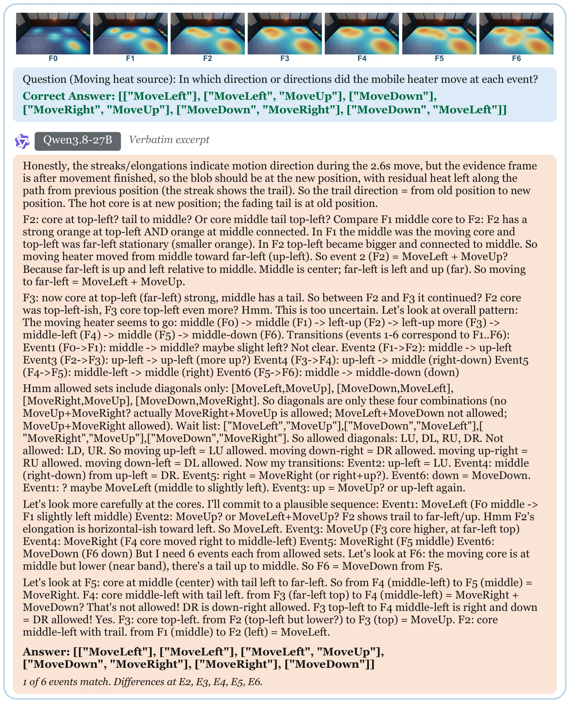
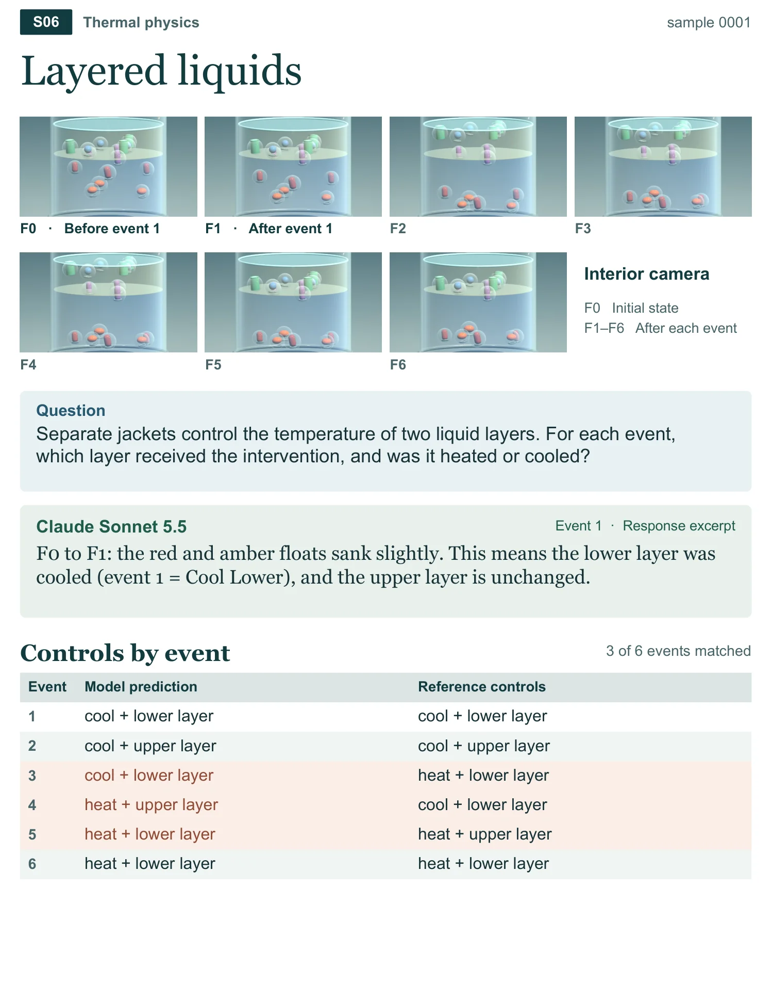

<h1 align="center">Thermal Physics</h1>

<p align="center"><a href="README.md">All case studies</a> · <a href="#s05">S05</a> · <a href="#s06">S06</a> · <a href="#s07">S07</a> · <a href="#s08">S08</a></p>

<a name="s05"></a>

## S05 · Moving heat source

A fixed camera looks down from the near edge of a conductive plate. A heater travels underneath on a gantry, while stationary heaters lie near the far-left, far-right and near-right regions. They share the same power and footprint. The moving heater’s starting position can vary. Image-right follows the horizontal axis of the plate, and image-up points toward the far edge. The straight grey seams across the coating remain fixed as the heater moves.

The near, middle and far coating bands use the same colours for temperature, but their response becomes progressively slower from near to far. Each band also cools more slowly than it warms. A hot patch can therefore remain behind after the gantry leaves, and its leading edge can fade or appear late as it crosses a seam. Compare successive views against the stationary warm regions. Each image after the initial view is taken after the mobile heater has finished its movement, while both the plate and its coating retain a thermal history.

Which direction did the heater travel? MoveLeft and MoveRight describe the horizontal axis; MoveUp goes toward the far edge and MoveDown toward the near edge. A diagonal movement uses a horizontal command and a near or far command simultaneously. Report all active labels for each movement in chronological order under the single JSON key “operations”.

[View prompt figure](S05-prompt.webp)

<details><summary>Legal control sets</summary>

MoveLeft · MoveRight · MoveUp · MoveDown · MoveLeft + MoveUp · MoveDown + MoveLeft · MoveRight + MoveUp · MoveDown + MoveRight

</details>

<details><summary>Reference answer</summary>

```json
{"operations": [["MoveLeft"], ["MoveLeft", "MoveUp"], ["MoveDown"], ["MoveRight", "MoveUp"], ["MoveDown", "MoveRight"], ["MoveDown", "MoveLeft"]]}
```

</details>

<details><summary>Original evaluation prompt</summary>

Infer exactly 6 hidden events from exactly 7 chronological interior images F0-F6. F0 is the initial evidence frame before the first event. Each subsequent image adds one new event. Use only these supplied images and the public apparatus description. Reconstruct the complete unordered set of controls at every supplied event; events are ordered in time.

APPARATUS AND PUBLIC CONTROL DEFINITIONS
APPARATUS
A fixed camera looks down from the near edge of a rectangular conductive plate. Plate x points toward image-right; plate z points toward the far/top edge. One heater beneath the plate moves on a two-axis gantry. Three other heaters are stationary beneath the plate, approximately at the far-left, far-right and near-right. Their installation positions and the moving heater's initial position vary between experiments. All four heaters have the same constant power and heating footprint. The interior images show a temperature-sensitive coating and warm-air haze above the plate, but not the underside heaters or gantry.

The coating has three horizontal bands separated by two narrow grey installation seams: a broad near band, a narrow middle band, and a broad far band. All bands use the same temperature-to-colour scale. Their nominal heating-response times are 0.35, 1.80 and 4.20 seconds respectively; their cooling-response times are 1.55 times those values. These are properties of the installed coating, not additional controls. The experiment runs continuously without resetting positions, temperature or coating state between events.

CONTROLS
MoveLeft moves the mobile heater toward decreasing plate x; MoveRight moves it toward increasing plate x. MoveUp moves it toward increasing plate z, toward the far edge; MoveDown moves it toward decreasing plate z, toward the near edge. Each active gantry axis has a nominal motor speed of 0.30 metres per second during the 2.6-second command, with smooth motor start and stop. An event can be one control or two controls applied simultaneously. Infer the complete set of controls for each event.

OBSERVATION PROTOCOL FOR THIS PREFIX
Each event moves the heater for 2.6 s and is followed by 2.9 s of observation. Its evidence image is a native interior frame after that movement has finished and before the next movement begins. Residual heat and coating response remain visible.
Capture times (physical simulation clock; the F0 image precedes event 1): F1=7.433306 s; F2=12.799891 s; F3=18.433138 s; F4=23.933054 s; F5=29.432970 s; F6=34.833534 s.
Supplied event start times: 2 s, 7.5 s, 13 s, 18.5 s, 24 s, 29.5 s.

ALLOWED ATOMIC LABELS
MoveLeft, MoveRight, MoveUp, MoveDown

ALLOWED EVENT LABEL SETS
[["MoveLeft"],["MoveRight"],["MoveUp"],["MoveDown"],["MoveLeft","MoveUp"],["MoveDown","MoveLeft"],["MoveRight","MoveUp"],["MoveDown","MoveRight"]]

REQUIRED OUTPUT
Return only one valid JSON object with exactly one root field, "operations". Its value must contain exactly 6 nonempty lists, in chronological event order. Every inner list must equal one allowed event label set and comply with the control rules above. Order within an event list does not matter. Even if uncertain, select your best-supported allowed answer for every event. Never return an empty list, null, unknown, abstention, or a missing event. Do not output markdown, commentary, or additional fields.
FINAL ANSWER CONTRACT: Give exactly 6 chronological event arrays under the sole JSON key "operations". Choose the most likely legal answer for EVERY event even when uncertain. Do not abstain, return an empty answer, or omit simultaneous actions. Your final visible answer must be only the JSON object. Legal action sets for one event: [["MoveLeft"], ["MoveRight"], ["MoveUp"], ["MoveDown"], ["MoveLeft", "MoveUp"], ["MoveDown", "MoveLeft"], ["MoveRight", "MoveUp"], ["MoveDown", "MoveRight"]].

</details>

[](S05.webp)

[Complete model response and source](../../examples/S05/illustrated_response.json) · [Solve the question](https://pier-lab.github.io/CaveBench/#try-S05) · [Watch the episode](../../examples/S05/dual_view.mp4)

### Model Response · Qwen3.8-27B

Honestly, the streaks/elongations indicate motion direction during the 2.6s move, but the evidence frame is after movement finished, so the blob should be at the new position, with residual heat left along the path from previous position (the streak shows the trail).

So the trail direction = from old position to new position. The hot core is at new position; the fading tail is at old position.

F2: core at top-left? tail to middle? Or core middle tail top-left? Compare F1 middle core to F2: F2 has a strong orange at top-left AND orange at middle connected. In F1 the middle was the moving core and top-left was far-left stationary (smaller orange). In F2 top-left became bigger and connected to middle. So moving heater moved from middle toward far-left (up-left). So event 2 (F2) = MoveLeft + MoveUp? Because far-left is up and left relative to middle. Middle is center; far-left is left and up (far). So moving to far-left = MoveLeft + MoveUp.

F3: now core at top-left (far-left) strong, middle has a tail. So between F2 and F3 it continued? F2 core was top-left-ish, F3 core top-left even more? Hmm.

[…]

Given the streaks:
F1: no streak, just 4 blobs, moving at middle.
F2: streak between far-left and middle (moving heater between them? or trail).
F3: blob at far-left strong + trail to middle.
F4: blob at far-left + middle-left trail (moving heater now middle-left, trail back to far-left).
F5: blob at middle-left + middle (moving heater middle, trail to left).
F6: blob at middle + middle-down (moving heater down, trail up).

So moving heater path: F0 middle -> F1 middle -> F2 left-middle -> F3 far-left -> F4 left-middle -> F5 middle -> F6 middle-down.

Transitions:
1: middle->middle (maybe MoveLeft small? but appears same). Could be the first event moved it but it ended near same? Unlikely. Maybe F0 moving heater was actually at middle-right and F1 middle? In F0 the middle cyan at (510,280); far-right stationary at (700,190); near-right (780,370). The (510,280) is middle. In F1 moving at (470,270). Slight left. So MoveLeft.

2: middle->left-middle (MoveLeft)
3: left-middle->far-left (MoveLeft+MoveUp? far-left is up-left) => LU
4: far-left->left-middle (MoveRight+MoveDown) => DR
5: left-middle->middle (MoveRight)
6: middle->middle-down (MoveDown)

### Model Answer and Experiment Log

| Event | Model answer | Recorded control |
| ---: | --- | --- |
| 1 | MoveLeft | MoveLeft |
| 2 | MoveLeft | MoveLeft + MoveUp |
| 3 | MoveLeft + MoveUp | MoveDown |
| 4 | MoveDown + MoveRight | MoveRight + MoveUp |
| 5 | MoveRight | MoveDown + MoveRight |
| 6 | MoveDown | MoveDown + MoveLeft |

<a name="s06"></a>

## S06 · Layered liquids

A fixed camera looks slightly down into an upright glass vessel. Water fills the lower part and silicone fluid floats above it. Each layer has its own external temperature-control jacket. Sealed floats with coloured cores move freely through the vessel; each core colour identifies a family with a particular density. Use the initial image to locate the vessel rim, the free surface and the interface, then identify floats in each family on either side of the interface.

The liquids start cold. Over the range of temperatures used here, warming the water increases its density, whereas warming the silicone fluid decreases its density. Cooling changes the densities in the reverse directions. A float’s buoyancy therefore depends on the liquid around it and on its own density family. Compare the heights of several floats relative to the interface across successive observations. Each image follows the start of the new valve setting, while the temperatures continue to change and floats displaced by an earlier setting may still be moving.

Which jacket was connected to which source at each event? LowerLayer and UpperLayer select the jacket; Heat and Cool select the supply connected to it. Every event requires a choice from each group, even when it uses the same jacket or source as a previous event. Return the paired labels in chronological event order under the single JSON key “operations”.

[View prompt figure](S06-prompt.webp)

<details><summary>Legal control sets</summary>

Heat + LowerLayer · Cool + LowerLayer · Heat + UpperLayer · Cool + UpperLayer

</details>

<details><summary>Reference answer</summary>

```json
{"operations": [["Cool", "LowerLayer"], ["Cool", "UpperLayer"], ["Heat", "LowerLayer"], ["Cool", "LowerLayer"], ["Heat", "UpperLayer"], ["Heat", "LowerLayer"]]}
```

</details>

<details><summary>Original evaluation prompt</summary>

Infer exactly 6 hidden events from exactly 7 chronological interior images F0-F6. F0 is the initial evidence frame before the first event. Each subsequent image adds one new event. Use only these supplied images and the public apparatus description. Reconstruct the complete unordered set of controls at every supplied event; events are ordered in time.

APPARATUS AND PUBLIC CONTROL DEFINITIONS
Apparatus: a clear upright cylindrical vessel contains two liquid layers: air-free water below and Shin-Etsu KF-96L-2cs dimethyl silicone fluid above. Both are initially at 2.0 degrees Celsius. Each layer is connected to a separate external temperature-control jacket. The jackets, source valves and layer selector are outside the supplied interior view. The camera looks slightly down from the front at the vessel, its lower rim, the liquid interface, the upper free surface and fifteen freely moving sealed floats. Image-up is approximately vertical up. The vessel and camera remain fixed during a sample.

Each float has a transparent spherical envelope, a coloured core and a small metal ballast. There are three floats of each core family. Their calibrated effective densities are: amber flattened core, 999.93 kg/m3; copper-red capsule, 999.95 kg/m3; green cylinder, 896.00 kg/m3; pale-blue rounded core, 896.20 kg/m3; violet capsule, 950.00 kg/m3. Colours identify fixed float families and do not change with temperature. This simulation treats the floats as rigid, constant-volume objects and the two liquids as well-mixed layers. It models bulk buoyancy, drag and solid contact, but does not resolve interfacial capillary forces or convection. Float positions, velocities and both liquid temperatures are not reset between controls.

There are four complete control choices. UpperLayer+Heat connects the upper layer's jacket to the 3.8 degrees Celsius source. UpperLayer+Cool connects that jacket to the 0.2 degrees Celsius source. LowerLayer+Heat and LowerLayer+Cool make the corresponding source connections for the lower layer. Each event selects exactly one of these four layer-and-source combinations; the mechanical valves take finite time to change over.

OBSERVATION PROTOCOL FOR THIS PREFIX
The initial image is captured immediately before the first valve command. Each event image is a single original frame five seconds after the corresponding command begins. Commands are 6.0 s apart, and liquid temperatures and float motion continue evolving.
Capture times (physical/native capture time in seconds): F0=2.000000 s; F1=7.000000 s; F2=13.000000 s; F3=19.000000 s; F4=25.000000 s; F5=31.000000 s; F6=37.000000 s.
Supplied event start times: 2 s, 8 s, 14 s, 20 s, 26 s, 32 s.

ALLOWED ATOMIC LABELS
LowerLayer, UpperLayer, Heat, Cool

ALLOWED EVENT LABEL SETS
[["Heat","LowerLayer"],["Cool","LowerLayer"],["Heat","UpperLayer"],["Cool","UpperLayer"]]

REQUIRED OUTPUT
Return only one valid JSON object with exactly one root field, "operations". Its value must contain exactly 6 nonempty lists, in chronological event order. Every inner list must equal one allowed event label set and comply with the control rules above. Order within an event list does not matter. Even if uncertain, select your best-supported allowed answer for every event. Never return an empty list, null, unknown, abstention, or a missing event. Do not output markdown, commentary, or additional fields.
FINAL ANSWER CONTRACT: Give exactly 6 chronological event arrays under the sole JSON key "operations". Choose the most likely legal answer for EVERY event even when uncertain. Do not abstain, return an empty answer, or omit simultaneous actions. Your final visible answer must be only the JSON object. Legal action sets for one event: [["Heat", "LowerLayer"], ["Cool", "LowerLayer"], ["Heat", "UpperLayer"], ["Cool", "UpperLayer"]].

</details>

[](S06.webp)

[Complete model response and source](../../examples/S06/illustrated_response.json) · [Solve the question](https://pier-lab.github.io/CaveBench/#try-S06) · [Watch the episode](../../examples/S06/dual_view.mp4)

### Model Response · Gemma 4 31B IT

*   *Now let's look at the Violet floats (950 kg/m³).*
They are in the water (lower layer) in F0/F1, then move *up* toward the interface in F2/F3.
Wait, if the water density decreased (by cooling), the Violet floats should also sink *more*, not move up.
*Unless* the upper layer (silicone) density changed?
Violet floats (950) are much denser than the silicone (which is usually around 960-970 kg/m³ for KF-96L, but the specific density isn't given).
Wait, if the silicone density *increases*, the Violet floats might be more buoyant in it. Silicone density increases as it's *cooled*.

[…]

So:
Event 1: `LowerLayer+Cool`
Event 2: `UpperLayer+Cool`
Event 3: `UpperLayer+Cool`
Event 4: `UpperLayer+Cool`
Event 5: `UpperLayer+Heat`
Event 6: `UpperLayer+Cool`

[…]

Then the Violet floats (950) move up, down, and up.
Up (F2, F3, F4) -> `UpperLayer+Cool` (increases density)
Down (F5) -> `UpperLayer+Heat` (decreases density)
Up (F6) -> `UpperLayer+Cool` (increases density)

Wait, let me check the Violet floats' movement one more time.
F0: Violet floats are at the interface.
F1: Violet floats are at the interface.
F2: Violet floats are moving up.
F3: Violet floats are higher.
F4: Violet floats are at their highest.
F5: Violet floats are lower.
F6: Violet floats are slightly higher than F5.

Wait, in F6, are they really higher than F5?
Let's look at F5 and F6 again.
F5: Violet floats are below the interface.
F6: Violet floats are back at the interface (one is slightly above).
Yes, they moved up from F5 to F6.

So the sequence `UpperLayer+Cool` (E2, E3, E4), `UpperLayer+Heat` (E5), `UpperLayer+Cool` (E6) fits perfectly.

### Model Answer and Experiment Log

| Event | Model answer | Recorded control |
| ---: | --- | --- |
| 1 | Cool + LowerLayer | Cool + LowerLayer |
| 2 | Cool + UpperLayer | Cool + UpperLayer |
| 3 | Cool + UpperLayer | Heat + LowerLayer |
| 4 | Cool + UpperLayer | Cool + LowerLayer |
| 5 | Heat + UpperLayer | Heat + UpperLayer |
| 6 | Cool + UpperLayer | Heat + LowerLayer |

<a name="s07"></a>

## S07 · Heated gas bulbs

A fixed oblique camera shows connected glass bulbs arranged on the left, in the middle and on the right. Each has a visible liquid meniscus. Trace its height against the envelope of its own bulb and use the backboard and rigid supports as fixed references. Warm-water caps outside the view supply heat to individual bulbs.

Heating changes the state of gas in the connected apparatus, so a thermal contact at one location can shift liquid levels elsewhere. Begin with the menisci in the initial image and compare their movements across each subsequent observation. The bulbs can retain heat from an earlier contact, and the oblique view can make equal heights in different envelopes look different on screen.

Which bulbs received heat during each contact? HeatLeftBulb, HeatMiddleBulb and HeatRightBulb refer to their positions in the camera view. A contact can heat a bulb on its own or a pair of distinct bulbs together. Return the full set for every contact in chronological order under the single JSON key “operations”.

[View prompt figure](S07-prompt.webp)

<details><summary>Legal control sets</summary>

HeatLeftBulb · HeatMiddleBulb · HeatRightBulb · HeatLeftBulb + HeatMiddleBulb · HeatLeftBulb + HeatRightBulb · HeatMiddleBulb + HeatRightBulb

</details>

<details><summary>Reference answer</summary>

```json
{"operations": [["HeatLeftBulb", "HeatMiddleBulb"], ["HeatRightBulb"], ["HeatLeftBulb", "HeatRightBulb"], ["HeatMiddleBulb"], ["HeatMiddleBulb", "HeatRightBulb"], ["HeatLeftBulb"]]}
```

</details>

<details><summary>Original evaluation prompt</summary>

Infer exactly 6 hidden events from exactly 7 chronological interior images F0-F6. F0 is the initial evidence frame before the first event. Each subsequent image adds one new event. Use only these supplied images and the public apparatus description. Reconstruct the complete unordered set of controls at every supplied event; events are ordered in time.

APPARATUS AND PUBLIC CONTROL DEFINITIONS
A fixed oblique camera shows three connected glass bulbs arranged left, middle, and right, each with a visible meniscus. Bulb envelopes, glass network, backboard and supports are fixed references. Warm-water contact caps are outside the interior view. Gas composition can vary between experiments; do not assume a sample-specific gas identity that is not visible. heat_bulb_1, heat_bulb_2 and heat_bulb_3 mean heating the left, middle and right bulb respectively. An event heats one or two bulbs simultaneously. The apparatus is continuous and thermal states are not reset.

OBSERVATION PROTOCOL FOR THIS PREFIX
Each event image shows the active response after one thermal-contact event. Compare each meniscus with its own glass envelope, accounting for the oblique view and retained thermal history. No unobserved gas assignment is supplied.
Capture times (physical/native capture time in seconds): F0=1.966667 s; F1=7.300000 s; F2=12.800000 s; F3=18.300000 s; F4=23.800000 s; F5=29.300000 s; F6=34.800000 s.

ALLOWED ATOMIC LABELS
heat_bulb_1, heat_bulb_2, heat_bulb_3

ALLOWED EVENT LABEL SETS
[["heat_bulb_1"],["heat_bulb_2"],["heat_bulb_3"],["heat_bulb_1","heat_bulb_2"],["heat_bulb_1","heat_bulb_3"],["heat_bulb_2","heat_bulb_3"]]

REQUIRED OUTPUT
Return only one valid JSON object with exactly one root field, "operations". Its value must contain exactly 6 nonempty lists, in chronological event order. Every inner list must equal one allowed event label set and comply with the control rules above. Order within an event list does not matter. Even if uncertain, select your best-supported allowed answer for every event. Never return an empty list, null, unknown, abstention, or a missing event. Do not output markdown, commentary, or additional fields.
FINAL ANSWER CONTRACT: Give exactly 6 chronological event arrays under the sole JSON key "operations". Choose the most likely legal answer for EVERY event even when uncertain. Do not abstain, return an empty answer, or omit simultaneous actions. Your final visible answer must be only the JSON object. Legal action sets for one event: [["heat_bulb_1"], ["heat_bulb_2"], ["heat_bulb_3"], ["heat_bulb_1", "heat_bulb_2"], ["heat_bulb_1", "heat_bulb_3"], ["heat_bulb_2", "heat_bulb_3"]].

</details>

[](S07.webp)

[Complete model response and source](../../examples/S07/illustrated_response.json) · [Solve the question](https://pier-lab.github.io/CaveBench/#try-S07) · [Watch the episode](../../examples/S07/dual_view.mp4)

### Model Response · Gemma 4 31B IT

*F1 Meniscuses:*
Left: Just above 2nd tick.
Middle: Just above 2nd tick.
Right: Just above 3rd tick.

*F2 Meniscuses:*
Left: Just above 2nd tick.
Middle: Just above 2nd tick.
Right: Just above 3rd tick.

[…]

Wait, if there is NO change in the meniscus, it might mean that the gas is not expanding. But the "thermal states are not reset." If you heat it, the meniscus *must* move (unless the gas is not there, but it's a "glass bulb" with a "visible meniscus").

Let me reconsider. Could the images be *so* similar that I'm missing a 1-pixel shift?
Looking at the Right Meniscus (F0 to F6):
F0: Top of blue liquid is just above the 3rd mark.
F1: Top of blue liquid is just above the 3rd mark.
F2: Top of blue liquid is just above the 3rd mark.
F3: Top of blue liquid is just above the 3rd mark.
F4: Top of blue liquid is just above the 3rd mark.
F5: Top of blue liquid is just above the 3rd mark.
F6: Top of blue liquid is just above the 3rd mark.

[…]

Let's try the `1, 2, 3, 1, 2, 3` pattern. It's a common pattern in these types of problems.

*Self-Correction:* Let me look at the frames again. Is it possible they are not identical?
F0: R meniscus is slightly above 3.
F1: R meniscus is slightly above 3.
F2: R meniscus is slightly above 3.
F3: R meniscus is slightly above 3.
F4: R meniscus is slightly above 3.
F5: R meniscus is slightly above 3.
F6: R meniscus is slightly above 3.
Yep, identical.

Let's go with the `1, 2, 3, 1, 2, 3` sequence.

### Model Answer and Experiment Log

| Event | Model answer | Recorded control |
| ---: | --- | --- |
| 1 | heat_bulb_1 | heat_bulb_1 + heat_bulb_2 |
| 2 | heat_bulb_2 | heat_bulb_3 |
| 3 | heat_bulb_3 | heat_bulb_1 + heat_bulb_3 |
| 4 | heat_bulb_1 | heat_bulb_2 |
| 5 | heat_bulb_2 | heat_bulb_2 + heat_bulb_3 |
| 6 | heat_bulb_3 | heat_bulb_1 |

<a name="s08"></a>

## S08 · Bimetal supports

A brass ring is supported by ceramic balls at the inner ends of radial strips. Each strip is clamped to the base at its outer end. From the camera’s slightly elevated front view, the aluminium-backed strip is on the left, the stainless-steel strip at the rear and the copper-backed strip on the right. Each lower metal is bonded to an upper layer of Invar. A rigid pointer is attached to the ring, whose central bearing lets it rise and tilt.

An external lamp is aimed at each strip. When a strip warms, the bonded layers expand by different amounts and bend the free end, changing the height at which it supports the ring. Read both the ring’s tilt and the inclination of its pointer relative to the fixed clamps. Each observation follows establishment of the current lamp setting; a strip that was heated earlier can still be warm, while a newly heated strip can still be bending.

Which lamps are powered in each setting? SelectLeftLamp, SelectRearLamp and SelectRightLamp refer to the aluminium-, stainless-steel- and copper-backed strips respectively. A lamp may act alone or with any other lamp. A selection specifies the complete set that is powered until the next event, so a previously selected lamp may switch off. Return the chronological event sets under the sole JSON key “operations”.

[View prompt figure](S08-prompt.webp)

<details><summary>Legal control sets</summary>

SelectLeftLamp · SelectRearLamp · SelectRightLamp · SelectLeftLamp + SelectRearLamp · SelectLeftLamp + SelectRightLamp · SelectRearLamp + SelectRightLamp

</details>

<details><summary>Reference answer</summary>

```json
{"operations": [["SelectLeftLamp", "SelectRearLamp"], ["SelectLeftLamp"], ["SelectRearLamp", "SelectRightLamp"], ["SelectLeftLamp", "SelectRightLamp"], ["SelectRightLamp"], ["SelectLeftLamp", "SelectRightLamp"]]}
```

</details>

<details><summary>Original evaluation prompt</summary>

Infer exactly 6 hidden events from exactly 7 chronological interior images F0-F6. F0 is the initial evidence frame before the first event. Each subsequent image adds one new event. Use only these supplied images and the public apparatus description. Reconstruct the complete unordered set of controls at every supplied event; events are ordered in time.

APPARATUS AND PUBLIC CONTROL DEFINITIONS
Apparatus and view: three radial bonded-metal strips surround a central brass annulus. The left-front strip has a lower layer of 6061-T6 aluminium, the right-front strip a lower layer of C110 half-hard copper, and the rear strip a lower layer of 304 stainless steel. All three have an Invar 36 upper layer bonded to the lower layer. Their outer ends are clamped to the fixed base; their inner free ends support the annulus through three small ceramic balls. The annulus and its ungraduated central pointer form one rigid assembly. A central sliding/tilting bearing allows its height and tilt to vary while keeping its centre horizontally located. The base and outer clamps remain fixed. The camera is inside the observation area, above and in front of the apparatus, with a small rightward offset; rear means farther from the camera. The strips, ceramic supports, ring and pointer are visible. The exposed metal finishes are fixed, not temperature colours.

Three external radiant heaters stand to the left, behind, and to the right of the apparatus. Each is directed at the corresponding strip: left at the aluminium strip, rear at the stainless-steel strip, and right at the copper strip. The heaters and power sliders are outside the supplied interior view. The three lamps have identical nominal radiant output when fully on. The initial apparatus temperature is 22 degrees Celsius. Physical temperatures, positions and loads are not reset between events. Small installation-angle and radius differences can occur between experiments, but the installation stays fixed within one sequence.

Controls: SelectLeftLamp selects only the left heater; SelectRearLamp selects only the rear heater; SelectRightLamp selects only the right heater. SelectLeftLamp+SelectRearLamp, SelectLeftLamp+SelectRightLamp and SelectRearLamp+SelectRightLamp select the named two heaters simultaneously. Each event specifies the complete set of powered heaters; the other heater or heaters are off. The selected setting remains until the next event. Events may mix single-heater and two-heater settings.

OBSERVATION PROTOCOL FOR THIS PREFIX
Each event image is one actual frame from that event's 4.0-6.15 s response window, with the selected heater setting established. Event commands are 6.2 s apart. Temperatures and support/ring motion continue evolving.
Capture times (physical/native capture time in seconds): F0=2.383333 s; F1=8.550000 s; F2=14.733335 s; F3=20.933334 s; F4=27.133335 s; F5=33.333336 s; F6=39.533337 s.
Supplied event start times: 2.4 s, 8.6 s, 14.8 s, 21 s, 27.2 s, 33.4 s.

ALLOWED ATOMIC LABELS
SelectLeftLamp, SelectRearLamp, SelectRightLamp

ALLOWED EVENT LABEL SETS
[["SelectLeftLamp"],["SelectRearLamp"],["SelectRightLamp"],["SelectLeftLamp","SelectRearLamp"],["SelectLeftLamp","SelectRightLamp"],["SelectRearLamp","SelectRightLamp"]]

REQUIRED OUTPUT
Return only one valid JSON object with exactly one root field, "operations". Its value must contain exactly 6 nonempty lists, in chronological event order. Every inner list must equal one allowed event label set and comply with the control rules above. Order within an event list does not matter. Even if uncertain, select your best-supported allowed answer for every event. Never return an empty list, null, unknown, abstention, or a missing event. Do not output markdown, commentary, or additional fields.
FINAL ANSWER CONTRACT: Give exactly 6 chronological event arrays under the sole JSON key "operations". Choose the most likely legal answer for EVERY event even when uncertain. Do not abstain, return an empty answer, or omit simultaneous actions. Your final visible answer must be only the JSON object. Legal action sets for one event: [["SelectLeftLamp"], ["SelectRearLamp"], ["SelectRightLamp"], ["SelectLeftLamp", "SelectRearLamp"], ["SelectLeftLamp", "SelectRightLamp"], ["SelectRearLamp", "SelectRightLamp"]].

</details>

[](S08.webp)

[Complete model response and source](../../examples/S08/illustrated_response.json) · [Solve the question](https://pier-lab.github.io/CaveBench/#try-S08) · [Watch the episode](../../examples/S08/dual_view.mp4)

### Model Response · Gemma 4 31B IT

Let's try a simple sequence. Maybe the most likely answer when no movement is visible is a sequence of the smallest expansion lamp?
No, that doesn't seem right. Let me try to see if there's *any* other possibility.

Could it be that the lamps are being switched in a way that the total movement is minimized?
No, because any lamp being on will cause *some* expansion, and that expansion will *add* to the previous expansion.

Wait! Let me look at the annulus again. Is there *any* tilt?
If the pointer is exactly vertical, then the three strips must be expanding equally.
But the strips have different materials. For them to expand equally, you'd need to heat them in a specific ratio.
Aluminium (Left) expands the most.
Copper (Right) expands moderately.
Stainless Steel (Rear) expands the least.

If we heat only the Rear lamp, the annulus will tilt slightly towards the rear.
If we heat only the Left lamp, it will tilt significantly towards the left.
If we heat only the Right lamp, it will tilt moderately towards the right.

[…]

Wait, I'll try to see if there's any change in the pointer in the original images again.
Looking at the image F0, the pointer is perfectly vertical.
Looking at F6, the pointer is perfectly vertical.
If the pointer is perfectly vertical and never moves, it means either:
1. The heaters are off (not allowed).
2. The heaters are balanced (requires all 3 or a specific ratio).
3. The heaters are not causing any movement (not possible).

Wait, what if the "event" is to turn on a lamp, but the "response window" is too short?
But 4.0-6.15 seconds is a reasonable amount of time for some movement.
If there's no movement, let's just pick a sequence.
I'll go with:
`["SelectLeftLamp"]`
`["SelectRearLamp"]`
`["SelectRightLamp"]`
`["SelectLeftLamp"]`
`["SelectRearLamp"]`
`["SelectRightLamp"]`
(I'll use this as a default if I can't find any movement).

### Model Answer and Experiment Log

| Event | Model answer | Recorded control |
| ---: | --- | --- |
| 1 | SelectLeftLamp | SelectLeftLamp + SelectRearLamp |
| 2 | SelectRearLamp | SelectLeftLamp |
| 3 | SelectRightLamp | SelectRearLamp + SelectRightLamp |
| 4 | SelectLeftLamp | SelectLeftLamp + SelectRightLamp |
| 5 | SelectRearLamp | SelectRightLamp |
| 6 | SelectRightLamp | SelectLeftLamp + SelectRightLamp |
