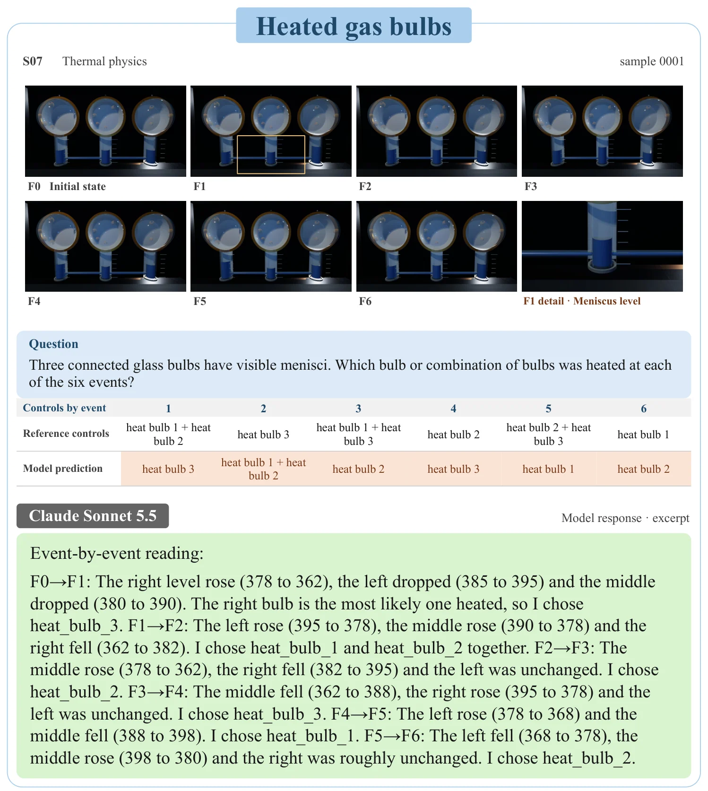
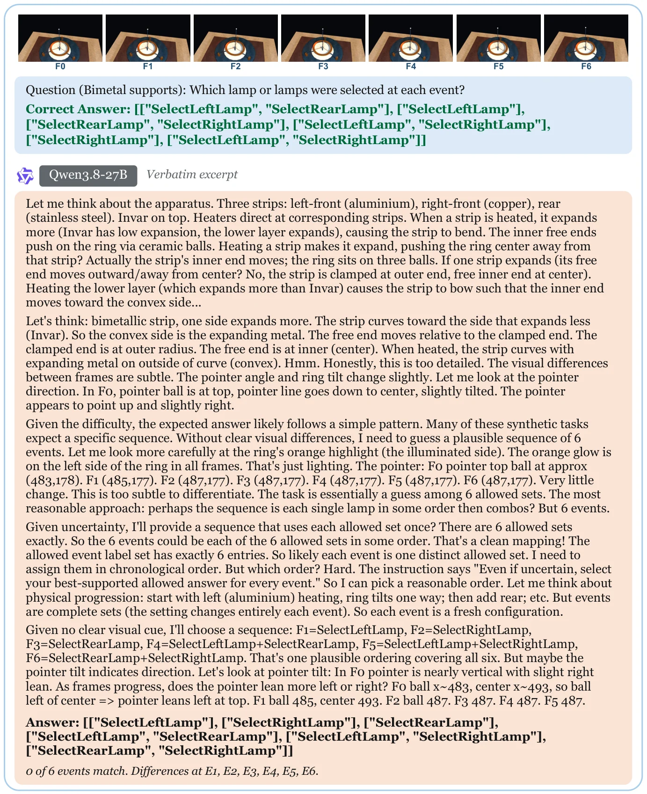

<h1 align="center">Thermal Physics</h1>

<a href="README.md">All case studies</a> · <a href="#s05">S05</a> · <a href="#s06">S06</a> · <a href="#s07">S07</a> · <a href="#s08">S08</a>

## S05 · Moving heat source

One heater moves beneath a conducting plate while three heaters stay fixed. In which direction or directions did the movable heater travel at each event?

[Solve the six-event question](https://pier-lab.github.io/CaveBench/#try-S05) · [Watch the episode](../../examples/S05/dual_view.mp4)

Full evaluation prompt

Infer exactly 6 hidden events from exactly 7 chronological interior images F0-F6. F0 is the initial evidence frame before the first event. Each subsequent image adds one new event. Use only these supplied images and the public apparatus description. Reconstruct the complete unordered set of controls at every supplied event; events are ordered in time.

APPARATUS AND PUBLIC CONTROL DEFINITIONS
APPARATUS
A fixed camera looks down from the near edge of a rectangular conductive plate. Plate x points toward image-right; plate z points toward the far/top edge. One heater beneath the plate moves on a two-axis gantry. Three other heaters are stationary beneath the plate, approximately at the far-left, far-right and near-right. Their installation positions and the moving heater's initial position vary between experiments. All four heaters have the same constant power and heating footprint. The interior images show a temperature-sensitive coating and warm-air haze above the plate, but not the underside heaters or gantry.

The coating has three horizontal bands separated by two narrow grey installation seams: a broad near band, a narrow middle band, and a broad far band. All bands use the same temperature-to-colour scale. Their nominal heating-response times are 0.35, 1.80 and 4.20 seconds respectively; their cooling-response times are 1.55 times those values. These are properties of the installed coating, not additional controls. The experiment runs continuously without resetting positions, temperature or coating state between events.

CONTROLS
MoveLeft moves the mobile heater toward decreasing plate x; MoveRight moves it toward increasing plate x. MoveUp moves it toward increasing plate z, toward the far edge; MoveDown moves it toward decreasing plate z, toward the near edge. Each active gantry axis has a nominal motor speed of 0.30 metres per second during the 2.6-second command, with smooth motor start and stop. An event can be one control or two controls applied simultaneously. Infer the complete set of controls for each event.

OBSERVATION PROTOCOL FOR THIS PREFIX
Each event moves the heater for 2.6 s and is followed by 2.9 s of observation. Its evidence image is a native interior frame after that movement has finished and before the next movement begins. Residual heat and coating response remain visible.
Capture times (physical simulation clock; the F0 image precedes event 1): F1=7.433306 s; F2=12.799891 s; F3=18.433138 s; F4=23.933054 s; F5=29.432970 s; F6=34.833534 s.
Supplied event start times: 2 s, 7.5 s, 13 s, 18.5 s, 24 s, 29.5 s.

ALLOWED ATOMIC LABELS
MoveLeft, MoveRight, MoveUp, MoveDown

ALLOWED EVENT LABEL SETS
[["MoveLeft"],["MoveRight"],["MoveUp"],["MoveDown"],["MoveLeft","MoveUp"],["MoveDown","MoveLeft"],["MoveRight","MoveUp"],["MoveDown","MoveRight"]]

REQUIRED OUTPUT
Return only one valid JSON object with exactly one root field, "operations". Its value must contain exactly 6 nonempty lists, in chronological event order. Every inner list must equal one allowed event label set and comply with the control rules above. Order within an event list does not matter. Even if uncertain, select your best-supported allowed answer for every event. Never return an empty list, null, unknown, abstention, or a missing event. Do not output markdown, commentary, or additional fields.
FINAL ANSWER CONTRACT: Give exactly 6 chronological event arrays under the sole JSON key "operations". Choose the most likely legal answer for EVERY event even when uncertain. Do not abstain, return an empty answer, or omit simultaneous actions. Your final visible answer must be only the JSON object. Legal action sets for one event: [["MoveLeft"], ["MoveRight"], ["MoveUp"], ["MoveDown"], ["MoveLeft", "MoveUp"], ["MoveDown", "MoveLeft"], ["MoveRight", "MoveUp"], ["MoveDown", "MoveRight"]].

### Model Response · Claude Sonnet 5.5

I tracked the mobile heater's hot spot across frames. The three stationary heaters sit at far-left, far-right and near-right. The mobile heater is the one that moves, and it starts near the middle of the plate, around image x≈500, at the seam between the far and middle bands.

Approximate hot-spot positions per frame, with the sign of each shift:

- **F0 to F1:** the spot is at about x=500, y=290 in F0 and about x=440, y=295 in F1. It shifted left by about 60 px, with little vertical change. Event 1 is MoveLeft.
- **F1 to F2:** the spot is at about x=420, y=295 in F2. The lower blob is at y≈295, spanning x 300-520, so it moved only slightly left. Event 2 is probably MoveLeft. Because the mobile heater can only move 0.78 m per command, the small change might instead mean a mix of left and down, but the evidence is weak.
- **F2 to F3:** the blob is at about x=340, y=290 and appears slightly further left. In F3 the lower blob is at about x=340, y=300 and merges with the far-left heater. Event 3 is MoveLeft.
- **F3 to F4:** the blob merges at about x=330, y=280, and the far-left merge extends to x=480 at y≈270. This suggests a move up and slightly right. A pure MoveUp would raise the spot into the far band, which responds slowly, so the visible change is small. I choose MoveUp.
- **F4 to F5:** a new hot spot appears at about x=500, y=295, to the right. Event 5 is MoveRight.
- **F5 to F6:** the spot now sits at about x=420, y=350, lower and slightly left of before. Event 6 is MoveDown with MoveLeft.

### Model Answer and Experiment Log

| Event | Model answer | Recorded control |
| ---: | --- | --- |
| 1 | MoveLeft | MoveLeft |
| 2 | MoveLeft | MoveLeft + MoveUp |
| 3 | MoveLeft | MoveDown |
| 4 | MoveUp | MoveRight + MoveUp |
| 5 | MoveRight | MoveDown + MoveRight |
| 6 | MoveDown + MoveLeft | MoveDown + MoveLeft |

## S06 · Layered liquids

Separate jackets control the temperature of two liquid layers. For each event, which layer received the intervention, and was it heated or cooled?

[Solve the six-event question](https://pier-lab.github.io/CaveBench/#try-S06) · [Watch the episode](../../examples/S06/dual_view.mp4)

Full evaluation prompt

Infer exactly 6 hidden events from exactly 7 chronological interior images F0-F6. F0 is the initial evidence frame before the first event. Each subsequent image adds one new event. Use only these supplied images and the public apparatus description. Reconstruct the complete unordered set of controls at every supplied event; events are ordered in time.

APPARATUS AND PUBLIC CONTROL DEFINITIONS
Apparatus: a clear upright cylindrical vessel contains two liquid layers: air-free water below and Shin-Etsu KF-96L-2cs dimethyl silicone fluid above. Both are initially at 2.0 degrees Celsius. Each layer is connected to a separate external temperature-control jacket. The jackets, source valves and layer selector are outside the supplied interior view. The camera looks slightly down from the front at the vessel, its lower rim, the liquid interface, the upper free surface and fifteen freely moving sealed floats. Image-up is approximately vertical up. The vessel and camera remain fixed during a sample.

Each float has a transparent spherical envelope, a coloured core and a small metal ballast. There are three floats of each core family. Their calibrated effective densities are: amber flattened core, 999.93 kg/m3; copper-red capsule, 999.95 kg/m3; green cylinder, 896.00 kg/m3; pale-blue rounded core, 896.20 kg/m3; violet capsule, 950.00 kg/m3. Colours identify fixed float families and do not change with temperature. This simulation treats the floats as rigid, constant-volume objects and the two liquids as well-mixed layers. It models bulk buoyancy, drag and solid contact, but does not resolve interfacial capillary forces or convection. Float positions, velocities and both liquid temperatures are not reset between controls.

There are four complete control choices. UpperLayer+Heat connects the upper layer's jacket to the 3.8 degrees Celsius source. UpperLayer+Cool connects that jacket to the 0.2 degrees Celsius source. LowerLayer+Heat and LowerLayer+Cool make the corresponding source connections for the lower layer. Each event selects exactly one of these four layer-and-source combinations; the mechanical valves take finite time to change over.

OBSERVATION PROTOCOL FOR THIS PREFIX
The initial image is captured immediately before the first valve command. Each event image is a single original frame five seconds after the corresponding command begins. Commands are 6.0 s apart, and liquid temperatures and float motion continue evolving.
Capture times (physical/native capture time in seconds): F0=2.000000 s; F1=7.000000 s; F2=13.000000 s; F3=19.000000 s; F4=25.000000 s; F5=31.000000 s; F6=37.000000 s.
Supplied event start times: 2 s, 8 s, 14 s, 20 s, 26 s, 32 s.

ALLOWED ATOMIC LABELS
LowerLayer, UpperLayer, Heat, Cool

ALLOWED EVENT LABEL SETS
[["Heat","LowerLayer"],["Cool","LowerLayer"],["Heat","UpperLayer"],["Cool","UpperLayer"]]

REQUIRED OUTPUT
Return only one valid JSON object with exactly one root field, "operations". Its value must contain exactly 6 nonempty lists, in chronological event order. Every inner list must equal one allowed event label set and comply with the control rules above. Order within an event list does not matter. Even if uncertain, select your best-supported allowed answer for every event. Never return an empty list, null, unknown, abstention, or a missing event. Do not output markdown, commentary, or additional fields.
FINAL ANSWER CONTRACT: Give exactly 6 chronological event arrays under the sole JSON key "operations". Choose the most likely legal answer for EVERY event even when uncertain. Do not abstain, return an empty answer, or omit simultaneous actions. Your final visible answer must be only the JSON object. Legal action sets for one event: [["Heat", "LowerLayer"], ["Cool", "LowerLayer"], ["Heat", "UpperLayer"], ["Cool", "UpperLayer"]].

### Model Response · Claude Sonnet 5.5

Physical reasoning: water's density peaks near 4 °C. Water floats (amber and copper-red are about 999.93 and 999.95 kg/m3) are nearly neutral at 2 °C. Warming the lower water toward 3.8 °C makes it denser, so the floats rise. Cooling it toward 0.2 °C makes it less dense, so the floats sink.

F0 to F1: the red and amber floats sank slightly. This means the lower layer was cooled (event 1 = Cool Lower), and the upper layer is unchanged.

F1 to F2: the floats sank further to the bottom, so the lower layer was cooled again (event 2 = Cool Lower). The upper floats (green, blue) rose to the top. The upper silicone fluid has a density near 896 and the floats are at 896.0 and 896.2. Silicone expands strongly when heated, so heating makes the fluid less dense and the floats sink. Cooling makes the fluid denser and the floats rise. The floats rose, so the upper layer was cooled. The violet floats moved from the interface up into the upper layer, which fits an upper cooling. The F2 image is at 13 s, and the event 2 command began at 8 s, so the upper cooling was probably event 2 (the F1 image at 7 s shows no upper change yet). Event 1 started at 2 s, and F1 at 7 s shows the lower floats sinking, so event 1 = Cool Lower. Event 2 produced the upper rise and the lower sinking continued, but only one control applies per event. If event 2 = Cool Upper, the lower layer is still cooling from its earlier temperature, so its floats keep sinking. That fits.

F2 to F3: the upper floats are unchanged. The lower floats sank further, though that may be only continued sinking. Event 3 is ambiguous: it could be Cool Lower or Cool Upper. Since the lower floats continue downward in F3 and F4 and the upper floats stay at the top, either cooling fits. The lower floats are at the bottom and just settling.

F5: the upper floats came back down to the interface, which means the upper layer was heated (event 5 = Heat Upper). The F4 image at 25 s shows them still at the top, and event 5 started at 32 s. But F5 is at 31 s, which falls within event 4 (26 s start). So event 4 = Heat Upper. In F5 the lower floats are still at the bottom. F6 shows the lower floats rising slightly, so event 5 = Heat Lower. Event 6 would then be unclear. The lower floats in F6 are only slightly raised, so event 6 might be another Heat Lower.

Event 3 is then Cool Upper or Cool Lower. I choose Cool Lower.

### Model Answer and Experiment Log

| Event | Model answer | Recorded control |
| ---: | --- | --- |
| 1 | Cool + LowerLayer | Cool + LowerLayer |
| 2 | Cool + UpperLayer | Cool + UpperLayer |
| 3 | Cool + LowerLayer | Heat + LowerLayer |
| 4 | Heat + UpperLayer | Cool + LowerLayer |
| 5 | Heat + LowerLayer | Heat + UpperLayer |
| 6 | Heat + LowerLayer | Heat + LowerLayer |

## S07 · Heated gas bulbs

Three connected glass bulbs have visible menisci. Which bulb or combination of bulbs was heated at each of the six events?

[Solve the six-event question](https://pier-lab.github.io/CaveBench/#try-S07) · [Watch the episode](../../examples/S07/dual_view.mp4)

Full evaluation prompt

Infer exactly 6 hidden events from exactly 7 chronological interior images F0-F6. F0 is the initial evidence frame before the first event. Each subsequent image adds one new event. Use only these supplied images and the public apparatus description. Reconstruct the complete unordered set of controls at every supplied event; events are ordered in time.

APPARATUS AND PUBLIC CONTROL DEFINITIONS
A fixed oblique camera shows three connected glass bulbs arranged left, middle, and right, each with a visible meniscus. Bulb envelopes, glass network, backboard and supports are fixed references. Warm-water contact caps are outside the interior view. Gas composition can vary between experiments; do not assume a sample-specific gas identity that is not visible. heat_bulb_1, heat_bulb_2 and heat_bulb_3 mean heating the left, middle and right bulb respectively. An event heats one or two bulbs simultaneously. The apparatus is continuous and thermal states are not reset.

OBSERVATION PROTOCOL FOR THIS PREFIX
Each event image shows the active response after one thermal-contact event. Compare each meniscus with its own glass envelope, accounting for the oblique view and retained thermal history. No unobserved gas assignment is supplied.
Capture times (physical/native capture time in seconds): F0=1.966667 s; F1=7.300000 s; F2=12.800000 s; F3=18.300000 s; F4=23.800000 s; F5=29.300000 s; F6=34.800000 s.

ALLOWED ATOMIC LABELS
heat_bulb_1, heat_bulb_2, heat_bulb_3

ALLOWED EVENT LABEL SETS
[["heat_bulb_1"],["heat_bulb_2"],["heat_bulb_3"],["heat_bulb_1","heat_bulb_2"],["heat_bulb_1","heat_bulb_3"],["heat_bulb_2","heat_bulb_3"]]

REQUIRED OUTPUT
Return only one valid JSON object with exactly one root field, "operations". Its value must contain exactly 6 nonempty lists, in chronological event order. Every inner list must equal one allowed event label set and comply with the control rules above. Order within an event list does not matter. Even if uncertain, select your best-supported allowed answer for every event. Never return an empty list, null, unknown, abstention, or a missing event. Do not output markdown, commentary, or additional fields.
FINAL ANSWER CONTRACT: Give exactly 6 chronological event arrays under the sole JSON key "operations". Choose the most likely legal answer for EVERY event even when uncertain. Do not abstain, return an empty answer, or omit simultaneous actions. Your final visible answer must be only the JSON object. Legal action sets for one event: [["heat_bulb_1"], ["heat_bulb_2"], ["heat_bulb_3"], ["heat_bulb_1", "heat_bulb_2"], ["heat_bulb_1", "heat_bulb_3"], ["heat_bulb_2", "heat_bulb_3"]].

### Model Response · Claude Sonnet 5.5

I could not read the meniscus levels reliably, so these six events are a best guess from rough estimates of each frame, not a confident reconstruction.

Approximate meniscus top positions (y in pixels; a lower y means a higher level):

| Frame | Left | Middle | Right |
|-------|------|--------|-------|
| F0 | 385 | 380 | 378 |
| F1 | 395 | 390 | 362 |
| F2 | 378 | 378 | 382 |
| F3 | 378 | 362 | 395 |
| F4 | 378 | 388 | 378 |
| F5 | 368 | 398 | 380 |
| F6 | 378 | 380 | 380 |

Event-by-event reading:

- **F0→F1:** The right level rose (378 to 362), the left dropped (385 to 395) and the middle dropped (380 to 390). The right bulb is the most likely one heated, so I chose heat_bulb_3.
- **F1→F2:** The left rose (395 to 378), the middle rose (390 to 378) and the right fell (362 to 382). I chose heat_bulb_1 and heat_bulb_2 together.
- **F2→F3:** The middle rose (378 to 362), the right fell (382 to 395) and the left was unchanged. I chose heat_bulb_2.
- **F3→F4:** The middle fell (362 to 388), the right rose (395 to 378) and the left was unchanged. I chose heat_bulb_3.
- **F4→F5:** The left rose (378 to 368) and the middle fell (388 to 398). I chose heat_bulb_1.
- **F5→F6:** The left fell (368 to 378), the middle rose (398 to 380) and the right was roughly unchanged. I chose heat_bulb_2.

### Model Answer and Experiment Log

| Event | Model answer | Recorded control |
| ---: | --- | --- |
| 1 | heat_bulb_3 | heat_bulb_1 + heat_bulb_2 |
| 2 | heat_bulb_1 + heat_bulb_2 | heat_bulb_3 |
| 3 | heat_bulb_2 | heat_bulb_1 + heat_bulb_3 |
| 4 | heat_bulb_3 | heat_bulb_2 |
| 5 | heat_bulb_1 | heat_bulb_2 + heat_bulb_3 |
| 6 | heat_bulb_2 | heat_bulb_1 |

## S08 · Bimetal supports

Three bimetal strips support a central annulus. Use their changing shapes and the annulus position to identify the lamp or lamps selected at each event.

[Solve the six-event question](https://pier-lab.github.io/CaveBench/#try-S08) · [Watch the episode](../../examples/S08/dual_view.mp4)

Full evaluation prompt

Infer exactly 6 hidden events from exactly 7 chronological interior images F0-F6. F0 is the initial evidence frame before the first event. Each subsequent image adds one new event. Use only these supplied images and the public apparatus description. Reconstruct the complete unordered set of controls at every supplied event; events are ordered in time.

APPARATUS AND PUBLIC CONTROL DEFINITIONS
Apparatus and view: three radial bonded-metal strips surround a central brass annulus. The left-front strip has a lower layer of 6061-T6 aluminium, the right-front strip a lower layer of C110 half-hard copper, and the rear strip a lower layer of 304 stainless steel. All three have an Invar 36 upper layer bonded to the lower layer. Their outer ends are clamped to the fixed base; their inner free ends support the annulus through three small ceramic balls. The annulus and its ungraduated central pointer form one rigid assembly. A central sliding/tilting bearing allows its height and tilt to vary while keeping its centre horizontally located. The base and outer clamps remain fixed. The camera is inside the observation area, above and in front of the apparatus, with a small rightward offset; rear means farther from the camera. The strips, ceramic supports, ring and pointer are visible. The exposed metal finishes are fixed, not temperature colours.

Three external radiant heaters stand to the left, behind, and to the right of the apparatus. Each is directed at the corresponding strip: left at the aluminium strip, rear at the stainless-steel strip, and right at the copper strip. The heaters and power sliders are outside the supplied interior view. The three lamps have identical nominal radiant output when fully on. The initial apparatus temperature is 22 degrees Celsius. Physical temperatures, positions and loads are not reset between events. Small installation-angle and radius differences can occur between experiments, but the installation stays fixed within one sequence.

Controls: SelectLeftLamp selects only the left heater; SelectRearLamp selects only the rear heater; SelectRightLamp selects only the right heater. SelectLeftLamp+SelectRearLamp, SelectLeftLamp+SelectRightLamp and SelectRearLamp+SelectRightLamp select the named two heaters simultaneously. Each event specifies the complete set of powered heaters; the other heater or heaters are off. The selected setting remains until the next event. Events may mix single-heater and two-heater settings.

OBSERVATION PROTOCOL FOR THIS PREFIX
Each event image is one actual frame from that event's 4.0-6.15 s response window, with the selected heater setting established. Event commands are 6.2 s apart. Temperatures and support/ring motion continue evolving.
Capture times (physical/native capture time in seconds): F0=2.383333 s; F1=8.550000 s; F2=14.733335 s; F3=20.933334 s; F4=27.133335 s; F5=33.333336 s; F6=39.533337 s.
Supplied event start times: 2.4 s, 8.6 s, 14.8 s, 21 s, 27.2 s, 33.4 s.

ALLOWED ATOMIC LABELS
SelectLeftLamp, SelectRearLamp, SelectRightLamp

ALLOWED EVENT LABEL SETS
[["SelectLeftLamp"],["SelectRearLamp"],["SelectRightLamp"],["SelectLeftLamp","SelectRearLamp"],["SelectLeftLamp","SelectRightLamp"],["SelectRearLamp","SelectRightLamp"]]

REQUIRED OUTPUT
Return only one valid JSON object with exactly one root field, "operations". Its value must contain exactly 6 nonempty lists, in chronological event order. Every inner list must equal one allowed event label set and comply with the control rules above. Order within an event list does not matter. Even if uncertain, select your best-supported allowed answer for every event. Never return an empty list, null, unknown, abstention, or a missing event. Do not output markdown, commentary, or additional fields.
FINAL ANSWER CONTRACT: Give exactly 6 chronological event arrays under the sole JSON key "operations". Choose the most likely legal answer for EVERY event even when uncertain. Do not abstain, return an empty answer, or omit simultaneous actions. Your final visible answer must be only the JSON object. Legal action sets for one event: [["SelectLeftLamp"], ["SelectRearLamp"], ["SelectRightLamp"], ["SelectLeftLamp", "SelectRearLamp"], ["SelectLeftLamp", "SelectRightLamp"], ["SelectRearLamp", "SelectRightLamp"]].

### Model Response · Claude Sonnet 5.5

This is a low-confidence guess. I read the pointer tip position and the height of the central hub in each frame, and I could not fully separate the three strips' contributions.

Pointer tip positions in the image, with the hub at about y=377:
- F0: (463,168)
- F1: (475,168)
- F2: (487,163)
- F3: (474,164)
- F4: (477,156)
- F5: (467,155)
- F6: (473,148)

The pointer's height rises overall, from 168 to 148, so the heaters keep adding heat to the strips.

Tilt estimates, from tip x relative to the hub at about x=470:
- F0: about −7, nearly untilted.
- F1: +5.
- F2: +17, the tip leans right.
- F3: +4.
- F4: +7.
- F5: −3.
- F6: +3.

I assumed the pointer leans away from the strip that is heated most (its end rises most). The rear strip is farthest from the camera, and its rise would tip the pointer toward the rear (up in the image). Lifting the left strip would tilt the pointer toward the right and rear, and lifting the right strip would tilt it toward the left. Aluminium has the highest expansion, then copper, then stainless steel, so with the Invar layer the aluminium strip bends most, then copper, then steel.

Event assignments:
- Event 1, F1: the tip moved right by 12, so the left strip is heated, giving Left.
- Event 2, F2: the tip moved right again, with a slight rise, so Left continues or Left+Rear. I chose Left+Rear.
- Event 3, F3: the tip moved back left by 13, so the right strip is heated, giving Right or Rear+Right. I chose Rear+Right.
- Event 4, F4: the tip rose by 8 and moved right slightly, so Left+Rear.
- Event 5, F5: the tip moved left by 10 with little height change, so Right.
- Event 6, F6: the tip rose by 7 and moved right by 6, so Left+Rear.

### Model Answer and Experiment Log

| Event | Model answer | Recorded control |
| ---: | --- | --- |
| 1 | SelectLeftLamp | SelectLeftLamp + SelectRearLamp |
| 2 | SelectLeftLamp + SelectRearLamp | SelectLeftLamp |
| 3 | SelectRearLamp + SelectRightLamp | SelectRearLamp + SelectRightLamp |
| 4 | SelectLeftLamp + SelectRearLamp | SelectLeftLamp + SelectRightLamp |
| 5 | SelectRightLamp | SelectRightLamp |
| 6 | SelectLeftLamp + SelectRearLamp | SelectLeftLamp + SelectRightLamp |
