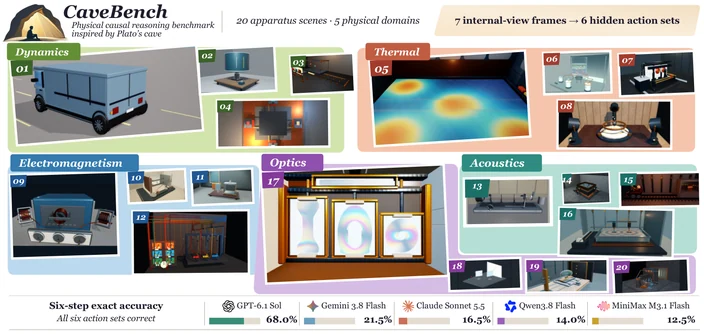
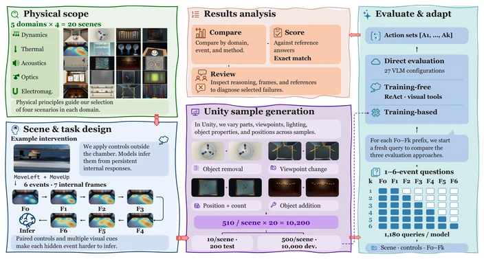
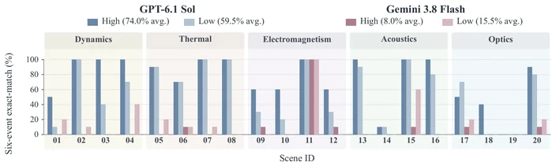

<h1 align="center">Data for the Paper Figures</h1>

[Six-event accuracy](#figure-1) · [Dataset construction](#figure-3) · [Reasoning effort](#figure-6) · [Error categories](#error-categories)

## Figure 1 · Six-event accuracy

| Model | Correct sequences | Test questions | Exact match (%) |
| --- | ---: | ---: | ---: |
| GPT-6.1 Sol | 136 | 200 | 68.0 |
| Gemini 3.8 Flash | 43 | 200 | 21.5 |
| Claude Sonnet 5.5 | 33 | 200 | 16.5 |
| Qwen3.8 Flash | 28 | 200 | 14.0 |
| MiniMax M3.1 Flash | 25 | 200 | 12.5 |

[Download figure data](../docs/assets/results/figure1.csv) · [All 27 models](domain_tables.md#domain-k6)

## Figure 3 · Dataset construction

| Quantity | Count |
| --- | ---: |
| Physical domains | 5 |
| Apparatuses per domain | 4 |
| Apparatuses | 20 |
| Episodes per apparatus | 510 |
| Development and test episodes per apparatus | 500 development + 10 test |
| Development episodes | 10,000 (9,000 training + 1,000 validation) |
| Test episodes | 200 |
| Total episodes | 10,200 |
| Internal frames per episode | 7 |
| Interventions per episode | 6 |
| Question lengths (events) | 1–6 (3–6 for S11) |
| Test questions per model | 1,180 |
| Evaluated model configurations | 27 |

[Dataset](https://huggingface.co/datasets/linguanxin/CaveBench) · [Test counts by apparatus](../docs/assets/results/scene_controls.csv)

## Figure 6 · Reasoning effort by apparatus

GPT-6.1 Sol and Gemini 3.8 Flash each answer the same ten six-event questions per apparatus at low, medium and high reasoning effort. Scores are final sequence exact match (%).

| Apparatus | Domain | Sol low | Sol medium | Sol high | Gemini low | Gemini medium | Gemini high |
| --- | --- | ---: | ---: | ---: | ---: | ---: | ---: |
| S01 · Cabin inertia | Dynamics | 10.0 | 20.0 | 50.0 | 20.0 | 0.0 | 0.0 |
| S02 · Rotation & gas | Dynamics | 100.0 | 100.0 | 100.0 | 10.0 | 60.0 | 0.0 |
| S03 · Driven pendulums | Dynamics | 40.0 | 100.0 | 100.0 | 0.0 | 20.0 | 0.0 |
| S04 · Tray impact | Dynamics | 70.0 | 80.0 | 100.0 | 40.0 | 70.0 | 0.0 |
| S05 · Moving heat source | Thermal | 90.0 | 90.0 | 90.0 | 20.0 | 10.0 | 0.0 |
| S06 · Layered liquids | Thermal | 70.0 | 60.0 | 70.0 | 10.0 | 20.0 | 10.0 |
| S07 · Heated gas bulbs | Thermal | 100.0 | 100.0 | 100.0 | 10.0 | 10.0 | 0.0 |
| S08 · Bimetal supports | Thermal | 100.0 | 100.0 | 100.0 | 0.0 | 10.0 | 0.0 |
| S09 · Magnetic coils | Electromagnetism | 30.0 | 30.0 | 60.0 | 0.0 | 30.0 | 10.0 |
| S10 · Electric dipoles | Electromagnetism | 20.0 | 20.0 | 60.0 | 0.0 | 0.0 | 0.0 |
| S11 · Dielectric response | Electromagnetism | 100.0 | 100.0 | 100.0 | 100.0 | 100.0 | 100.0 |
| S12 · Conducting wires | Electromagnetism | 30.0 | 50.0 | 60.0 | 0.0 | 0.0 | 10.0 |
| S13 · Standing waves | Acoustics | 90.0 | 90.0 | 100.0 | 0.0 | 0.0 | 0.0 |
| S14 · Wave scattering | Acoustics | 10.0 | 0.0 | 10.0 | 0.0 | 0.0 | 0.0 |
| S15 · Doppler response | Acoustics | 100.0 | 100.0 | 100.0 | 60.0 | 70.0 | 10.0 |
| S16 · Two-source ripples | Acoustics | 80.0 | 100.0 | 100.0 | 0.0 | 0.0 | 0.0 |
| S17 · Photoelastic load | Optics | 70.0 | 90.0 | 50.0 | 20.0 | 20.0 | 10.0 |
| S18 · Double reflection | Optics | 0.0 | 20.0 | 40.0 | 0.0 | 0.0 | 0.0 |
| S19 · Graded refraction | Optics | 0.0 | 0.0 | 0.0 | 0.0 | 0.0 | 0.0 |
| S20 · Double-slit fringes | Optics | 80.0 | 90.0 | 90.0 | 20.0 | 10.0 | 10.0 |
| Overall · All 200 episodes | All five | 59.5 | 67.0 | 74.0 | 15.5 | 21.5 | 8.0 |

[Download initial and final scores and counts](../docs/assets/results/effort_results.csv) · [Question-level scores](effort_question_scores.csv)

## Error categories

Each of the 100 incorrect six-event responses received one primary error category. Visual identification accounted for 38 responses and evidence integration for 31.

| Error category | Responses |
| --- | ---: |
| Visual identification | 38 |
| Physical inference | 24 |
| Evidence integration | 31 |
| Action composition | 7 |
| Total | 100 |

[Download error counts](../docs/assets/results/error_categories.csv)
